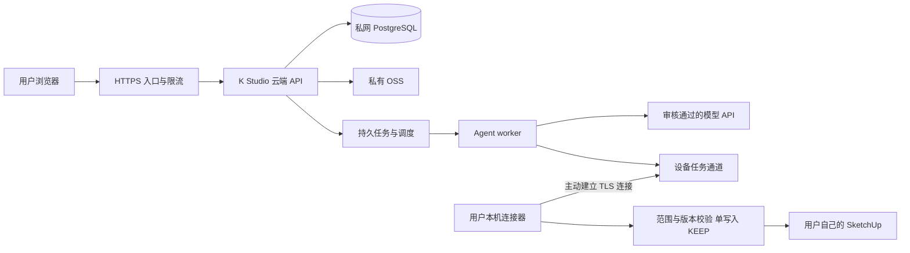

# K Studio 中国大陆首发准备：部署、数据库与稳定性

日期：2026-10-19（北京时间）。所有者选择：先中国大陆，后续再考虑海外。

**当前结论：可以继续受控本机试用，尚不能作为几百名付费用户的公网服务直接发售。** 本轮完成代码整合、故障核对、隔离回归和方案准备；没有购买云资源、使用新 API Key、产生付费推理、部署公网或修改原模型。具体问题状态见[问题核对](RELEASE_ISSUE_AUDIT_2026-10-19.md)。

## 1. 你要上线的产品怎样运行

建议继续做同一个 K Studio，拆开部署责任：

| 位置 | 放什么 | 用户感受 |
| --- | --- | --- |
| 中国大陆云服务器 | 网站、登录、项目权限、任务排队、额度、运营接口 | 打开网站，注册并购买使用额度 |
| 私网托管 PostgreSQL | 账号、项目归属、对话、版本、任务、支付与额度账本 | 换电脑仍能找到自己的项目与记录 |
| 私有对象存储 OSS | 用户同意上传的参考图、截图、交付文件 | 上传和下载文件；不会得到别人的文件 |
| 云端 Agent worker / 模型 API | 理解需求、生成受控修改、质量检查与计量 | 使用 K Studio 服务，不需要自己购买 Codex 或找 Key |
| 用户 Windows 电脑 | K Studio 连接器、已安装且实际验证过的 SketchUp、原生模型与恢复副本 | AI 修改自己的模型；本地可保存、撤销和继续编辑 |

云端不能直接访问用户的 `127.0.0.1`，也不能让几百名用户共用开发者电脑上的一个 SketchUp。需要实现经过认证的连接器通道，保留每台设备的单写入保护。服务器上的 Docker/Linux 不会自动获得 Windows SketchUp 建模能力。

未来海外版沿用同一业务与版本系统，独立部署区域、数据与供应商配置。跨区迁移、数据授权和访问速度要重新验证，先不做全球多活。

图为目标架构，**账号、多租户数据库、云任务、远程配对及支付尚未接入现有本机应用**。当前 `/api/release-readiness` 会明确返回这些缺口。

## 2. 第一套服务器和数据库放在哪里

建议首先评估阿里云杭州或上海，同一地域、同一 VPC（私有网络）。地域最终取决于用户网络实测、账号资质、供应商可用性及控制台报价。腾讯云同类托管组件也可实现，但首发不同时维护两套云。

| 组件 | 首发建议 | 为什么 |
| --- | --- | --- |
| 网站与 API | 负载均衡 + 两台应用实例，或等价的托管容器；起始可评估每台2核4GB | 单台应用退出时还能服务，应用可滚动升级 |
| Agent worker | 与 API 分离；起始评估4核8GB、少量执行槽 | 长任务和图片处理不能堵住登录、下载与查询 |
| 数据库 | RDS PostgreSQL 高可用版，跨可用区主备、私网连接 | 数据不会因为换一台应用机器而丢失；数据库故障可切换 |
| 缓存和限流 | 托管 Redis 兼容服务 | 保存短期状态、速率计数；不作为余额或支付的唯一依据 |
| 文件 | 私有 OSS Bucket，版本和生命周期策略 | 大文件不塞进数据库，用户文件不设公共读 |
| 密钥 | 云密钥管理服务 + 应用角色最小权限 | 模型运营 Key 不进入浏览器、安装包、GitHub或普通用户电脑 |
| 监控 | 云日志/告警 + OpenTelemetry 接口 | 能从一个任务 ID 找到报错、耗时与费用 |

这些规格是**待压测的起始方案，不是容量保证或购买指令**。邀请5—20人阶段可先用一台应用实例节省费用，但不能宣称应用层高可用。数百人付费前再验收双实例故障切换。

RDS 官方说明高可用版具有主备与自动切换能力，基础版不提供相同能力；主备仍不能代替误删恢复和备份演练。[RDS 高可用版](https://help.aliyun.com/zh/rds/apsaradb-rds-for-postgresql/rds-high-availability-edition)

费用预算分开算：应用实例 + worker + 数据库 + Redis + 存储容量/流量 + 短信/邮件/支付手续费 + 模型输入输出费用。以控制台当日报价和已确认的模型计价为准；先设置经营者月度和每日硬预算，再决定售卖额度。不开无上限“终身免费”或无限建模套餐。

## 3. 数据库里存什么，怎样保护用户与余额

当前 `ProjectStore` 是本机 JSON 文件；它不是可供多台服务器共享写入的数据库。不要把现有 `runtime/projects` 放到共享网盘后直接开多个 worker。新增本机运行锁只防止采用该锁的服务同时占用**同一目录**；不能代替云数据库事务或跨设备锁。

目标数据库至少有：

| 表/数据 | 必要保证 |
| --- | --- |
| users / memberships | 成熟密码哈希、登录保护、重置和注销；任何角色都从服务端认证结果取得 |
| projects / artifacts / model_versions | 每行有用户/租户归属；版本不可覆盖，文件元数据带 SHA 与来源 |
| runs / run_events / tool_commands | 唯一请求 ID、请求摘要、任务状态、顺序号和实际模型回执 |
| credit_accounts / reservations / usage_ledger | 余额预占、结算、退款在数据库事务内完成；不能靠浏览器计算 |
| payments / webhook_events | 支付回调验签、金额与订单复核；事件唯一，重复回调不能重复到账 |
| connector_devices / leases | 设备归属、撤销、到期、每设备一个写任务与单调递增的防旧任务令牌 |

用户 A 换一个 URL、项目 ID、下载对象路径或设备 ID，仍不能读写用户 B 的内容。数据库行级权限可作第二道防线，不能替代每个 API 的服务端授权。文件下载先查归属，再发短时签名 URL；签名 URL 本身应视作临时访问凭据。[OSS 私有访问](https://help.aliyun.com/zh/oss/user-guide/access-buckets-via-custom-domain-names)

额度流程：数据库原子预占最大本轮额度 → 发起供应商请求 → 收集实际 usage 与价格版本 → 幂等结算并释放差额。计量缺失、网络超时且结果不明时进入“待核对”，不能把用量当0自动退款后再次消费。一个请求 ID只能对应相同请求摘要；换内容必须新建 ID。

参考 [FastAPI 官方完整模板](https://github.com/fastapi/full-stack-fastapi-template) 的 PostgreSQL、认证、邮件、迁移、测试和部署组织方式，逐步接到现有 K Studio 后端。**不替换当前产品界面，不另外创建一个第一方产品。** 模板的用户登录并不自动实现 K Studio 的租户隔离或额度账本。

## 4. API 稳定性：能恢复、有限重试、不会重复改模型

把供应商请求状态、Agent 任务状态和本地模型提交状态分开存。推荐任务状态包含：排队、处理中、等本机连接、等用户批准、取消处理中、完成、失败、部分完成、结果待核对。刷新浏览器只重新订阅已有任务，不重新 POST 一次建模。

| 情况 | 应有处理 |
| --- | --- |
| 明确临时限流429或暂时故障503 | 尊重有效 Retry-After；退避加随机抖动；限制次数和整轮总时间；不能多层 SDK 各自重试 |
| Key失效、无权限、余额/账单不足 | 停止，运营告警；不高频重试，不让普通用户输入运营 Key |
| 请求超时、连接中断且结果不明 | 持久化“待核对”；核对供应商回执及模型实际版本，不能直接从头重跑 |
| SU 已提交但 Agent 断线 | 从已验证版本恢复，保留部分成果；不自动撤销，也不重复提交同一写指令 |
| 主供应商持续故障 | 暂停新任务或排队；只有已批准、协议和质量都测过的备线才能启用，显示实际供应商与模型 |
| 模型答错或实际模型 ID 不符 | 质量/身份失败，不能当普通网络错误循环重试或悄悄换模型 |

OpenAI 官方建议限制重试次数与总时间、区分额度错误和临时限流，避免多层重试叠加。[限流与重试](https://developers.openai.com/api/docs/guides/rate-limits)；[生产部署](https://developers.openai.com/api/docs/guides/production-best-practices)

本项目的 Responses 运输目前是有预算保护的本机试验，出错停止，不是完整生产网关。仅发送名为 `Idempotency-Key` 的请求头**不证明供应商承诺请求去重**；必须查明其协议保证，仍需本方持久账本与本机指令去重。

可组合 LiteLLM 的已开源路由、冷却、限流与观测能力；现有代码已使用部分 LiteLLM，不因学习而切换模型/供应商。网关仍需验证 Responses 多模态、工具循环、取消、实际模型、价格和隐私。核心 MIT 与 enterprise 目录分开核对。[LiteLLM 故障恢复](https://docs.litellm.ai/docs/proxy/reliability)；[许可证](https://github.com/BerriAI/litellm/blob/main/LICENSE)

队列建议学习 Celery 的持久任务、有限重试与 worker 恢复方式。消息可能被再次投递，因此不能假设“只执行一次”。SU 写指令必须携带任务 ID、设备 ID、项目/根/版本、审批范围和脚本 SHA，由本机保存执行回执；超时先核对再恢复。过期 worker 的令牌不能继续写入。[Celery 任务与幂等](https://docs.celeryq.dev/en/stable/userguide/tasks.html)

用户连接器主动建立 TLS 通道，不向公网暴露现有 Kongxing/MCP 端口。不允许浏览器任意指定另一台电脑或模型路径。配对码一次性、短时有效；登录会话、设备访问和模型写入授权相互独立，支持撤销。

## 5. 几百名注册用户怎样测试

500人注册不等于500个同时在线，更不等于500个同时建模。约束包括数据库、图片内存、供应商 RPM/TPM、运营预算、活跃连接器和本机性能。

初始建议：每用户1个执行任务，每设备1个写任务；全站只开放少量 Agent 执行槽，按实测供应商吞吐调高。需要可见排队、取消与公平调度。HTTP进程数不直接决定可并发的原生模型数量。

| 阶段 | 测什么 | 通过标准（目标，尚未全部执行） |
| --- | --- | --- |
| 离线回归 | 审批、图片语义、取消、重复请求、源/副本隔离、KEEP、支付/额度竞态 | 不重复写，不跨用户读取，不负余额；错误保留证据 |
| 隔离 staging | 500个合成账号，20→50→100并发短请求；大图上传；消息重连 | 核心短接口p95目标<1秒，错误率目标<1%，内存受控，权限失败正确拒绝 |
| 模型模拟服务 | 注入429/503/断流/延迟/无usage/错误模型、停worker、Redis重启 | 不重复扣费/改模；待核对状态正确；服务恢复后可追踪 |
| 有预算的真实小流量 | 5→20个体验用户、独立设备/真实版本；短中文建模、局部编辑、保存下载重开 | 每个受支持版本有真实记录；正确范围、源匹配与恢复通过 |
| 扩量前 | 国内三网、数据库切换、丢失连接器、备份还原、发版回滚 | 告警能到人，恢复演练达标，无跨租户数据与未结算额度丢失 |
| 数百注册开放 | 逐批放行，监控实际队列与预算 | 不因短接口压测通过就无限开放模型任务 |

推荐用 MIT 许可的 [Locust](https://github.com/locustio/locust) 编写控制面和故障场景负载，staging 用模型模拟服务，不靠真实收费模型跑几千次压测。付费真实链路测试需要另行确定供应商、Key、单次与累计预算。

本轮已运行：隔离本机的500个合成虚拟客户端、20并发、共1000次只读 HTTP 请求；这些不是已注册账号，未覆盖公网、认证、数据库或原生模型负载。结果见[回归报告](test-results/windows/2026-10-19-release-preparation/README.md)。

## 6. 备份、监控和发版

三个环境分开：开发、本地/云端 staging、生产。使用不同数据库、Bucket、密钥和支付沙箱，测试不能操作真实用户账本。

建议准备的运营目标：数据库可恢复到最近15分钟内、重大故障30分钟内恢复核心服务；这是待演练的RPO/RTO目标，不是本次测得结果。托管数据库启用备份与日志恢复策略，至少完成一次“恢复到新实例并校验账号、项目、订单、额度”演练，再考虑收费。[PostgreSQL 备份与恢复](https://www.postgresql.org/docs/current/backup.html)

对象存储保留版本与可核对清单；备份使用独立权限。用户本机模型保留不可变检查点和恢复副本，不把云端数据库备份说成本机 SKP 备份。只有用户同意上传且上传完成的文件才有云备份。

监控：API错误率/p95、排队时间、各供应商429/超时/熔断、模型费、未知usage、额度对账差异、连接器离线、每设备写锁、保存失败、内存/磁盘/数据库连接池。按 request_id/run_id 串联，不记录密钥、完整私图、原始账号凭据或隐含推理。可使用 [OpenTelemetry Collector](https://opentelemetry.io/docs/collector/) 统一采集，后接云监控。

发版固定 commit、依赖与迁移版本，先过CI和staging，再小批用户灰度；应用能回滚到上一镜像，数据库变更先保持向后兼容。正在运行的建模任务排空或保留可恢复状态。发现扣费、权限或写模型异常时，可暂停新任务而保留查看/下载与客服入口。

## 7. 大陆上线前由谁确认什么

你需要持有域名/云账号、经营与收款主体、客服/退款规则，并确认实际经营预算。开发实现、部署和演练可由工程方执行；需要一个明确负责告警与恢复的人，不能把“用了云服务”当无人值守承诺。

大陆服务器网站需要按接入商规则办理ICP备案；具体主体、业务和地区要求应在实际申请时核对。[官方备案说明](https://help.aliyun.com/zh/icp-filing/basic-icp-service/product-overview/icp-filing-requirements-for-a-regular-website)

确认适用于本产品的生成式AI、个人信息、生成内容标识和收费业务要求，必要时向接入商、监管部门或专业人员核对；调用某个已合规上游不自动完成本产品全部义务。[生成式AI服务办法](https://www.cac.gov.cn/2023-07/13/c_1690898327029107.htm)；[生成合成内容标识](https://www.cac.gov.cn/2025-03/14/c_1743654684782215.htm)

模型服务的支持地域、商业条款和数据流向必须单独核对。大陆部署服务器并不意味着任何海外模型都可直接用于大陆付费服务；不能借当前 Codex 登录代理替代商用运营 API。OpenAI API 当前支持名单没有中国大陆；不要用改变服务器位置当作已满足访问/商业条款的证明。[官方支持地域](https://developers.openai.com/api/docs/supported-countries)

保留已有 gpt-6.1-sol / medium 开发路由作为开发事实；首发供应商需要真实多模态工具链和质量验收，不能只凭模型列表或 API 200。B.AI、官方 API 与国内可用候选均不因本报告而获得调用或付费授权。

宣传片中的“前十名免费使用额度”还需真实可分配、可核对、可限额的后台能力；当前没有公开注册与自动发放闭环。上线文案须与实际可兑现功能对应。本轮没有修改宣传片或其原生模型。

## 8. 接下来按这个顺序推进

1. **本轮：已完成准备。** 合并散落的本机修复到隔离候选、保留失败、执行离线和界面回归，形成问题与发售方案。
2. **云基础工程：待实施。** 单独建设认证、PostgreSQL迁移/权限、原子额度、对象存储和可恢复任务；沿用同一K Studio产品。先跑模拟供应商，不能只开公网端口。
3. **连接器工程：待实施。** 签名安装/升级、经过认证的设备配对、断线回执、撤销与每设备单写入；验证实际支持的SU版本。
4. **真实商用链路：待授权并验收。** 选好可用且获准的供应商与有限预算，在测试项目验证建模、局部修改、KEEP、保存下载原生重开、取消和计量。
5. **邀请内测→限量付费→扩量。** 完成权限/账本/故障/恢复/大陆网络演练后按批开放；跟随实际指标调整并发和售卖额度。

离线检查命令 `python -m scripts.release_readiness --json` 目前以退出码2提示付费公网发布被阻止；这不是已完成云服务的部署命令。开源学习与许可证选择记录见 [OSS参考](RELEASE_OSS_REFERENCES_2026-10-19.md)。
