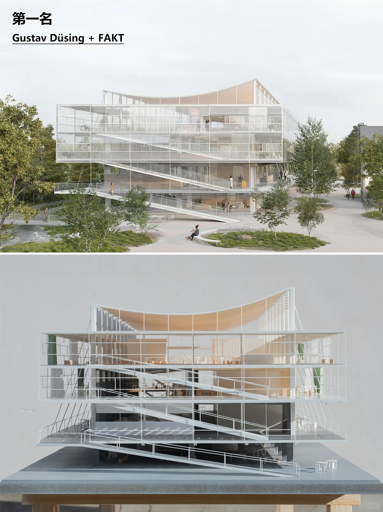
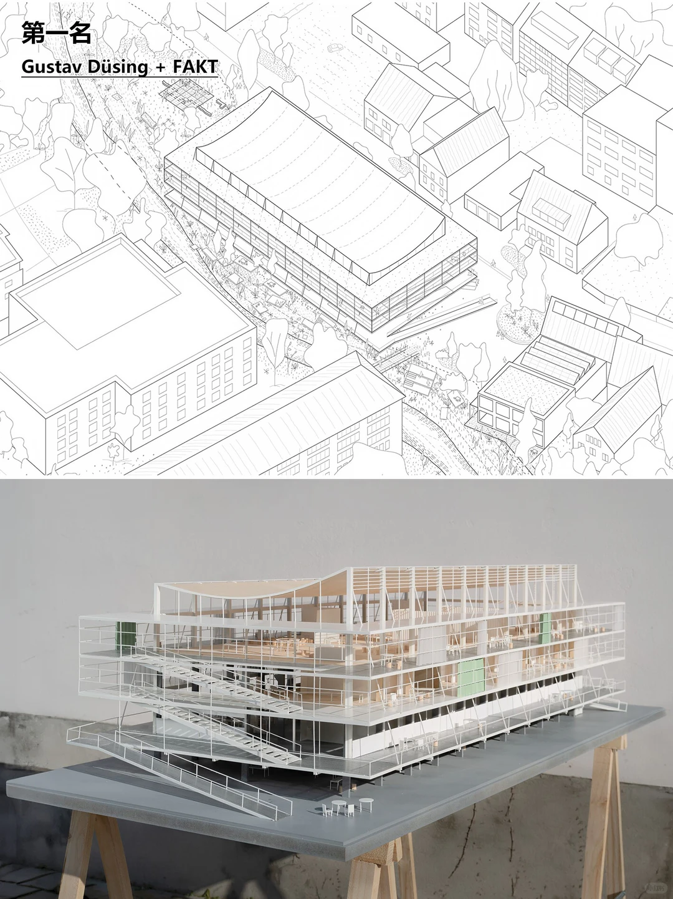
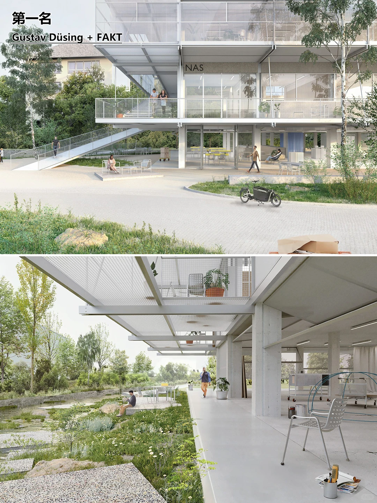
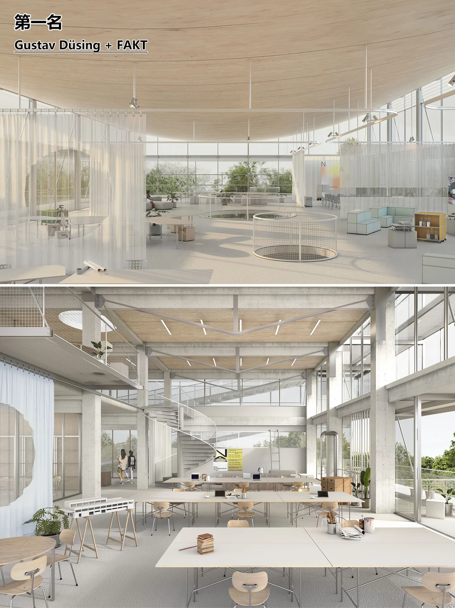
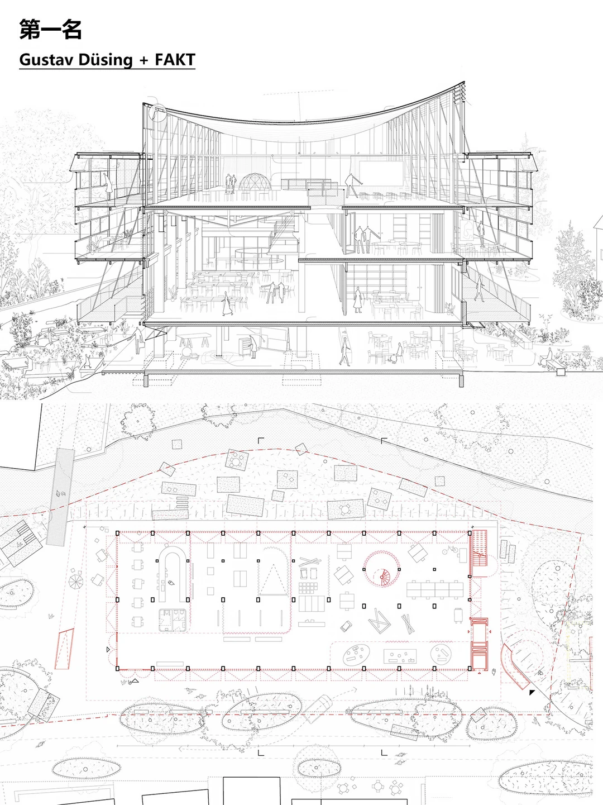
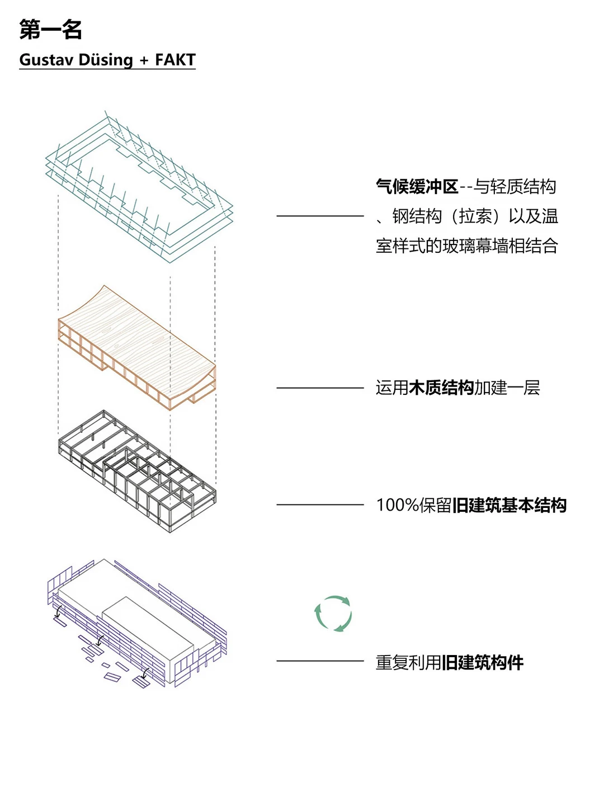
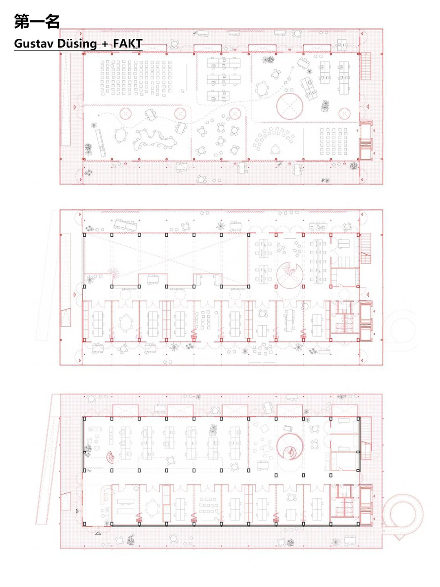
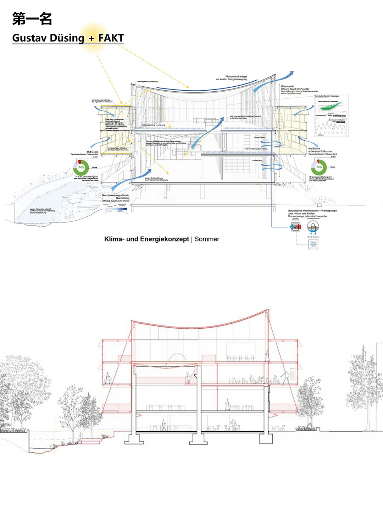

# 同八张原图建筑：公开审查资料

所有者于 **2026-10-15 明确授权**公开本案例原始图片、SKP及完整测试资料。本目录为同一个 `architecture-project-4f0e4`，没有换建筑。API Key、账号密码、登录令牌等认证资料仍不公开；其他案例没有被纳入这次授权。

**当前结论：原生交付与r4恢复PASS，原版对照已完成；整栋源图质量仍FAIL / 整体PARTIAL。** 发布资料不改变任何质量结论。历史r1保存前证据缺失仍BLOCKED；不得从此次公开补造。

## 审查顺序

1. 先读 [CURRENT](../../CURRENT.md) 和 [原版实际对照报告](../../test-results/windows/2026-10-14-authorized-original-codex-control/README.md)。
2. 对照下列八张整图与 [网站r4实际六视角](../../test-results/windows/2026-10-14-eight-source-r4-clearance/README.md)，检查斜撑、坡道平台、围护和室内关系。
3. 阅读 [网站完整会话状态](review/projects/architecture-project-4f0e4/state/agent_session.json)、[空间方向spec](review/projects/architecture-project-4f0e4/runtime/agent_workspace/notes/spatial_spec.json)、[重建参数卡](review/projects/architecture-project-4f0e4/runtime/agent_workspace/notes/reconstruction_card.md)、[完整文件索引](index.json)。
4. SKP为可下载的原生文件；GitHub网页不提供SKP三维预览，网页视觉审查请用真实截图，原生几何检查请下载到SketchUp。

## 八张原始整图（原上传顺序，未裁切/改图）

### 原图 01



[原始PNG](sources/01-9d05f4a6ae-codex-clipboard-1b4276a9-93d4-4833-95cb-c3b193c9c96d.png) · SHA256 `241ef6d992daca53dbf3a0e7858aae8019324abc14e60cbc6ca7703603e4ea9d`

### 原图 02



[原始PNG](sources/02-ade9a9063c-codex-clipboard-273f5c39-ee57-4cd8-a0c0-d1113b742a27.png) · SHA256 `dc9e475954ce972f109c7099c4615a6231c58a571216eb348c245f62cc1e6088`

### 原图 03



[原始PNG](sources/03-8e8a3625d5-codex-clipboard-a04d023f-1044-423f-89db-4a0b51e92505.png) · SHA256 `8d1ea1d26866d7f9f1d29da4575878ea7c73952f99cad1aad7abdd8c99874cbe`

### 原图 04



[原始PNG](sources/04-c55a28860e-codex-clipboard-fdf7fe7c-e5f1-47d4-b800-d4f5eaf99b52.png) · SHA256 `f341c11421bf3009c1b4ea71aceded026827881486184b77708a276c0eed5080`

### 原图 05



[原始PNG](sources/05-da5324e1c5-codex-clipboard-1ed05c14-1674-4910-bc05-ccb2c03aec93.png) · SHA256 `d66b0eed9546e8e1447c7a46d6669b2ea64e7b5f31298a7fda231ca8128e9095`

### 原图 06



[原始PNG](sources/06-4fdbe428b1-codex-clipboard-8856a1fd-12c2-44d9-a5af-868c4c8d4c2a.png) · SHA256 `f2f3d60f8b711e50a05fef9f574e495d23c67d6e1de7cd4bd3d5c98f017ad331`

### 原图 07



[原始PNG](sources/07-8328ae9aa4-codex-clipboard-538fb3e3-5783-461e-8458-b231bd90bd57.png) · SHA256 `883b837c5ec3c999d7066195a4df501d28e03e036f9417982f1cc9c1c15a7c13`

### 原图 08



[原始PNG](sources/08-92fc9f3b50-codex-clipboard-10ea73cd-a751-4576-b174-295e6446a725.png) · SHA256 `7d651d9eb1bd3d6cd3a5d1d227b1cdf7875d33d5eb73f2d9ae2a35919c586096`

## 六个关键原生版本

| 文件 | 用途 |
|---|---|
| [website-original-r1.skp](models/website-original-r1.skp) | 原始r1，历史失败保留，不是修复结果 |
| [repaired-r2-baseline.skp](models/repaired-r2-baseline.skp) | 受控对照共用的安全r2起点 |
| [website-r3.skp](models/website-r3.skp) | 网站一次屋顶方向修改r3；与原版最终几何相同 |
| [website-r4-current.skp](models/website-r4-current.skp) | 网站现工作r4；已恢复/重连，保真仍FAIL |
| [website-r4-downloaded.skp](models/website-r4-downloaded.skp) | 网站实际下载r4候选；与绑定文件字节不同但原生深层几何一致 |
| [original-codex-control-r3.skp](models/original-codex-control-r3.skp) | 原版CLI一次局部修改的控制r3 |

各原生文件的原路径、字节大小及精确SHA见 index.json 的 direct_files。源文件不被覆盖，原生版本和下载候选不混为同一文件。

## 完整资料与文件结构

共 **1069 条原文件路径 / 603 个去重对象**，覆盖原网站项目、2026-10-13 P0、2026-10-14原生修复/对照/净空/备份、2026-10-15恢复收尾。只略去12个生成的Python字节码缓存；源代码均保留。

包含真实执行JSONL/标准错误、耗时Token、完整原生深层JSON、保存/下载/重开证据、Ruby源码、计划/参数/空间spec、截图、历史失败模型及备份。原文件多次备份会重复；归档按导出SHA去重，index.json保留每个原相对路径到 archive/entry 的映射，以及 original_sha256 / export_sha256 / auth_redacted。

- [evidence-01.zip](archives/evidence-01.zip)（21,633,075 bytes）
- [evidence-02.zip](archives/evidence-02.zip)（21,238,927 bytes）
- [evidence-03.zip](archives/evidence-03.zip)（17,281,395 bytes）

需要恢复原目录结构时，下载本目录的 index.json、三个 archives ZIP 和 restore_evidence.py，再执行：

```powershell
python restore_evidence.py E:/eight-source-public-review
```

目标目录必须尚不存在。脚本先验证每个归档对象SHA，再还原所有相对路径；不会运行归档代码，也不会打开或修改SketchUp。身份认证容器不会通过恢复工具重建。

review/ 下另有162个直接审查文件中的计划、状态、代码、日志等；较大的完整深层证据在ZIP中，不是只有摘要。独立Critic与Builder日志均保留各自身份，失败记录没有因公开而清空。

API Key/账户密码/令牌等依据实际本机认证值和常见格式扫描，认证原值不打印、不导出。文本如需清除认证内容会明确标记；PNG/SKP保持原始字节与SHA。检查过程和发布清单见 [本次发布记录](../../test-results/windows/2026-10-15-owner-authorized-public-assets/README.md)。
