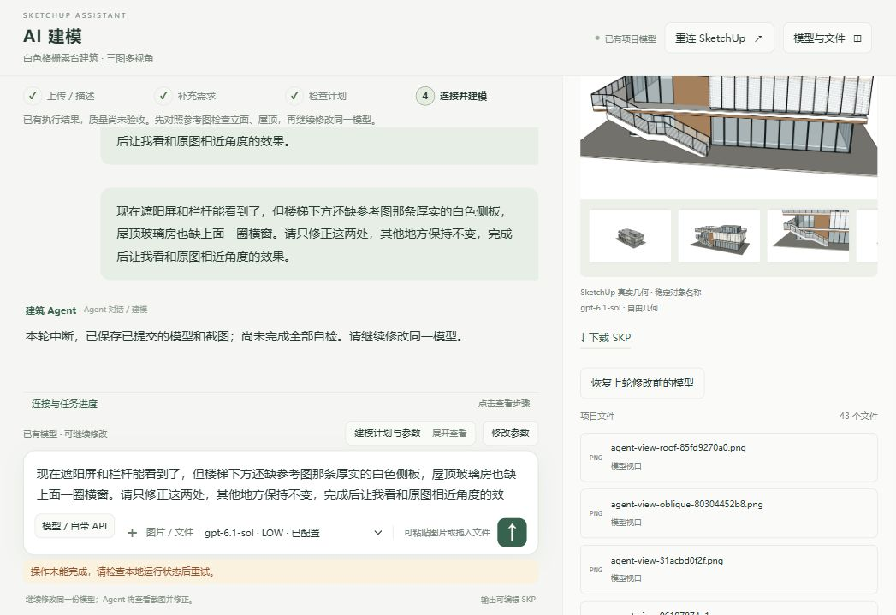
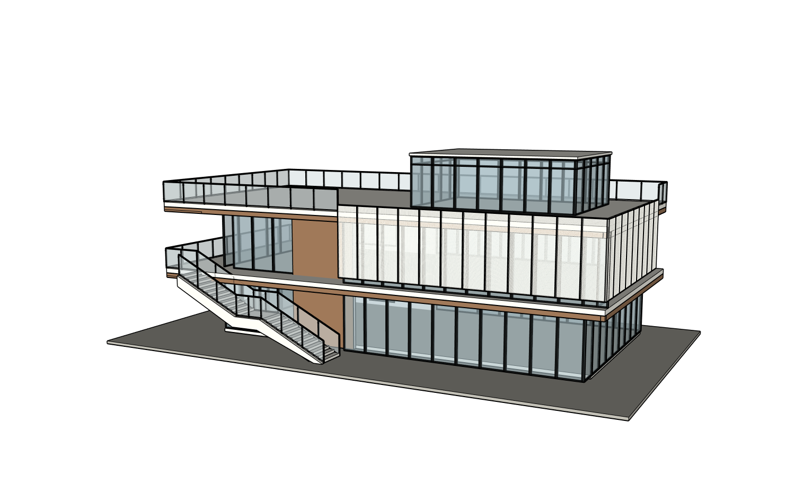

# 三张整图、多视角同一建筑：真实网站 Sol Low 验收

## 结论：PARTIAL，视觉未通过

2026-10-11 至 12 日，从 main `c1bcb80ce0373c366280ecf08d7c09870fe8abdb` 开始。外层 Codex 型号未改；K Studio 网站实际 App Server 推理为 **gpt-6.1-sol / low**。没有付费 API、B.AI 或假回复。身份与实际 Token 在 [运行事件](trace/runtime-events.json)、[指标](metrics.json)，真实网站界面见下图。

这是新建项目 `architecture-project-8d214`，三张私有整图共七个视角，未拆图。A 是正面/右前斜视，B 是俯视/露台近景/左侧，C 是楼梯/遮阳屏近景；没有真实背面，背面为明确估算。原图和私人 SKP 未公开，审查者可复查真实输出和脱敏记录，不能在公开仓库独立核对私有源图全部像素。

## 实际体验、方法和修复

通过网站上传、短中文对话、计划和批准操作完成建模，完整[自然对话记录](conversation.json)。没有把 Ruby、JSON、MCP 或测试清单粘进用户聊天，也没有由开发者代写正式建筑几何。网站 Agent 自己生成持久脚本，经唯一 Kongxing 写入。开发者直接工具只用于排错、只读审查、原生下载副本鼠标编辑和空白重放验证。

初次发送发生前端 `message` 未定义；修复后回同一网站重试。三张图被随机上传前缀排序，Agent 将方向编号错配；改为真实上传顺序后重新自然交流，计划确认同一建筑。首轮空 WALLS 组被 SketchUp 提交时移除，事务前13组/事务后12组导致验证失败；改为提交后重新读取，并只允许完整清单证明的空容器清理恢复，原失败保留。另修复保存后 GUID 更新、Skill 被截断、历史模型上下文重播。新上下文修复本身曾引入 `ruby_state` NameError，自动回归和同一网站重试确认修复。见[全部错误](errors.json)、[原失败与修复后检查](checks/fresh-sol-initial-check.txt)、[最终检查](checks/fresh-sol-final-check.txt)。

正式写入 r1 主体，r2 遮阳屏/栏杆，r3 楼梯白色侧板/屋顶横窗，r4 侧板位置。**两轮修正对话内实际发生三次局部提交**，并非严格两次事务；如实记录。最终 Builder 输入 2,508,990 Token 触发上限，中断后未再美化。整个 Builder/Planner 记录合计 **6,439,408 input Token**，未达到优于约4.92M旧基线的效率目标；案例不同，不能当受控模型对比。

ADAI 实际生成楼梯侧板，当前 r4 根内账本有真实 PID、耗时和返回记录：[OSS账本](model/oss-method-ledger.json)。首轮观察到 SAIE 墙洞/墙与 ADAI 板及穿孔母件调用，但原始完整账本未跨版本持久保留，**不能用最终 r4 单次调用数冒充全部历史账本**。这是证据持久化缺口；历史方法选择见 [策略](planning/construction_strategy.json)。幕墙框玻璃、楼梯及栏杆由网站 Agent 用受控 Ruby 与原生组件完成，适配非墙洞框架/带平台楼梯；没有硬塞 ADAI 独立 MCP 或第二写者。安装成功不计产品使用，执行也不计视觉通过。

## 真实效果

可辨认的同一建筑主形、右侧穿孔屏及转角、左侧两层露台和楼梯、中央木墙、底层幕墙及屋顶玻璃房已出现。穿孔母件复用，正式根有15个独立命名构件。[当前读回](model/geometry-readback.json)、[指纹](model/final-fingerprints.json)、[事务和验证](model/write-verifications.json)保留。

独立只读 Sol Low Critic 对实际 r4 六图/对应角度及私有源图审查，结果 **NEEDS_FIX / PARTIAL**：[原始 Critic](review/critique.json)。屋顶玻璃房过高、遮阳屏楼层比例偏压缩、白色楼板/檐带偏薄、花池/家具缺失；楼梯最低处低于场地，构件真实接合尚未充分验收。不能用主体可辨认或15组一致宣布还原 PASS。标准六图留白过多，构图仍需改善。[正](views/front.png)、[背](views/rear.png)、[左](views/left.png)、[右](views/right.png)、[顶](views/roof.png)、[斜](views/oblique.png)均真实 r4，附原相机/版本 sidecar。

QA 文件中的网站审查有 r3 历史，最终 r4 独立审查是 **Builder 停止后开发测试侧调用的同一只读 Critic**，不是网站自动完成全部闭环的证明。没有与旧咖啡店做同源公平对比；本轮可见进步是转角屏、侧板与横窗的局部修正及被保护构件保留，整体质量仍未通过。

## 原生编辑与重放

浏览器下载 SKP 与服务端文件 SHA 一致；在下载副本中用 SketchUp 2024 鼠标 Move SITE，保存并原生重新打开，修改保留、其余14构件几何/材质指纹完全相同：**PASS**。[原生证明](model/native-reopen.json)。正式模型未手工改几何，私人文件不上传。

新空白模型实体数0，使用网站 Agent 原样生成的完整持久脚本进行一次 **测试侧重放**，不是新网站推理。首次桥接15秒超时，但原请求随后真实提交；没有重复执行。已记录的15构件严格几何/材质哈希与正式模型全部相同：**指纹 PASS，传输 FAIL，完整重放生命周期 PARTIAL**。[重放原失败及后续读回](model/replay.json)。恢复过程被中断，后续桌面 SketchUp 已退出，2024 注册安装位置无法找到。发现的另一个本机 executable 为2022，仅诊断启动后立即终止，没有用其建模或验收；缺少这份重放的六图及保存再开证据。不得以正式模型六图替代。正式项目状态已从真实 r4 Session 恢复。

## 下一步

先修整个项目级预算、超时后的实际提交检测/安全恢复、OSS 历史账本持久化、明确预算提示，再用新案例验证源图角度和比例约束。保留本轮已有结果，禁止继续无限修补这栋或旧 Dream Coffee。付费托管 API 仍 LIVE_NOT_RUN，本轮不证明 B.AI 效果或可收费上线。

本轮未找到原生编辑阶段的截图文件，不能补造；原生下载/鼠标编辑/保存重开的真实指纹与操作记录保留，截图证据缺口明确记录。
