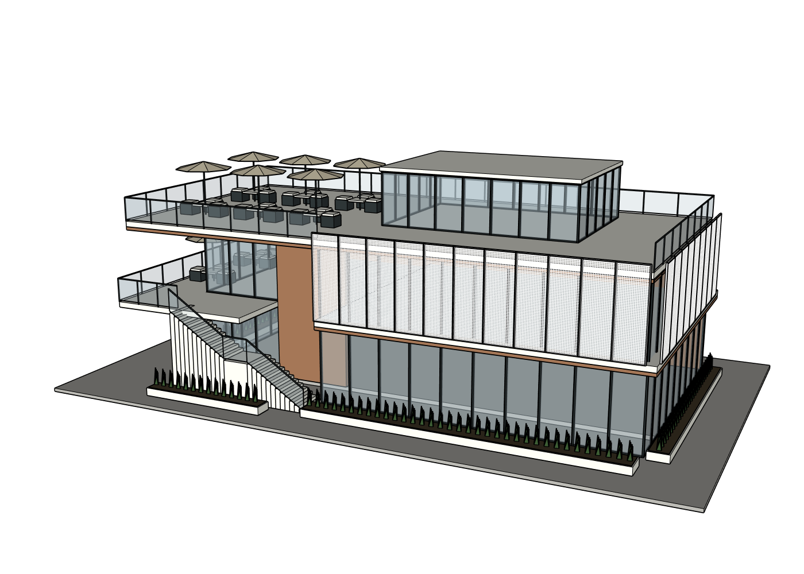

# K Studio 普通学生自然对话复测：PARTIAL

测试基线 `899581b147187581e152eaaf1deee359383e9276`；Issue [#10](https://github.com/eksn425-del/ai-architecture-studio/issues/10)。本次用户明确授权继续使用上次三张整图，不是新的建筑案例。三张私有拼图共七个视角，保持整图输入，原图和 SKP 不公开；公开的是实际 SketchUp 输出、对话和脱敏测量。没有重新测试咖啡店，没有付费 API。

## 用户真正走过的流程

鼠标在原网站新建复测项目、上传三张图，短中文提出还原要求；Agent 识别同一建筑七个视角和密孔板；自然回答尺寸与背面推定；查看计划，输入“可以，就按照这个方案开始建模吧。”，批准一次，自动连接空白 SketchUp 2024。正式建模全部由网站内 **gpt-6.1-sol / low** 编写和执行，控制模型未变。实际 App Server 身份见 [model/model-identities.json](model/model-identities.json)，[完整脱敏交流](conversation.json)。这是 Codex 代理测试，不是独立供应商 API 能力已验证。

第一版完成主体几何，却把白色屏表现成黑色网片，900 秒中断。后台找到局部修改会被匿名隐藏组件阻挡的问题，修 Ruby 范围保护及 Skill、运行检查、重启服务，再回到同一网站项目。

先问“白色遮阳屏怎么看起来是黑的？你建议怎么改？先别修改模型。”：Agent 解释密孔边线、正反面材质；真实前后完整指纹相同，**讨论没有写几何**。再说“把正面和转角的遮阳屏改成图片里的白色密孔板，远看也要是白的，其他地方别改。”：r2 提交，白色效果有可见改善；又经历 900 秒中断。第二次用户局部修改仅要求楼梯下方恢复悬空梯板，却遇真实使用额度限制，0 工具/0 写入，保留 r2，不切换模型或代写几何。没有第三次建模请求。

| 验收 | 真实结论 |
|---|---|
| 同一建筑、多视角理解、短中文批准后执行 | PASS，但计划用时约 464 秒，整体体验慢 |
| 首版外观 | FAIL：黑屏、实心梯下块、薄楼板边带、屋顶分格缺失 |
| 简单中文修白屏 | 可见改善；正式建筑视觉仍 PARTIAL |
| 讨论不写几何 | PASS，14 构件前后完整指纹相同 |
| 局部修改 KEEP | 11 个其他命名组完整指纹 PASS；共享匿名隐藏母件也改变，全部非目标严格 KEEP FAIL |
| 原生下载、编辑、保存、重开 | PASS，下载校验一致；只移动屋顶玻璃房，13 个其他组不变 |
| 一个全新空白重放 | PASS：14/14 世界坐标面/边及面材质指纹一致，六图、原生保存重开读回一致；匿名母件仅在比较中用诊断别名，不能算命名质量 PASS |
| 效率 | FAIL：两次 900 秒超时；第二次修改被额度拦截；不能用少调用或未完成任务的低 Token 宣称效率通过 |

## 真实效果图

第一版黑屏：[斜视](first/views/oblique.png)、[较大视口](first/source-perspective.png)。修后：[对应角度](source-perspective.png)、[密孔板近景](screen-closeup.png)。这些都是实际 SU 截图，无生成式修图。源角度仍是近似匹配，没有确认一对一投影。

六视图：[正](views/front.png) / [背](views/rear.png) / [左](views/left.png) / [右](views/right.png) / [顶](views/roof.png) / [斜](views/oblique.png)，同一 r2，各有 canonical sidecar。构图留白偏大，局部审查应看源角度和近景。

网站：[局部修改处理状态](ui/first-result-public.png)、[下载和额度错误](ui/download-ui.png)。原生：[选中独立玻璃房](ui/native-selected.png)、[实际移动保存](ui/native-edited.png)、[再次打开](ui/native-reopened.png)、[重放原生重开](ui/replay-reopened.png)。截图排除个人会话列表、原图和文件路径。

## 已修代码与限制

- `Group#to_component` 会清空实例名称，导致隐藏母件阻挡任何范围编辑。现在只对**隐藏、无名 ComponentInstance**以保留 PID 标识检查原有保护字段，并额外保护隐藏状态；禁止把保留标识当编辑目标。可见无名构件仍拒绝，删除/显示隐藏母件负例仍拒绝。不是解除范围保护或重命名模型。
- Skill 提醒分别命名返回实例和定义。当前真实模型已存在匿名母件，阶段同步仍 NOT_VERIFIED，没有伪造“全部系统通过”。
- Ruby 保护契约已在 SU2024 中以只读假对象运行，无几何写入；完整检查 **391 passed / 2 skipped / 2 warnings**。正向正式网站修屏实际发生，初始失败和重试都保留。
- **未修**：范围保护仍主要是 ID/直接子组数/边界，不能检测共享定义内部材质的越界变化。r2 的屏母件共用定义，隐藏母件完整材质指纹改变，尽管范围收据说 passed。不能把它当严格全内容保护。
- **未修**：写后 GUID 变化产生 6 次规范截图失败，Agent 只读重新检查后恢复；新回合重复六图审查耗时大；中断消息不区分“此次未写入”和“历史已有结果”，且额度限制仍诱导“继续修改”，体验不合格。
- 重启后服务会恢复已保存 DeepSeek 提供商，环境指定 Sol 不足以覆盖它。后台明确切回授权的 Sol 网站预设，等待页面恢复完成后再发送；未读取密钥，未付费调用。一次刷新未就绪发送报项目缺失，没有推理。不能宣称 provider 持久默认问题已完全解决。

## 外部能力吸收结果

| 方法 | 适用与实际执行 | 真实效果 |
|---|---|---|
| SAIE wall | r1 返回中央木墙 PID40621 | 建立独立木墙；不证明所有墙连接正确 |
| SAIE wall_with_openings | r1 返回背墙 PID40847 | 推定背面墙洞；用户允许补全，无法凭源图确认背面保真 |
| ADAI profile_with_holes | r1 约 29.082 秒，真实母件 PID49219；20 个屏实例复用 | 实际密孔几何，不是安装烟测；首版黑边视觉失败，r2 改双面材质/隐藏孔边后改善 |
| 原生组件/受控项目 Ruby | 露台、门窗、屋顶玻璃房、栏杆、楼梯等 | 可独立编辑，但楼梯方法制造实心块；现有方法适用不等于首版完成度通过 |

[r1 实际账本](first/oss-method-ledger.json)和[选用理由](first/oss-method-adoption.json)保留。r2 是材质和边线编辑，没有新的 OSS 构造调用；[r2 账本](model/oss-method-ledger.json)真实 `events: []`，不能据此否认 r1 已用，也不能补造 r2 调用。

## 数据、人工干预和复现

[metrics](metrics.json)：74 次原生 Agent 编码/工具调用、10 次失败；明确报告 Builder 下界 **3,882,086 input / 11,604 output**，3 个独立 Critic 合计 **123,149 input / 2,319 output**。额度失败回合 usage=null，总 Token 保持 null，不能当零；讨论与计划单列在逐回合数据和交流元数据。上轮 6.439M，不是可比的完整任务效率改善证明。

人工干预：启动已注册 SU2024、关闭其他旧插件弹窗、选择授权网站模型、调试/重启底层服务。控制器没有给 Agent 粘贴技术指令，没有创建正式几何。一次鼠标移动仅在**下载副本**验证原生编辑，不用它改善还原质量。空白重放由测试侧执行**原封不动的网站 Agent 持久脚本**，不是新网站建模，也不是人工替 Agent 写建筑。

复现：同一三图整图上传→上述短中文→计划批准→第一版→只讨论不改→修白屏→第二次楼梯要求。检查隐藏母件、r1/r2 6 图和 [完整错误](errors.json)。共享定义问题：修改 SCREEN_FRONT/RIGHT 的定义材质会改变同定义隐藏实例；metadata-only receipt 不捕捉。[KEEP](model/keep-results.json)保留此反例。不要把数目相同当哈希相同。

本机实际找到并运行 **SU2024 24.0.484**；上次产品复盘中“2024 不可用”的查找判断不完整，本批原生标题与读回纠正该结论。原始参考图/私人 SKP 保留本机但不向公共仓库传；报告不以私人路径冒充公开证据。审查原图需用户再次授权提供给网页端。

## 下一轮只做有效产品改进

先处理写后相机/保存 GUID 刷新和复用**同修订有效**的六视图/审查，避免一条局部要求重拍重评再超时；讨论和修改分清；中断回复说明这次实际写入与未执行事项，不诱导无限重试。修共享定义保护及命名同步，不能降低 KEEP。把源图可见白色边带和悬空梯板的比例/拓扑约束落实到首版，而不是追加家具。只在新的有界测试中证明这些改动可见有效；本批停止修图，Issue #10 保持未关闭。
