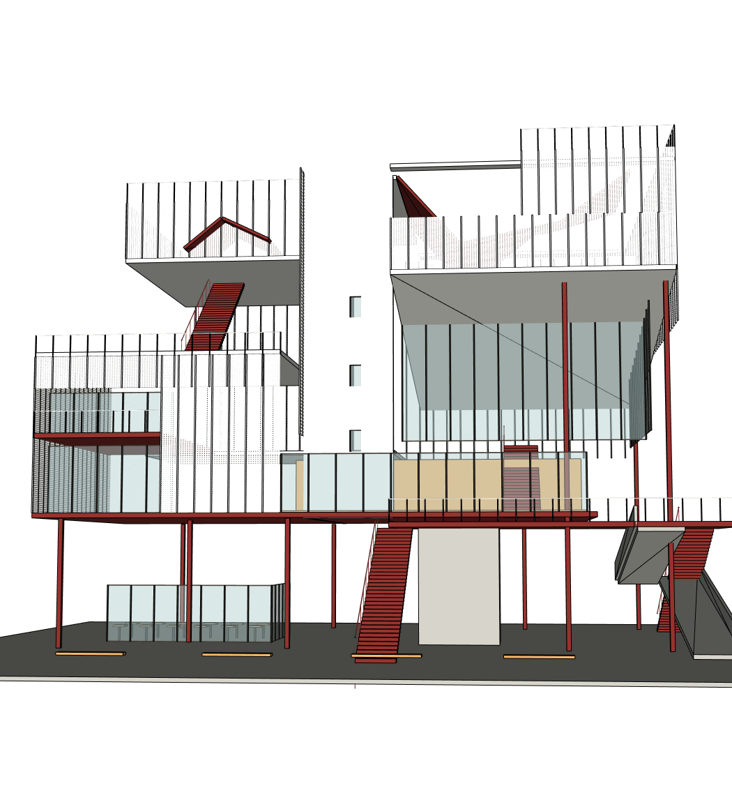
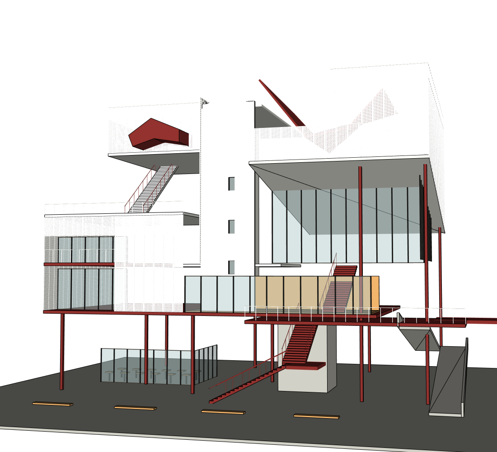
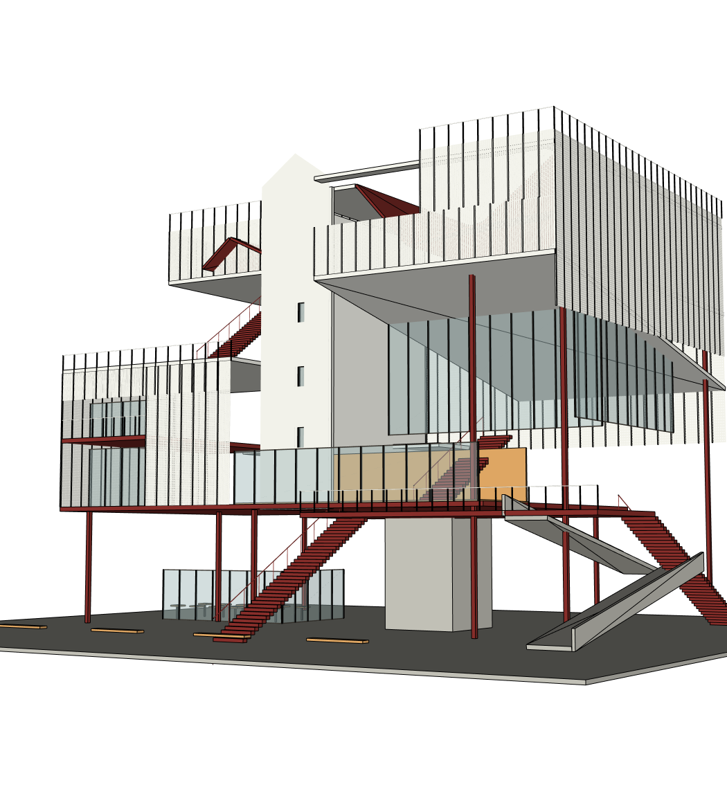
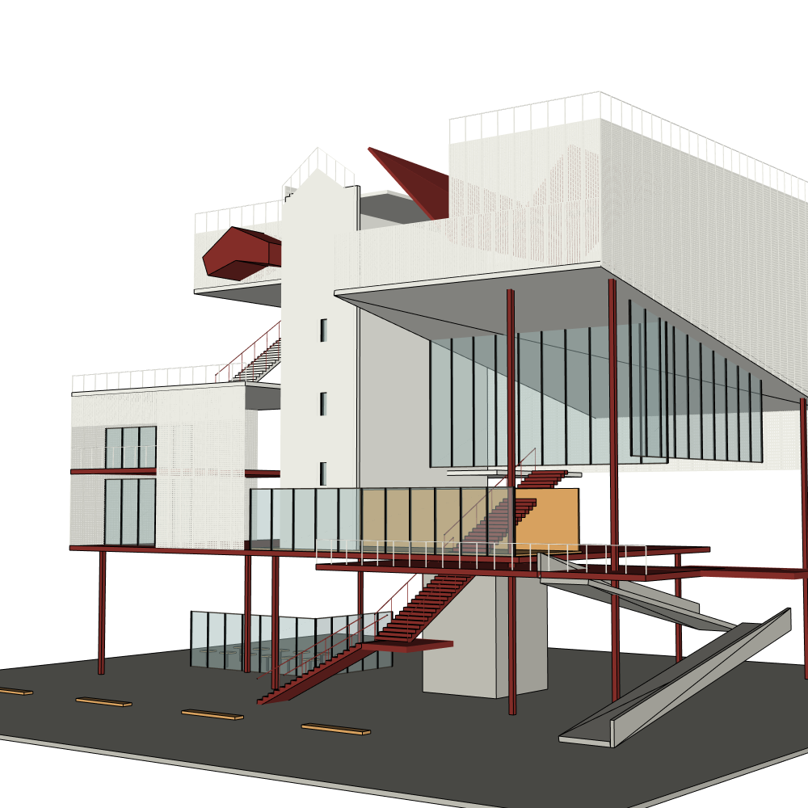

# 同一双图 r3 → Sol Medium 网站修正：PARTIAL / 视觉仍 FAIL

Issue #12，起始 main `3dda2a40ab9d228ee3390992070dcf6603f6a75c`。沿用用户亲测的两张私有源图和“我的建筑项目”，原生 SketchUp2024、同根 PID 26048，r3 备份后继续。**没有新建建筑、没有整根重建、没有清预算、没有付费 API。** 外层 Codex 控制模型未变。

## 实际用户操作

1. 网站实际选择 `gpt-6.1-sol / MEDIUM`，用原会话发出：
   > 我觉得这个建筑和原图还有很大区别，先别整栋重建。帮我重新对照两张图片，优先调整整体体块、红色折面和楼梯平台的位置，已经正确的地方不要动。改好先让我看效果。
2. Agent 通过现有网站工具提交一次 r4 局部修改，自动进行两张源图对应视角及六视图的独立 Critic。没有人工几何代建，没有注入工具名/Ruby/验收清单。
3. 看到右上凹口仍不正确，从网站继续发出：
   > 右上那个大凹口里面还是一整片玻璃，原图那里有白色围墙，玻璃主要在右边退进去的位置。先只把这一处改像，刚才改好的屋顶、左边和楼梯都别动。
4. 第二次请求重新读取/截图/审查并编写修正文件，**未提交几何**即被项目预算中断。最终仍 r4。真实网站界面：[自然聊天与预算中断](browser/natural-chat-budget-stop.png)。两回合用户均未被要求重新批准旧首版计划。

`runtime-traces.json` 保留两个真实回合的 thread 身份、请求/返回档位、工具结果与终止原因。**实际模型与档位 PASS**：两回合 requested/reported 均 `gpt-6.1-sol / medium`。仅是 Codex 开发代理；B.AI/独立付费 API 未测。

## 前后真实结果（两张源图对应角度）

来源对应及原始修订标记见每张图片的 sidecar 和 Critic JSON。源图私有，未公开。构图仍有一定源角度偏差，不能把这组称为像素级同相机叠图。

|视角|r3 修正前|r4 最终|
|---|---|---|
|近正面|||
|右前斜视|||

**可见改善**：白色屏风的黑边弱化；右侧屏风下缘更贴合斜底；左上红色折面从薄人字片变成有深度的外伸构件；前直梯改成转折梯及中间平台，右外梯与平台有所调整。

**仍然 FAIL**：右上凹口的白色内围合缺失、玻璃覆盖过大；中央仍像实心浅色尖顶条带；主要红色折面宽度/连续关系不正确；坡道是分离交叉的薄带、端部和平台不连贯；上层左梯缺源图的厚白色斜向围合。第一轮的改善不足以证明主体已像原图。

最终独立只读 Medium Critic 仍 `NEEDS_FIX: YES`：[审查全文](review/visual_qa.md)、[最终 receipt](review/after-critique.json)。两源图 CURRENT 配对完整性通过；不是 Builder 自评，也不是拿旧咖啡店期待套新案例。

### 最终 r4 六个真实规范视图

[正面](views/front.png) · [背面](views/rear.png) · [左面](views/left.png) · [右面](views/right.png) · [顶面](views/roof.png) · [斜视](views/oblique.png)

六张为当前同 revision 4，附实际 canonical camera sidecar；它们证明可读回，不证明视觉还原通过。

## KEEP 与专业方法

- 同 root、revision 3→4，writer 验证/声明范围收据通过：[write-verifications](model/write-verifications.json)。
- 实际 native 顶点、边、正反面材质完整指纹证明以下八项 r3→r4 不变：STRUCTURE、CORE_WALLS、GLAZING、SITE、VISIBLE_INTERIOR、Core_front_openings、Screen_panel_prototype、Screen_panel_dense_prototype。第二次回合结束后 15 个顶层对象的完整指纹仍与 r4 相同：[KEEP](model/keep-results.json)。不以组数相等冒充保护成功。
- 声明允许变化：ENVELOPE、ROOF、CIRCULATION、RAILINGS、SCREENS、Core_front_screen，并增加 Left_red_fold_volume。8 项 KEEP PASS 仅覆盖声明保护对象，不覆盖允许范围内部所有子构件。
- 新 r4 实际 OSS 账本为 **ADAI profile 1 次**，用于左上红色折面挤出构件。真实产生外伸体量，但仍未实现完整源图形体。SAIE 新调用为 0；第二次准备的墙体脚本未写入，不能报告 SAIE 使用成功。[原始实际账本](model/oss-method-ledger.json)、[选用/回退记录](model/oss-method-adoption.json)。其余复杂定位使用既有受控项目 Ruby；未连接第二写入者。

## 真实效率与终止

|回合|input / output|工具 / 失败|耗时|实际提交|终止|
|---|---:|---:|---:|---|---|
|主体修正|1,929,892 / 11,020|47 / 1|903.078 秒|r4 一次|900 秒 deadline；旧提示误写成通信故障|
|凹口局部请求|1,470,740 / 6,667|26 / 1|567.734 秒|无|原项目累计预算保护|

本批 Builder 输入 3,400,632、输出17,687；73工具/2失败。项目从4,488,068累计到 **7,888,700**，8M上限、200k交付预留未改。下一次 Builder 已被预算阻断；没有把旧日志归零、新建项目避限或伪造用量。两个失败工具均为每回合缺当前审查的首次写入被拒，Agent 又重新拍六图与两源图配对并审查。Critic真实用量单列在 [metrics](metrics.json)，不混入 Builder、不充当全部供应商费用。没有效率 PASS。

## 修了哪些底层问题

1. **整轮时限误报通信失败**：等待事件正好达到 deadline 时分类成整轮超时；提前发生的传输 Timeout 仍为通信故障。没有延长900秒或改变预算。两个回归覆盖两类原因。
2. **进度工具数错误归零**：现实现用“最后修改的日志”，嵌套只读 Critic 日志较新且0工具，会盖掉 Builder。现在优先选择同一活动时段声明 `is_builder=true` 的日志，非Native仍回退最新。两条回归通过。**已重启部署，但修复后活动回合网站验证 NOT_RUN**：预算已用尽，不能为了拍 PASS 再推理。仅声称离线/真实日志根因验证，初次错误截图/记录保留。

完整自动检查 **398 passed / 2 skipped / 2 warnings**。工程检查通过不能代替建筑质量。持久化完整 reconstruction.rb 在中断时尚未整合 r4 patch；当前模型成果与可重放完整源仍需核实，**重放 NOT_RUN**。

## 原生交付与下一步边界

备份 r3 原项目（图、脚本、状态、预算、SKP）仅留私有 runtime。最终同模型原生 Ctrl+S 保存及私有 r4副本已保留，未动用户其他原模型。下载/原生重开/鼠标编辑再重开/严格空白重放本轮 **NOT_RUN**，不继承旧案例 PASS：[记录](model/native-reopen.json)。

下一步由网页端审查：减少同修订重复六图/重复 Critic 消耗，保留真实源图与源匹配截图而压缩无关历史；把 Critic 的空间关系改动转成一次有限写入，并合并可重放源；改善预算不足时提前展示“本轮无法完成”的提示。恢复推理需用户明确决定预算，不能绕过当前原项目上限。不要再次只升模型档位或反复加长 Prompt。

**验收：模型身份 PASS；同根有范围修改/八项完整 KEEP PASS；两源配对和六图采集 PASS；视觉 FAIL；简单局部修改未完成 FAIL；整体 PARTIAL。** 所有结果来自真实网站，测试侧只做只读诊断、备份、保存和代码修复，未代替 Agent 写模型。
