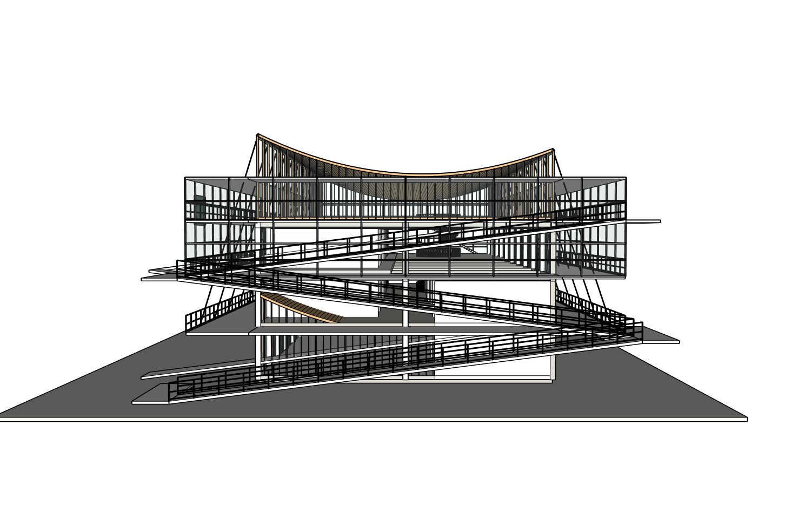

# 新建筑 · 原生 Codex Harness 网站实测

## 结论：PARTIAL，视觉与最终交付均未通过

实际测试代码起点 `02f63af09961a283de04d7bbc07e893deeeccb2b`，其后在本机修复并重启。全新项目 `architecture-project-4f0e4`，原生模型根 PID **20606**，脚本 `glass_curved_roof`，唯一成功提交 **r1**。外层 Codex 模型未改，网站真实运行 **gpt-6.1-sol / medium**，没有付费 API 调用或模型替换。

用户提供的八张整图全部通过真实文件选择器上传，未拆图。资料是同一栋建筑的外观、实体模型、室内、平面、剖面及构造示意；不是八栋建筑。原始图片和私人 SKP 未获公开许可，均不提交。公开保留 [源文件哈希清单](sources.json)、Agent 的 [逐图分析和估算计划](planning/reconstruction_card.md)、真实模型输出和脱敏日志；网页审查者无法仅靠公开仓库重新查看私人原图。

| 验收项 | 真实结果 |
| --- | --- |
| 网站上传、简短中文澄清、批准后连接并建模 | PASS 跑通；前面计划恢复失败多次，体验仍差 |
| 实际网站模型与档位 | PASS：App Server 返回 Sol Medium 身份 |
| 原生 Harness 连续线程 | PASS 观察到真实 resume；更换阶段指令／工具清单后正确新开线程 |
| 第一版源图还原 | FAIL：整体有辨识度，屋顶高低、坡道关系、外廊、圆洞护栏仍错 |
| 一次自然语言局部修改 | FAIL／BLOCKED：三个尝试无几何提交，不能展示“修正成功” |
| ADAI / SAIE 真正用于正式模型 | PASS 调用事实；不代表视觉 PASS |
| 六个认证视图与独立 Critic | PASS 取得证据；Critic 判 NEEDS_FIX，部分构图及内部证据欠佳 |
| 网站 SKP 下载 | PASS：文件实际下载，副本哈希一致 |
| 原生打开与独立组件选中 | PASS 操作事实 |
| 原生重开几何保持一致 | FAIL：干净下载副本再次重开仍见屋顶错位／上部缺失 |
| 手动移动、保存后再重开一致性 | PARTIAL：选中独立柱；移动未确认；保存测试副本成功，保存版再重开 NOT_RUN |
| 严格空白重放 | NOT_RUN：局部修改未完成且原生交付已有阻断 |

## 关键真实图片

[首版源角度](source-perspective.png) · [首版较清楚斜视](first-pass/views/agent-view-oblique-e136231381.png) · [首版网站预览](browser/first-model-preview.png) · [下载前端视图](first-pass/pre-download-end.png) · **[干净下载副本原生重开异常](browser/native-clean-reopen.png)**。

六视图：[正](views/front.png)、[背](views/rear.png)、[左](views/left.png)、[右](views/right.png)、[顶](views/roof.png)、[斜](views/oblique.png)。它们是网站成功提交 r1 后、下载之前的真实认证截图，**不是干净下载副本的重新认证截图**。下载副本仍标 r1，却出现几何外观差异，不能用同 revision、33 个直接组或根包围盒通过来掩盖该问题。

## 实际用户流程及失败

1. 新建“玻璃与曲面屋顶建筑”，上传八张原始整图，发普通中文课程汇报建模请求。
2. Agent 识别长条框架、玻璃缓冲廊、下垂木屋顶、折返坡道和内部挑空，仅问室内及周边范围。确认采用推荐范围和估算。
3. 第一次计划超时 902219ms：同路径 Delete+Add 补丁失败，随后全文补丁因解码错误再次失败；模型连接也发生重试。仅编码工具计数未包含这两次补丁失败，补充写入 [errors.json](errors.json)。
4. 重启发现保存的 DeepSeek 配置覆盖专用启动脚本。修复后真实页面保持 Sol Medium，未删除或读取用户 Key。
5. 计划重试写好文件但容量不足；随后“展示已保存计划”被本轮文件新鲜度拒绝。进一步查实际原生 rollout：resume 线程仍保留首次澄清开发指令，新的阶段指令未进入持久线程。
6. 修复指令指纹后通过网站重新整理，计划成功保存并展示。只批准一次，网站自动连接会话独立 SketchUp 2024 模型并启动建模。
7. Builder 自主生成 Ruby，失败后自主修正；一次成功写入 r1。实际错误包括 MCP 无回应、不同 parent 实体合组、读取未存在 owned root、原生命令失败和源图匹配证据缺失。
8. 首版六视图及独立 Critic 已保存。Critic 295500ms，判屋顶端部高低／坡道方向相反、外廊过实过重、圆洞缺护栏；首轮累计 948407ms 超时，未作第二次写入。
9. 看网站模型预览后，仅提出“从坡道这一端看，屋顶左右高低好像反了……调整过来，保留曲面，坡道和其他部分先别动”。首次容量不足；同一请求重试有脚本但 KEEP 24 路径上限拒绝，然后超时。修复后再次从真实网站提交同一请求，因容量不足中断。**三次均没有修正提交**，根始终 r1。
10. 下载 SKP，确认 SHA256；打开测试副本、进入组、选中 `COLUMN_X00_Y00` 原生组件。尝试移动未得到确认，不声明修改成功；测试副本实际保存。另从未改的下载文件复制干净副本、重开，仍出现屋顶异常，已保存截图与只读读回。

自然对话与完整轮次见 [运行日志目录](runtime/)、[指标](metrics.json)、[错误](errors.json)。公开日志包含真实用户话语和实际 Agent 回复，超时未返回到聊天的中间话语不是成功的聊天回复。原始图片缩略图及个人侧栏没有公开。

## 修复及验证范围

- **专用启动器模型固定**：`ARCH_STUDIO_USE_LAUNCHER_MODEL=1` 防止重启时 BYOK 覆盖实验模型；普通用户加密 Key 恢复机制保留。真实重启后页面及后续执行身份均是 Sol Medium。
- **Windows 文件操作指导**：显式 UTF-8、同路径单次更新、失败后重新读取小范围修复，避免超大模板补丁空转。修后计划实际落盘。
- **线程指令指纹**：源图、工具清单之外新增开发指令 SHA；阶段或安全指令变化强制新线程。同阶段／同工具／同源允许原生 resume。新计划成功、实际建模成功、局部请求真实 resume 均有日志，不能宣称每次 resume 都完成修改。
- **容量错误 UX**：实际网站显示模型繁忙、资料计划保留，无需重输 Key。见 [真实错误提示](browser/capacity-error.png)。
- **KEEP 256 路径及批量只读**：原 24 限制不适合独立幕墙组件。现在每个保护路径仍做精确指纹，并保留原 GUID、路径、修订、重复路径拒绝及事务内越界回滚。95 路径原生只读批量探测 656ms；这不是网站局部修正 PASS。工具清单变化导致新线程是正确行为。

## 外部能力吸收结果

| 方法 | 正式调用 | 选择与真实结果 |
| --- | --- | --- |
| ADAI 0.5.39 profile | 6 | 楼板、曲面屋顶及坡道截面实际写入；屋顶方向和交付异常仍未解决 |
| ADAI profile_with_holes | 3 | 楼板圆洞真实参与模型；洞口护栏不足仍被 Critic 拒绝 |
| SAIE wall | 18 | 直隔墙参与正式建模，非独立烟测 |
| 原生组件／项目 Ruby | 实际 Builder 源码公开 | 柱梁、玻璃框、栏杆、旋转踏步复用与组合；不同 parent 合组先失败后修复 |
| 屋顶局部反射脚本 | 未成功执行 | 计划保留原曲面而交换高低；SAIE 墙和重新挤出不适合保留既有网格。脚本存在不能当作能力通过 |

真实 [OSS 方法账本](model/oss-method-ledger.json)、[吸收评估](model/oss-method-adoption.json)、[Builder 源码](model/reconstruct_building.rb)、[未执行的局部脚本](model/correct_roof_handedness.rb) 均可复查。

## 效率与真实阻断

总计 **5,213,096 input / 55,858 output，87 次已计工具调用**；Planner 1,894,383 input／17 工具，Builder 3,249,362 input／70 工具，独立 Critic 69,351 input／0 工具。计数未纳入上述两次上游补丁失败，不能写总失败为零。部分成功规划轮次缺持久 latency，保留 null；首版 948407ms 包含 295500ms 独立审查，不能再相加。见逐轮 [metrics.json](metrics.json)。

与以前约 4.92M 六视图基线不是同案例、同资料或同工作量，本次八张多面板加多次失败规划。**不能证明 Harness 效率通过**；恢复阶段错误、重复图像／历史上下文、容量重试和审查占时仍很重。较好的首版形体也不能证明对上轮建筑实现了定量进步。

## 下一步可执行项

1. P0：对已保留的下载 SKP，在 SU2024 干净副本上比较屋顶及支承子组的 native transform、定义、面边和保存前后深层指纹，区分 save_copy、共享组件／ADAI 组装、插件或坐标读回原因。已有证据不足以确定根因；禁止据猜测修全局几何。
2. 等同一 Sol Medium 容量可用后，只重试已有屋顶局部请求，并真实验证新 KEEP 批量路径、源角度、局部变更和保护组。不要继续装饰或全局重建。
3. 减少规划历史／重复图像和重复截图；明确真实首个可见结果时间，补齐成功轮次 latency 与上游补丁失败计数。短对话被恢复流程拖长是产品缺陷。
4. 修正轻质外廊、坡道落点、内部护栏与合理构图，再进行完整原生编辑保存重开／严格空白重放。当前都不能提前 PASS。

## 检查

起点全量 408 passed／2 skipped；最终 **413 passed／2 skipped**（2 个已知依赖警告），Python compileall、Node 语法检查通过。一次测试中间失败是 schema 测试仍要求旧 24 容量，已更新为 256 并新增批量及边界回归；未降低视觉标准。Ruby 独立 CLI 本机未提供，本轮 Ruby 真实执行由 SketchUp 验证，相关 native 脚本失败保留。

本目录 SHA256 清单由仓库证据校验器生成。CI 与最终推送状态由最终交接提交／Issue #16 评论补充。
