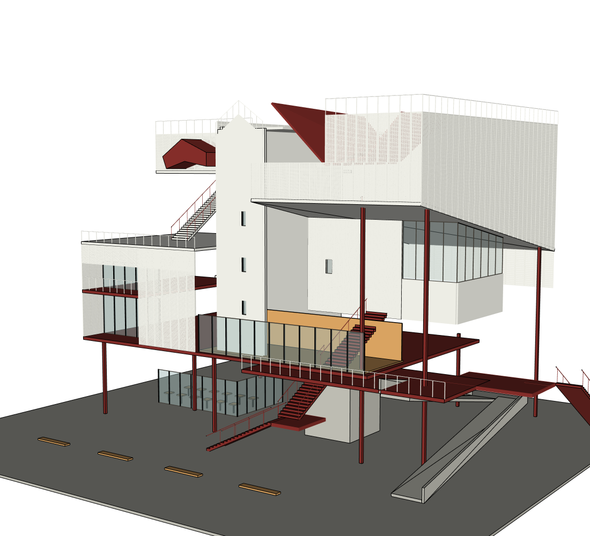
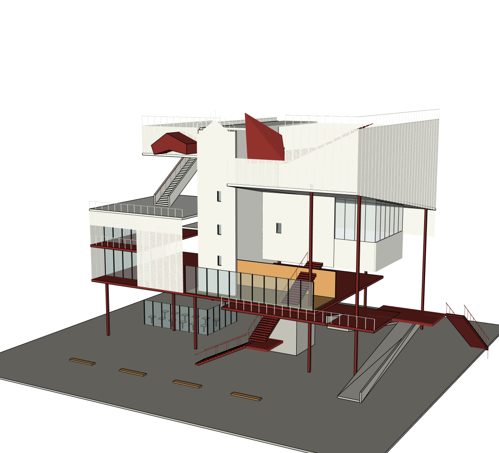

# 2026-10-13 同项目修复重复审查，用户主动停止：整体 PARTIAL / 视觉 FAIL

## 实际做了什么

沿用用户亲测的两张私人建筑照片和现有 r4，不创建新建筑。先备份；SketchUp 2024 原生打开同一项目副本，网站点击重连，再用两句自然中文要求修改。真实网站实际执行 **gpt-6.1-sol / medium**，两次新回合均由实际 thread 身份回执证实。外层控制模型不变；没有付费 API。

- **r5**：修右上凹口。正面大玻璃缩小，白色内壁及小窗补入，玻璃退到右侧；屋顶、左侧、楼梯平台由范围/KEEP收据保护。
- **r6**：补左上斜向楼梯两侧白色围墙，调整红色屋顶为相连折面；既有凹口、玻璃及其他命名组保留。随后再次深化红色屋面时，GUID 误判阻止写入，未产生 r7。
- 用户明确要求停止。**不再启动 Builder、修图、下载编辑或重放**；本报告是停止时的真实记录。

## 对比图（实际 SketchUp 输出）

### 本轮开始前 r4

### 第一处修正 r5

### 停止时 r6

[正面结果](after/source-1.png) · [六视图](views/) · [网站截图](browser/final-chat.png)。before 明确引用上轮真实 r4 当前修订证据，未冒充本轮新截图；r5/r6 是本轮真实捕获。源匹配相机偏高且侧图边缘有裁切，不宣称像素级同角度比较。私人原图与 SKP 未公开，网页审查受此限制；模型输出可公开。

## 修复的产品问题与验收边界

| 问题 | 改动 | 已验证 / 尚未验证 |
|---|---|---|
| 新回合清空同修订有效 Critic，重新拍六图/重复审查后才允许修改 | 跨回合加载同修订独立审查；核对六图相机/修订、源配对、写后收据与源文件；新源使用 SHA256，旧源以修改时间拒绝变更 | 离线回归与两次真实网站写入 PASS；两回合都先写入，再审查新修订，未出现写前重复六图/Critic |
| 原累计预算阻止迭代 | 按用户本次明确授权，Medium 本地启动脚本将 Native 项目/回合输入 Token 和工具调用 cap 设为 0 | 本轮真实超过旧累计限额仍正常提交；历史 7,888,700 input 原样保留，新累计 11,493,239；未更改付费 Responses 预算 |
| 自动保存后 GUID 改变，后续 writer 误判切换模型 | 对同路径进行原生只读 root PID、project_id、revision 校核后再绑定新 GUID；路径切换/证明失败仍拒绝 | 两项回归与 [只读原生证明](model/guid-rebind-native-proof.json) PASS；修后网站重新建模 NOT_RUN（用户停止），原始失败完整保留 |
| 回复中的效果图相对链接被前端写成 # | 支持当前项目 outputs 相对链接，仍拒绝逃逸与 javascript | 执行真实 JS 函数的回归 PASS；停止前网站仍见 #，最终浏览器交付 NOT_VERIFIED，需确认缓存/实际资产加载 |

本轮完整自动检查：**404 passed / 2 skipped / 2 warnings**；compileall 通过。自动测试不能证明最终建筑还原通过。

## 视觉审查：仍 FAIL

[独立 Critic 原始结构化意见](review/critique.json) · [审查正文](review/visual_qa.md)。新修订由 dedicated_read_only、gpt-6.1-sol/medium、fresh readOnly context 审查，不是 Builder 自评。

可见改善：右侧凹口由满幅玻璃变为白墙与退入玻璃，左上楼梯出现实体侧围墙，红色屋面有相连几何；均有真实 commit/readback。

仍存在：右侧下部围合变成悬挂玻璃盒、下缘与深凹口关系不对；白色网屏顶缘仍偏平，源图的高低折线未充分恢复；红色折面宽度和方向仍不够像；下部楼梯/平台和坡道仍呈细窄、直槽与错位。主体问题未被植物家具掩盖，也没有降低标准换取 PASS。

## 效率与实际方法

| 回合 | Builder input / output | 工具 / 失败 | 时间 | 实际结果 |
|---|---:|---:|---:|---|
| 凹口 | 1,782,372 / 3,809 | 25 / 0 | 302.969 秒 | r5 提交，完成网站回合 |
| 楼梯围墙与红折面 | 1,822,167 / 9,450 | 40 / 1 | 532.375 秒 | r6 提交，追加修改 GUID FAIL |
| 合计 | 3,604,539 / 13,259 | 65 / 1 | 835.344 秒 | 2 次局部提交；无全局重建 |

第一次同类凹口修改上轮 567.734 秒/26 工具却无提交，本轮 302.969 秒/25 工具有提交，具备实际进步。但不是完整任务公平成本 A/B；总体 Token 仍很大，**不宣称效率已全部解决或质量 PASS**。独立 Critic Token 单独记录于 [metrics](metrics.json)，不混进 Builder 总数。

| 方法 | 实际使用 | 效果 / 原因 |
|---|---|---|
| SAIE wall_with_openings | r5 提交脚本实际调用、带失败检查；原生读回有墙洞，独立 r5 OSS 账本未留存 | 补凹口内壁小窗；围合空间定位仍须视觉改进 |
| ADAI profile | r6 账本真实 2 次 | 生成 Upper_left_stair_enclosure_west/east；适用等截面侧墙 |
| 受控项目 Ruby 共享顶点壳 | r6 红折面 | 连续变截面折叠屋面不适用直墙或等截面 profile；实际生成，但视觉宽度/朝向仍不足 |

[最终 OSS 账本](model/oss-method-ledger.json) · [采用评估](model/oss-method-adoption.json)。r6 账本仅代表 r6，不用它冒充 r5/旧版本全部方法。r5 原生报告和验证收据已保留；其独立 OSS 调用账本缺失，因此不补造 r5 计数。KEEP PASS 是 host 收据范围，未新增全顶点严格指纹验收，不能扩大解释。

## 未完成与下次接手

用户主动停止，测试当前不自动恢复。下载最终 SKP、原生编辑保存重开、严格空白 replay **NOT_RUN**。Agent 已更新持久脚本，但未跑重放，不能称可重现交付已通过。

用户后续恢复后：先验证 GUID 修复和前端效果图链接实际加载，再在同项目对照两图修右侧下部围合、网屏顶缘、红色折面宽度/方向与坡道连接。保留本批 FAIL 与原图，不清 Token 记录；预算上限取消不代表可以无限重复无进展审查。将每次真实修改落到命名构件并核对前后效果，无法定位的几何问题应记录具体原因。

## 推送时并行远端更新

首次推送被拒绝，因网页端 main 已新增 `459b934`（Codex harness研究及严格证据SHA审查复用）。已保留远端更新，并采用其完整PNG/sidecar/原图SHA及历史一致性实现替代本轮本地复用实现，避免两个重复流程。上述真实r5/r6是在本轮本地实现上运行；合并后的更严格实现只做自动回归，不声称已做新网站验收。用户停止指令仍有效，不启动新图测试。
