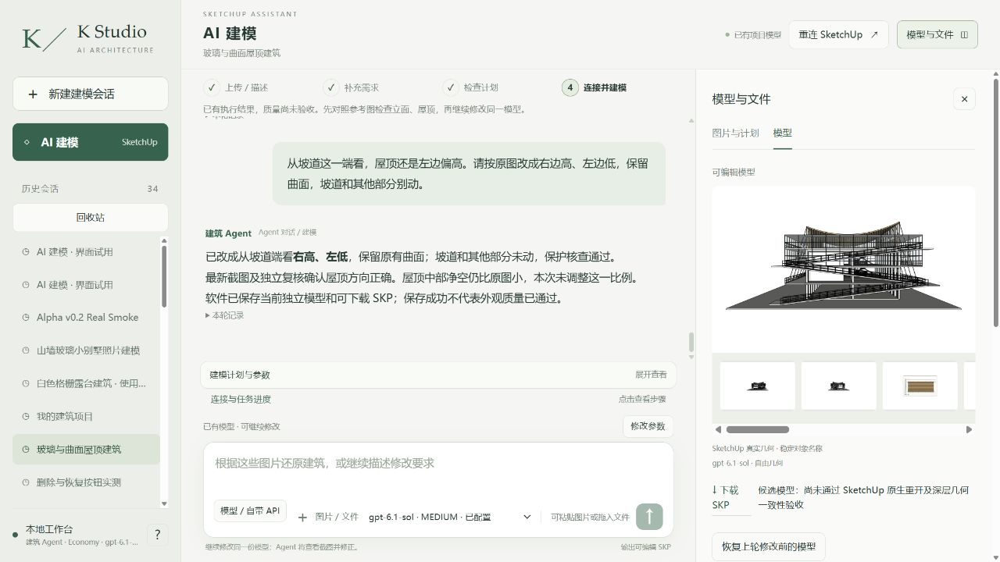

# 八张原图、原项目：原生交付修复与网站局部修改

本轮继续 `architecture-project-4f0e4`，原八张整图及上传顺序不变，原始根 PID 20606。原始 r1、下载文件、脚本、照片、测试记录及暂停代码均已在本机备份，未公开上传。起点 main 为 `74cbafc14cfe2b9135b6a24f2f0a8fdc9ca36e5b`。历史视觉 FAIL 和三次未提交的修改仍保留。

## 原生根因：只检查 owned root 会漏报

实际 SketchUp 2024 / 24.0.484 下，原脚本把已经在 root 内的构件传给 `root.entities.add_group(existing_entities)`。生成的 FLOORS、ROOF_TIMBER、RAMPS、INTERIOR 容器却出现在文档顶层，root 内原构件仍被引用，而且局部坐标减去了新容器变换。

历史安全副本中，CURVED_SHELL 和 ROOF_SUPPORTS 的局部位移均为 `[55,90,-10800] mm`；顶层 ROOF_TIMBER 为 `[-55,-90,10800] mm`，重新打开后为空。FLOORS、RAMPS 也出现对应的反向平移及空容器。图层可见、没有活动剖切/编辑上下文，显示状态不能解释这些构件归属异常。

历史 r1 缺少真正保存前的深层证据，仍标 **BLOCKED**。一次原脚本的确定性重放实际记录保存前→保存→新文件名原生重开：root SHA 相等，**整份文档 SHA 不相等**，且顶层屋顶/楼板/坡道容器变空。因此仅 owned root、组数或下载字节相同会产生漏判。这不是已证实的浏览器下载损坏。

修复包含两层：新脚本必须先创建空父组再在其内建构件；事务拒绝新增逃出 root 的顶层实体。原 r1 安全副本则依据真实反向矩阵恢复构件归属及局部坐标，保留已有 definitions，没有重建整栋或猜测移动建筑。此零模型调用修复得到同一根 r2。

受控父组优先重放和原项目 r2 均通过实际三阶段比较。原项目 r2 第三阶段来自**真实网站点击下载**、下载 SHA 核对、SketchUp 原生打开下载文件；整文档/根/显示深层指纹均一致。五个未涉及的主体系统深层 SHA 与 PID 保持不变。独立原生负例还验证逃逸组事务回滚、256 条 KEEP 及第 256 条变化被拒绝，操作前后整文档一致。

## 空间理解与网站

网站实际 Sol6.1 Medium 对原八张整图输出平面/剖面/箭头草图，分析阶段不开放 SketchUp 写工具。用户委托“你自己判断，我不想给你做选择”；复核后为 `AGENT_REVIEWED_OWNER_DELEGATED`，不是伪造 OWNER_CONFIRMED。短端朝建筑看：屋顶右高左低；坡道三段均向左上升；局部中间层与大挑空相连。环廊具体返回路线及实测尺寸仍未确认。

草图显示曾被本机路径过滤隐藏。现在仅把当前项目实际存在的 notes/outputs 文件转为相对链接并显示图片，原始输入及其他项目路径不提升为公开草图。恢复的是原生日志中的真实回复，没有编造新 Agent 回答。网页缓存版本也已更新。

网站在已验证的原项目安全副本上收到普通中文：

> 从坡道这一端看，屋顶还是左边偏高。请按原图改成右边高、左边低，保留曲面，坡道和其他部分别动。

实际同根 r2→r3 一次局部提交，镜像屋顶及关联的 TENSION_BRACING；没有全根替换。119 条未涉及路径的深层 SHA 与 PID 相同，包括幕墙玻璃/框架、坡道、楼板、结构和室内。仅 Python/Ruby ID/count/bounds KEEP 不代表此深层验证；两种证据分别保留。

最终结论、原生重开、独立 Critic、耗时与 Token 数据见同目录 `run.json`、`metrics.json`、`model/native-reopen.json`、`review/review.md`。代码通过不代表整栋原图质量通过，历史坡道错误不能因本轮保护它而变成 PASS。

最终：**原生交付 PASS，网站屋顶局部修改 PASS，整栋原图保真 FAIL，总体 PARTIAL。** 原版 Codex 对照在额度恢复后仍被新增 MCP 的审批策略拒绝，记 BLOCKED，零对照几何提交，不做排名。未关闭保护或购买额度。

网站空间分析 342,610ms / 547,887 输入 / 9,483 输出；局部修改 536,656ms / 3,431,345 输入 / 7,112 输出。独立 Critic 额外 131,156 输入 / 1,437 输出，耗时已包含在局部修改墙钟时间中。原生 P0 为零模型调用。435 个 Python 测试通过、2 个跳过，Node 语法与 Python 编译通过，这些是代码证据。

独立原生编辑副本完成鼠标选取屋顶、向 +Z 移动 390mm、Ctrl+S、全新文件名重开，深层一致且另 26 个顶层组未变。此编辑性探针未改动网站 r3 或原始 r1。

## 外部能力吸收结果

| 候选 | 本轮选择及理由 | 实际调用 | 作用 |
| --- | --- | --- | --- |
| Kongxing + ProjectRuby | 沿用已验证的原生连接、单写者、事务保护 | 原生读取、确定性重放、局部写与截图 | 复现并修复真实交付差异 |
| ADAI / SAIE | 原脚本重放实际调用；局部修复复用已有定义/曲面，避免重新挤出 | 重放 ledger 与网站局部零调用 ledger 分开 | 不把原调用数量当视觉成功 |
| 原版 Codex | 仅依可执行条件策略决定是否对照 | 见最终 parity 记录 | 不以换模型掩盖网站问题 |
| Claude 独立审查 | 阅读其既有报告；假设由原生证据检验 | 未新增 Claude 付费推理 | 显示差异假设未解释本次归属异常 |

没有付费 API、新 CAD、渲染、漫游或 PPT 开发。公开包只含模型输出截图及脱敏证据，原图、SKP、账号、密钥均留本机。
