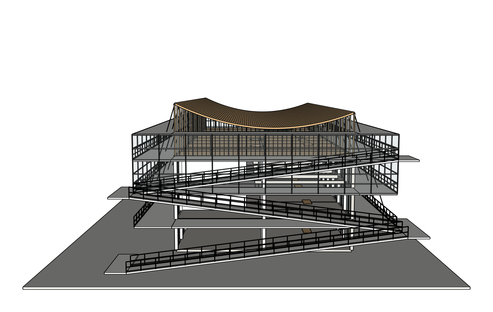
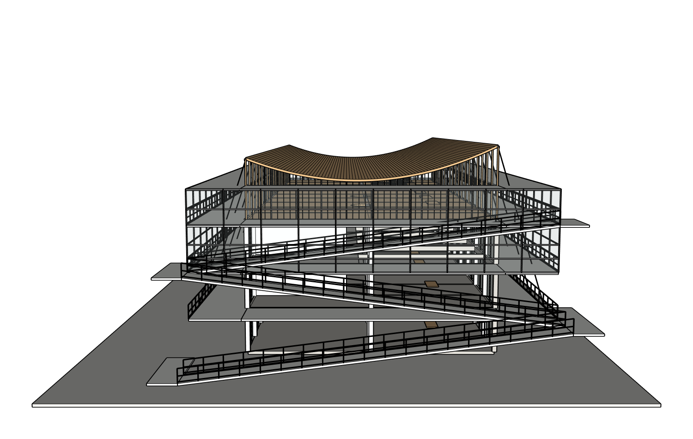

# 独立审查与实际视觉结论

总体 **PARTIAL / 整栋原图保真 FAIL**。本轮修复的是原生交付和一次屋顶方向修改，没有修复所有原图差异。

| 验收项 | 结果 | 真实证据与限制 |
| --- | --- | --- |
| 历史 r1 保存前阶段 | BLOCKED | 当时未保存原生深层指纹，不补造 |
| 原脚本确定性重放 | FAIL | 顶层逃逸容器在原生重开后变空；root SHA 相同却整文档 SHA 不同 |
| 修复后受控重放 | PASS | 父组先建，保存前/绑定副本重开/候选重开深层一致 |
| 原项目安全副本 r1→r2 | PASS | 按真实反向矩阵恢复已有构件，网站下载后原生重开一致 |
| 原图空间草图 | 按委托复核 | 右高左低、三段短端投影向左上升；环廊返回路线及层号仍为推定；不是 OWNER_CONFIRMED |
| 真网站 r2→r3 局部修改 | PASS | 一句自然中文、一次提交，屋顶及拉索方向改变，曲面保留 |
| 未涉及构件保护 | PASS | 119 条路径完整递归几何/材质 SHA 和 PID 不变；与 bounds-level KEEP 分开记录 |
| 本轮 SKP 下载重开 | PASS | 真实按钮下载、SHA、保存前/绑定重开/下载重开均深层一致 |
| 原生鼠标编辑保存重开 | PASS | 额外下载副本中单选屋顶向 +Z 移动 390mm，Ctrl+S，换文件名重开一致；其余 26 顶层组不变，未替换网站 r3 |
| 最终 r3 两次 blank replay | NOT_RUN | 未将受控原脚本/父组优先重放冒充最终模型 blank replay |
| 原版 Codex 对照 | BLOCKED | 传输沙箱、额度中断、随后新增受保护 MCP 要审批但策略 never；零几何提交，不做优劣排名 |
| 整栋还原 | FAIL | 屋顶中央净空、坡道连接/方向、双层高与环廊构造仍不符 |

真正独立 Critic 为新建只读上下文，实际 `gpt-6.1-sol / medium`，没有 writer tools。r2 前审查耗时 60,875ms、63,556 输入 / 751 输出；r3 后审查耗时 202,406ms、67,600 输入 / 686 输出。报告 `critique.json` 对 r3 仍为 `needs_fix=true`。

Critic 确认来源匹配端视图中的屋顶凹曲线及更高右端应保留，同时指出坡道落台、室内挑空、透明格栅环廊的差异。其文字把部分坡道称为 alternating flights，与本轮八图空间草图的短端投影关系并不完全一致。此为真实审查的不确定/投影解读问题，保留原文，不当作修改全部坡道的授权。用户本次要求仅屋顶，因此没有跟着 Critic 自动扩大修改范围。

从实际前后同机位图看，左高右低已成为右高左低；原曲面形状、条状木构、玻璃框架和已有坡道都保留。中央屋面距离外层围护顶线仍偏近，不能称为已经还原原图。玻璃栏杆和实心灰色环廊也不具有原图轻型钢格栅的开放感。数字一致证明交付没有再次变化，不证明建筑像原图。

修正前 r2：

网站修改及原生重开后的 r3：

## 执行差异与产品优化

网站本次局部修改实际用时 536,656ms，52 个工具调用，3,431,345 输入 / 7,112 输出 token。原版 CLI 各失败尝试已报告输入小计 1,033,925、输出 2,220；额度失败阶段未报告最终用量，记 null。两边未完成同样的模型执行，不能用这些数值宣布某方更好。

已经证实的一项成本问题是独立 Critic 的图片列表重复附加同一个 current PNG：最终实际列表 25 个图片项含重复来源配对图。代码现在对同一个已验证路径只附加一次图像，并保留每个来源配对标签；全部原图和不同视图仍存在。这个补丁仅完成离线回归，真实后补丁 Critic 未运行，未宣称节省了多少 Token 或提升了保真。

网站还修复当前项目草图的安全显示、继续修改时保留旧候选 SKP、阻止跨父级重组及顶层逃逸实体。没有增加另一套几何引擎，也没有以更多 Prompt 或全建筑生成次数解决质量问题。

Claude 既有独立报告提出显示、变换/ADAI 和空间方向候选解释，未接触私有原图或本轮原生实测。显示层解释在实际层可见/无剖切证据下不能说明空组；本轮确定性重放证实跨父级重组才是交付失真的具体原因。没有新增 Claude API 调用。
