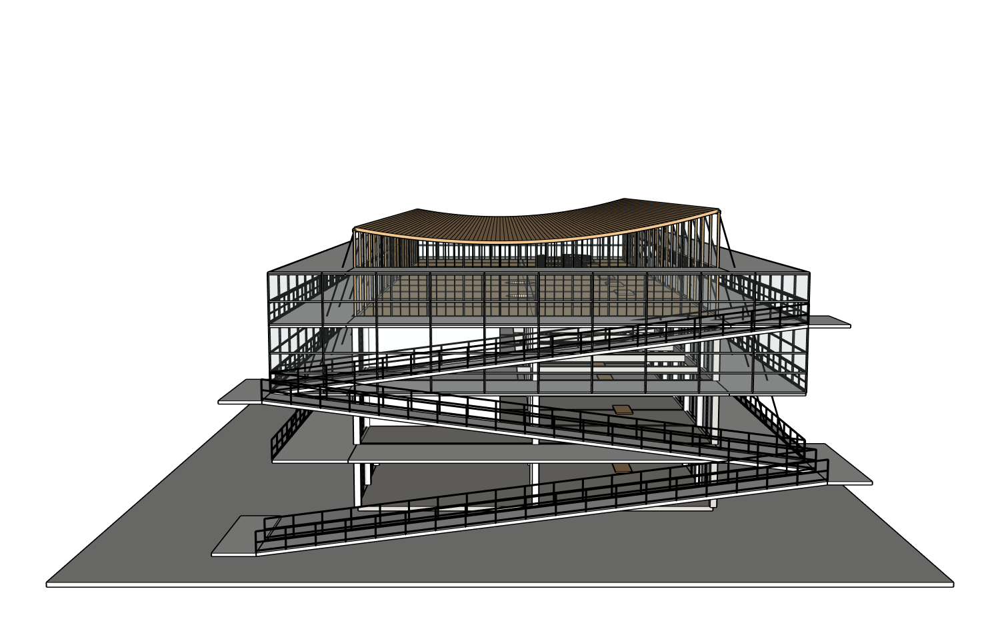

# 同八张整图、同项目 r4：屋顶净空局部修改与交付验证

**尚未全任务通过：原生交付 PASS、深层保护 PASS、屋顶方向保留，整栋保真仍 FAIL，总体 PARTIAL。** 原项目 architecture-project-4f0e4、根20606、原始r1和八图不变；本轮先备份r3项目完整资料，再通过真实网站 Sol6.1 Medium 修改到r4，没有新建筑或全栋重建。

用户明确继续后，网站收到一句普通中文：“屋顶左右高低已经对了，但中间压得太低。请对照原来的剖面图调整屋顶下方的净空，保留曲面和正确方向，坡道、楼板、玻璃及其他部分都别动。” Agent识别屋顶与端部玻璃连接会产生缝隙，因此先询问，无几何提交；由外层按用户委托澄清关联玻璃上缘/边框可随动，其他部分保护。这个澄清是测试控制者判断，不伪造原用户新的亲自确认。

一次实际局部写入将曲面中部约抬高1m，保留既有端缘高度差，调整端部玻璃上缘和边框顶部。原生测得顶层最低净空3.9763m、相对环廊顶线的高度差1.2763m；图像估算不等于原图实测。74条保护路径递归SHA/PID不变，非屋顶26个直接组完全保持。详见 model/keep-results.json 和 native/clearance-landmarks.json。

写入后的900秒超时中断被如实保留。现有开发启动脚本改为3600秒等待，实际进程白名单环境读取确认 Token/工具四项设置仍全部0不限，历史累计没有清空。真实网站随后一句“不要再改模型，只检查和保存”完成只读恢复。模型身份、八张整图顺序、真实耗时和Token在 turns.json / metrics.json 中。无外层模型切换、无付费API。

交付：真实受控保存前深层采集→绑定副本全新文件名原生打开→实际网站点击下载所得文件全新文件名原生打开，整文档/根/呈现指纹均相同。下载SHA也匹配。浏览器下载事件接口超时，但真实下载已发生，失败及文件核对同时记录；不是用直接HTTP请求冒充用户下载。原生结束时恢复绑定工作文档。原始r1历史保存前证据仍缺失BLOCKED，r4严格空白重放NOT_RUN。

实际独立只读审查仍 NEEDS_FIX，主要是坡道与落台关系、过重的围护线条/结构层次，内部与所有接缝未认证。不能把运行库测试、文件一致或4m估算目标说成整栋原图建模成功。下一步是同案例源图局部质量与条件对照，不增加CAD、渲染、漫游或PPT。

原版Codex对照的先前实际错误是“MCP tool call requires approval, but approval policy is never”。本轮未重复相同失败调用，也没有取消审批。已准备单一工具、仅对照进程内的授权方案供用户明确确认，保留安全r2对照副本/单写者/范围/KEEP/身份验证；此授权尚未执行，不做A/B排名。官方 per-tool 配置依据：[OpenAI MCP 文档](https://learn.chatgpt.com/docs/extend/mcp)。

本轮19项相关Python回归通过；这些只验证运行库、用量与Critic代码，不是原生质量证明。公开包仅包含真实模型输出图、草图和脱敏派生回执；私人八图、SKP、账号、密钥、完整对话日志未上传。

## 外部能力吸收结果

| 候选 | 选择与理由 | 实际调用 | 结果 |
|---|---|---|---|
| ProjectRuby/Kongxing | 原生单写者及只读深层验证，沿用既有连接 | 网站局部写入、保护、截图、保存及深层读回 | 原生三阶段PASS，保真FAIL |
| ADAI/SAIE | 本轮曲面变形保留既有网格，不重新挤出 | 本轮局部0 wrapped calls，真实ledger保留 | 不伪造采用或视觉PASS |
| 独立 Native Critic | 原八图与r4六视图，新只读上下文 | 真实Sol6.1 Medium | NEEDS_FIX |
| Claude既有审查 | 阅读既有报告，按证据核对假设 | 本轮未新增Claude推理 | 延续P0与空间核验，未扩张 |
