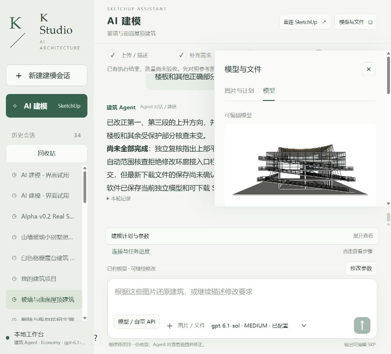
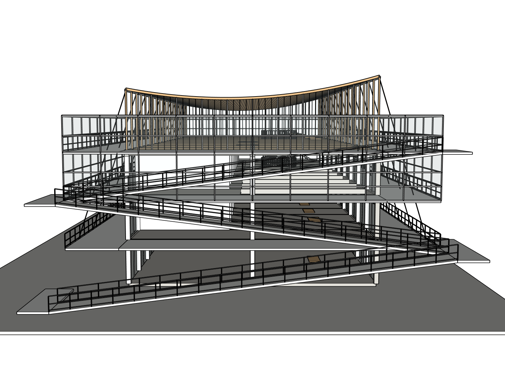
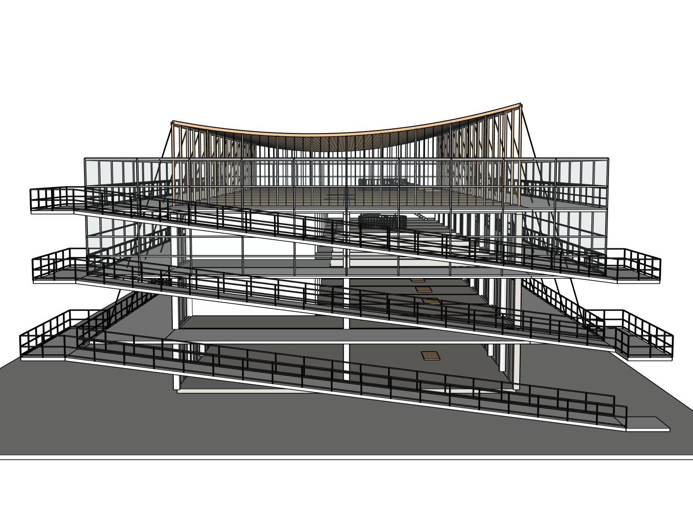

# 客户交付攻坚：真实网站 r4→r5 局部修复（2026-10-15）

**本轮有真实几何进展；整体仍PARTIAL，不能交付客户。** 所有者已授权按规划持续解决问题；新的[执行任务](../../../NEXT_CUSTOMER_READY_SAME_CASE_2026-10-15.md)取代旧斜撑条件。当前阶段不再因“斜撑不是错误”停止。保持同八张原图、同项目、root20606；原始r4与完整项目先备份，网站改的是原生指纹完全相同的安全工作副本。

## 实际改了什么

通过真实网站发送一句普通中文，实际App Server返回gpt-6.1-sol/medium。第一次调用错误脚本ID被拦，随后补齐源图配对；第一次writer含erase_entities被拒；后续扩大父组范围被host授权拒并原生事务aborted；最终改成十条精确目标路径，成功提交一次r5。

- 第一、第三跑从-Y上升调整为+Y，三跑现在同向，符合源图01端景；第三跑还移到现有环廊外侧避免占用其平面。
- 对应平台与自身栏杆在原容器内修改；第二跑、屋顶、玻璃、楼板、结构及GALLERIES保持。
- writer/KEEP通过；**独立原生路径快照保护SHA相等**。自动保存/原生写入后的GUID变化经真实path/root/project/revision核实，未盲目忽略UUID差异。见[r5路径审计](r5-path-audit-final.json)。

## 为什么还没有通过

独立Critic对八张原图及r5当前视图判NEEDS_FIX：上部坡道/平台外挑比例仍偏大、细网格护栏缺失、小圆洞未全部围护。原有固定环廊栏杆仍挡接入口。**原生射线进一步发现三处上层接入口的连续玻璃也挡通路**；校正起点到平台内部后30条样本射线仍24条受阻，不能把平台端点接触说成路线可用。

现已单独进入下一轮精确叶构件接入口修复；它没有混写到这个r5验收。后续还须处理有证据的局部玻璃开口、源图格栅和其余实际缺项，保留未知与估算。路线射线仅是局部几何探针，不是完整导航/规范/结构认证。

## 保存、下载与原生验证

实际点击网站“下载SKP”，取得agent-checkpoint-700e6c420f74.skp，与网站候选文件SHA一致。原生live、保存后bound重新打开、实际下载副本重新打开，深层三阶段一致性PASS；恢复工作副本成功，原r4字节c337d2bc…完全未变。详见[原生交付记录](r5-delivery-verification.json)、[原始JSON压缩索引](native/compressed-index.json)、[两个实际SKP](execution/models/)。

为保证阶段诚实：live指纹在**本轮受控host验证保存之前**采集，时间晚于网站首次自动检查点；不冒称网站首次保存前已经采集。网站建模/自动保存和实际浏览器下载是真实操作，host保存/打开是后续原生诊断。严格空白重放仍NOT_RUN，保真FAIL仍保留。

## 证据与耗时

六张当前r5认证视图在[views](views/)，八图同方向/室内图及sidecar、前后原生/KEEP、Ruby候选与失败/成功记录、独立Critic、原始事件与上下文在[execution](execution/)。[原八图/历史SKP与完整旧记录](../../../test-assets/architecture-project-4f0e4/README.md)，[r4源图对照](../2026-10-15-eight-source-r4-quality-diagnosis/README.md)。

Builder实际1,002,797ms（约16.7分钟），91次工具调用/5次失败，6,664,107输入、19,554输出tokens。独立Critic另计（最后一次59,442输入/811输出、243,531ms），原始其他审查事件一并保留；不是付费账单金额，外层tokens未知。耗时/Token仍过高，是后续客户可用性必须解决的问题，没有重新启用本地cap。付费API0，无原版CLI重复对照。

本轮结论：局部修改PARTIAL；构件保护PASS；原生交付一致性PASS；整栋保真FAIL；严格重放NOT_RUN；客户交付NOT_READY。目标继续推进，不以这一中间提交宣布完成。

## 实际修改前后同机位对照

八组source-matched视图的已记录实际相机参数8/8相同，原图镜头内参仍未知；不宣称摄影测量标定。全部路径/相机见[r4→r5配对表](r5-actual-camera-pairs.json)。

| r4实际修改前 | r5实际修改后 |
|---|---|
|  |  |
