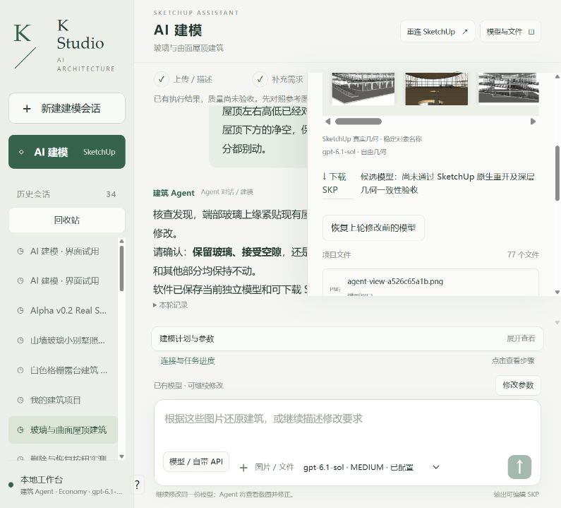

# 客户交付攻坚：r6 入口栏杆与共享组件保护

**中间结果 PARTIAL，客户交付 NOT_READY；Codex继续执行。** 同八张原图、同项目、原r4不覆盖。实际网站一句中文要求只打开必要接入口，真实Sol6.1 Medium提交r5→r6一次；五处栏杆接入口打开，远处185根立柱、坡道、平台、玻璃等保护检查通过。[作用域审计](r6-path-audit.json)。

原生平台内部射线：修改前24/30受阻，r6为18/30，剩余全部为三处上层入口连续玻璃；下层栏杆障碍已消除。这个样本证明局部改善，不代表完整通行或规范验收。独立Critic仍NEEDS_FIX：入口玻璃/边框阻挡、室内空间边界不足、圆洞缺围护；源图比例仍须修正。

真实浏览器下载agent-checkpoint-d064364f5b94.skp，原生controlled save前、bound重开、实际下载重开深层三阶段PASS，恢复工作副本、原r4不变。[原生记录](r6-delivery-verification.json)，[真实SKP](execution/models/)。live基线晚于网站首次自动保存，早于后续受控host保存，未伪称首次保存前证据。

## 进一步安全验证

为了下一步只修改真实两扇共享玻璃模块，修复guard对make_unique的误拒：只排除共享定义引用数/GUID这类记账字段，保留全部几何/材质深层SHA、容器PID及祖先/其他实例保护，版本v2。复用原生helper增加clear_owned_contents，清内容保留容器、必须属于已批准范围且所有祖先/目标唯一且解锁；原始erase接口仍禁用。公开已有只读batch inspection，每次最多48条，避免几十次独立模型推理。

**真实SU2024一次性副本上的集成测试**（不冒称网站成功）：

- 先移动允许的坡道，再偷偷改保护屋顶材质，bounds/counts不变：deep fence拒绝，整事务回滚，前后整文档深层一致。
- 不make_unique就修改共享玻璃定义：其他实例改变被发现，整事务回滚，整文档一致。
- 仅指定NORTH_BAY_0先make_unique，再唯一化其玻璃，调用受控清内容后重建并移动100mm：v2保护PASS，其他实例未变。此实验仅在故障副本产生测试r7，已恢复真实工作r6；不得把它算作网站r7或质量改善。

完整[故障测试](fault-probe/results.json)、原生前后压缩数据/成功失败Ruby/真实批查回执均保留。31项针对性Python测试通过只是工程回归；真实建模质量仍FAIL，严格重放NOT_RUN。

Builder实际2,888,765ms（约48.1分钟）、82工具/2失败、4,534,608输入/9,358输出；最后独立Critic406,828ms、67,744输入/685输出，详见原始事件和[metrics](metrics.json)。耗时明显不够客户使用，尚不能宣传产品可交付。未付费API、未重复原版CLI、外层模型未变、本地cap0。

[前轮r5](../2026-10-15-customer-readiness-r5-circulation/README.md) · [公开原八图与完整历史](../../../test-assets/architecture-project-4f0e4/README.md) · [持续执行任务](../../../NEXT_CUSTOMER_READY_SAME_CASE_2026-10-15.md)。下一步先精确处理两个端部窗格内的必要局部门洞与横框，保留未知尺寸估算，再验路线及源图。
