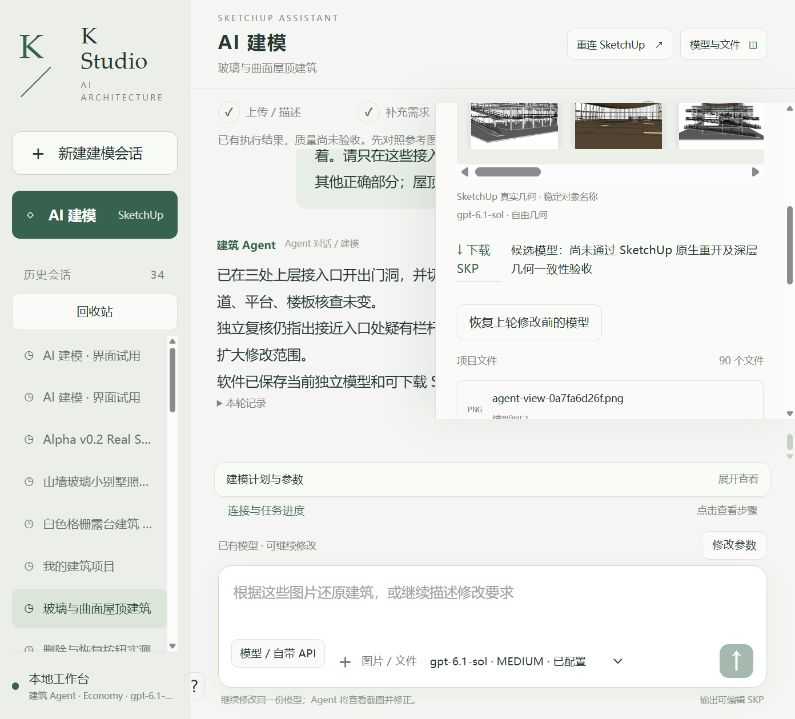
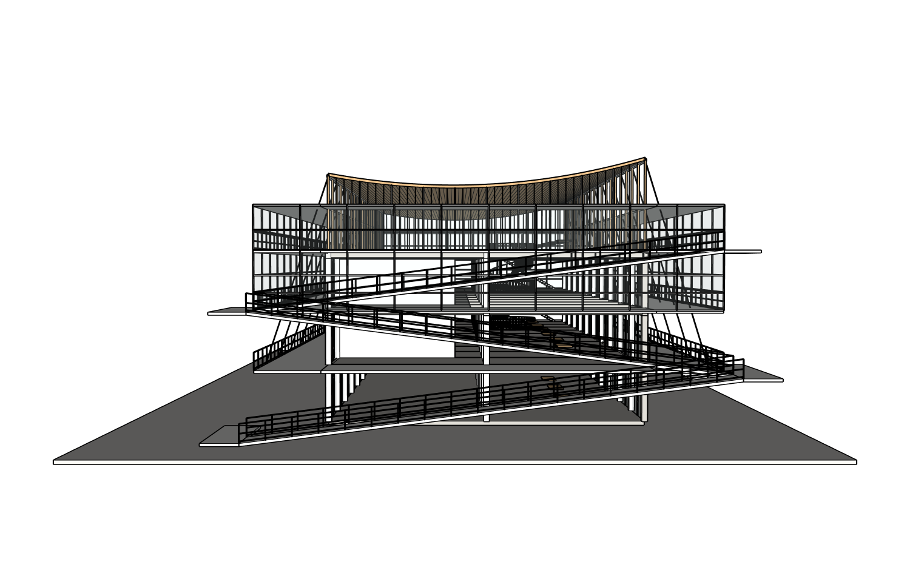
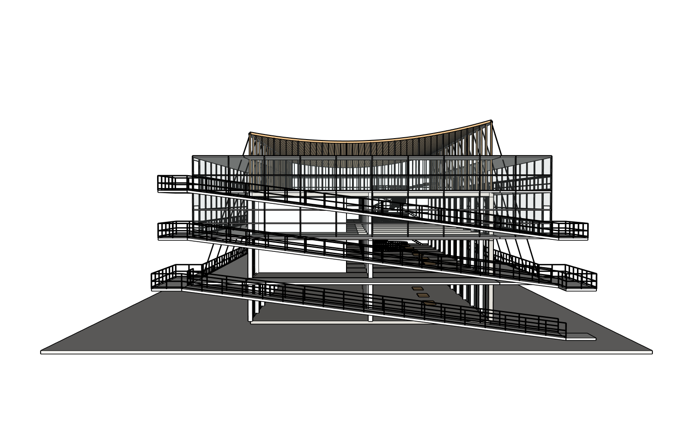

# 客户交付攻坚：r7 三处玻璃入口与相机证据更正

**局部门洞修复PASS；整体仍PARTIAL，客户交付NOT_READY，持续执行。** 同八张整图、同项目/root20606、原r4未覆盖，真实网站普通中文、实际Sol6.1 Medium，在两个已验证窗格模块内提交一次r6→r7。先make_unique再只清理必要内容，三个门洞及穿洞横框改为实际估算2200×2400mm；不是原图实测尺寸，早期准备值2200mm高度随后由Agent取2400mm，已按实际值验收。

## 已证实的改善

- 三个上层玻璃入口打开。原生180条样本射线中，三个门洞内横向五个位置、离地20/100/1100/1800/2300mm，**75/75无遮挡**；旁边保留玻璃18/18仍挡住，门头上方2500mm的15/15仍挡住。旧30条样本从18受阻降到6，剩余6都在门洞外保留玻璃，不是该门洞失败。详见[门洞审计](r7-door-aperture-audit.json)。这不是整条路线或规范认证。
- [v2精确路径原生保护](r7-path-audit.json)前后SHA相等。两个窗格容器PID稳定，全部其他模块保持；窗格内部未涉及的竖框、窗顶横框几何材质也逐项不变。make_unique可能复制目标模块内子实体PID，不冒称这些内部PID都未变。
- 实际浏览器下载62baaa4cbb6d检查点，保存后工作副本与真实下载副本SU2024重开深层三阶段PASS，[原生记录](r7-delivery-verification.json)、[两份SKP](execution/models/)。仍是网站自动检查点之后的受控保存基线，不补造首次保存前证据。

## 发现并更正相机证据错误

r5旧配对表的before_camera和after_camera均为null，旧“8/8相机一致”实际是null==null，**旧结论撤回**，原错误表保留，r5 README已更正。这个错误不改变各自真实原生几何、KEEP和交付结果，但旧截图不能证明同机位。

产品现在读取SketchUp实际eye/target/up、透视/FOV、正交高度、aspect及文档身份，在截图前后核对；缺字段、变焦或身份变化均不能标为相机已核实。原来通用导出默认zoom_extents可能重设刚选的参考相机，现默认保留相机。回归覆盖null/null、FOV变化、NaN、视点和文档变化。

另外已重新打开保存的r4/r5/r6/r7，按八组相同相机各拍一次，32张实际PNG、前后原生相机回执、24对非空实际投影/相机参数相等，模型前后深层不变。[真实配对表](verified-camera-comparison/camera-pairs.json)。这是**新的受控历史版本重拍**，不是声称当时修改前已录下这些相机。八组包含室内/入口/细部视点；原八张图继续全部审查，照片真实内参未知，不宣称摄影测量标定。

| 保存的r4重拍 | 保存的r7重拍 |
|---|---|
|  |  |

## 目标模块内部的保护也做了真实故障验证

复用现有深层collector增强KEEP，检查目标父组内部明确保护的子构件；相同PID/数量/包围盒而材质或几何改变也要在原事务提交前回滚。host授权可强制required_preserve_paths，不能由Builder省略。

真实r7一次性副本两次负向测试：[deep KEEP](deep-keep-probe/result.json)与[host强制子构件保护](host-required-keep-probe/result.json)。先改变允许玻璃，再改同父组内受保护竖框材质，前者由深层KEEP拦、后者即使Builder不给KEEP也由host强制拦，整文档回滚相等，工作r7恢复。还修复没有旧KEEP时失败候选会留在主Ruby文件的代码问题：失败源码归档并恢复上一份，真实负测已验证。并非网站新版本或质量PASS。

工程回归212项、补充21项通过；真实建模仍按下面失败结论处理。

## 仍然失败，下一步怎么修

独立Critic仍判源图FAIL：上面两跑在模型里外露，源图中应位于外层玻璃屏之后；平台过度外挑。需要一次有明确关联范围的局部调整，连同必要的环廊板槽/平台接续一起验证，不能再仅移动坡道使其穿板。三个门洞内并未证实Critic所疑的栏杆障碍，不据此多切正确栏杆。

室内局部楼板/挑空与真实剖切正反注册仍有疑点。另一次新鲜独立只读八原图事实核对确认原剖面中间层在画面右、挑空左；图片7中间平面上半左段无板，但不能唯一证明所有图的正反映射。保留UNRESOLVED，不盲目镜像楼板或删除梁。圆洞缺网状围护、外廊实板应为格栅也仍待修。真实固定室内视角已保留，不能只凭旧未核实相机的低顶截图宣布全楼板错误。

严格空白重放仍NOT_RUN；现有整栋基线Ruby尚未随所有局部修改更新，含旧regroup写法及硬编码编辑PID，必须修复可重放来源再做真实两次空白验证。独立付费服务与干净客户安装未验收；没有客户交付PASS。

Builder485,297ms（约8.1分钟）、63工具/1失败、4,951,293输入/9,311输出；最后独立Critic253,203ms、59,894输入/802输出。另源图事实核对76,969ms、31,101输入/1,114输出、工具0。[实际指标](metrics.json)。外层未知不填0，没有付费调用、重复CLI或重置旧用量。

[原八图与完整历史](../../../test-assets/architecture-project-4f0e4/README.md) · [r6证据](../2026-10-15-customer-readiness-r6-gates/README.md) · [持续执行任务](../../../NEXT_CUSTOMER_READY_SAME_CASE_2026-10-15.md)。
