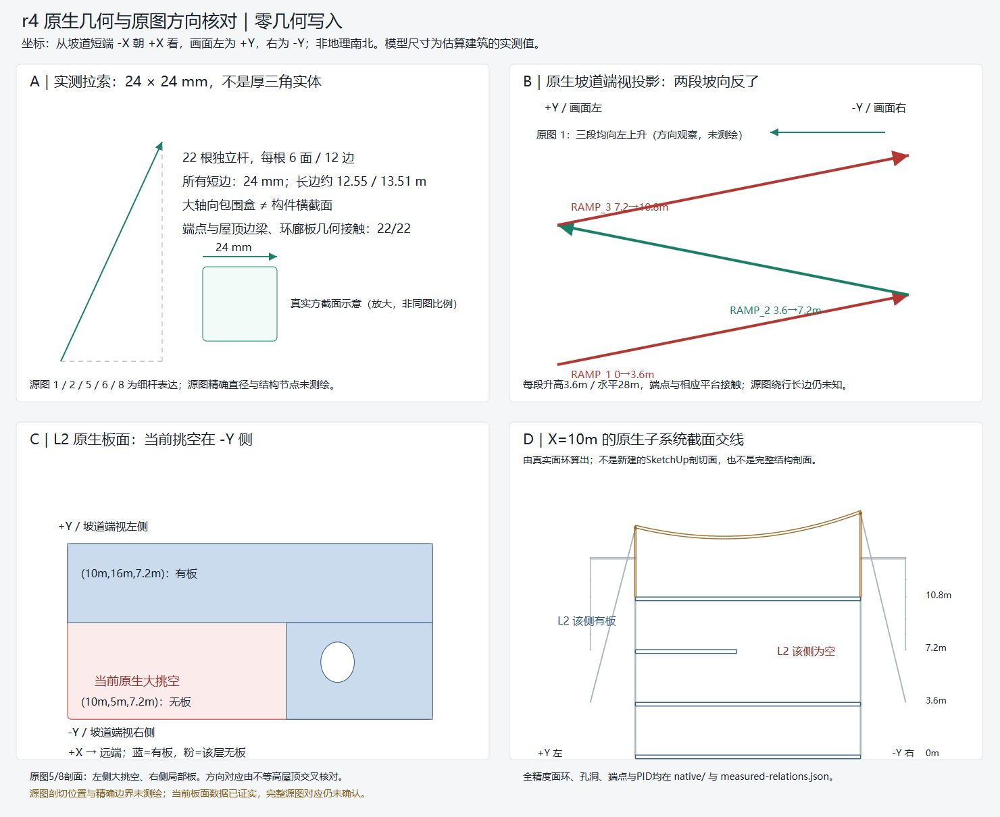
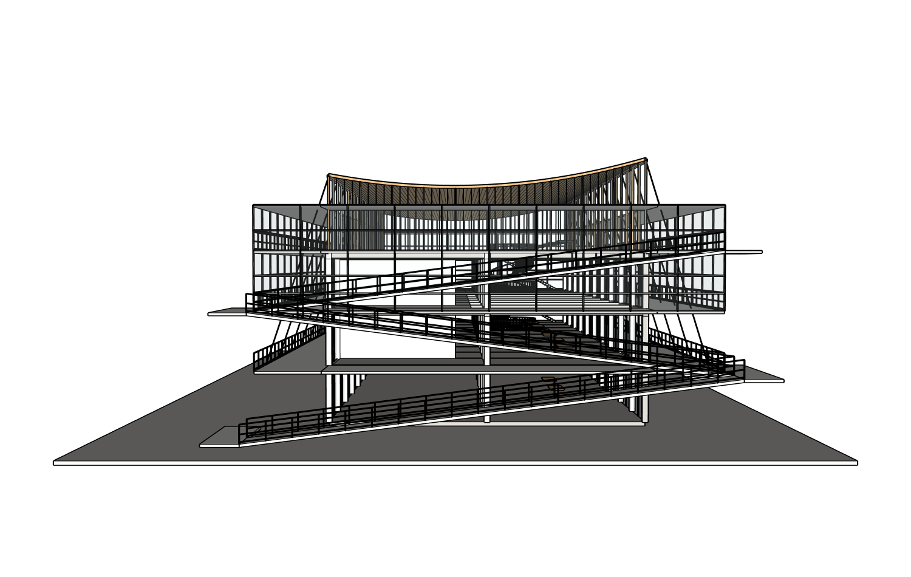
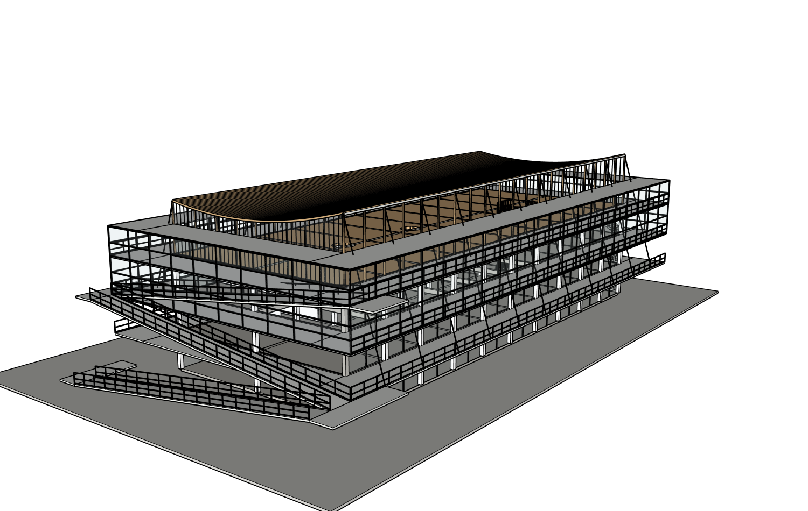
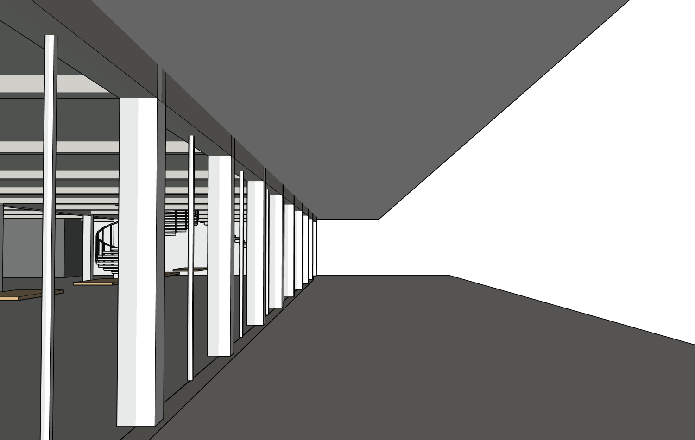
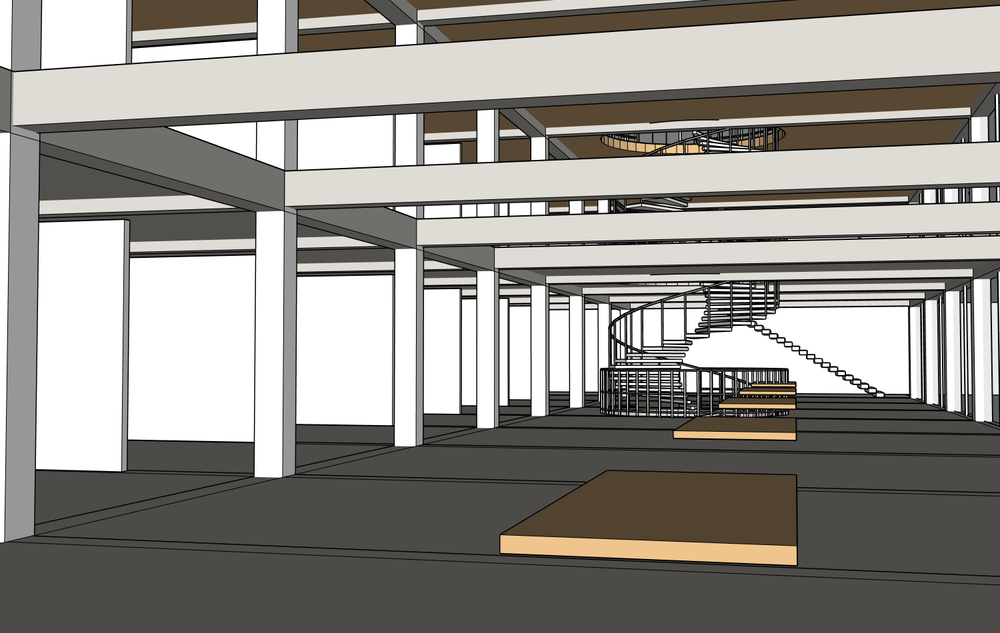

# 八图建筑 r4：只读质量诊断（2026-10-15）

**诊断完成；未修改模型。整栋源图保真仍FAIL，整体PARTIAL。** 原先“厚三角斜撑”的修复前提不成立，故按任务门槛结束只读分支，没有偷偷改修其他构件。

- 原项目 architecture-project-4f0e4；八张整图SHA/原顺序逐张核对，[源图清单](source-manifest.json)、[原图/SKP/完整历史资料](../../../test-assets/architecture-project-4f0e4/README.md)。完整项目、原SKP、下载版本、原图和记录已先复制备份；原件未改。
- 真机SU2024 **24.0.484**；GUID `e28c67a2-edd5-4af0-bcbd-b434ffa5a2d5`；根PID **20606**；r4。当前文件名虽含r2，内容由状态/原生身份确定为r4，不能按文件名猜版本。
- 原始路径 `runtime/projects/architecture-project-4f0e4/outputs/model/blank-disposable-p0-repaired-r2.skp`；安全副本 `blank-disposable-r4-quality-diagnosis-20261015.skp`。[本轮安全SKP](model/r4-safe-copy.skp)与原文件同字节SHA **c337d2bcc36922167da85be070463988bd9622b6c43bb402d2ce8d2151ec63db**。
- 安全副本初次、诊断后、恢复原网站绑定文件三次整文档几何/材质SHA全部 **b3fb8fbde6ae874a78570201b78dbd635072b9204ca9881c8972d189bfd14e10**。所有嵌套PID不变；122条现有host路径读回一致；根/文档松散面、边均0；无逃逸顶层组。见[原生压缩索引](native/compressed-index.json)、[检查记录](final-native-checks.json)、[恢复记录](restore-receipt.json)。压缩可用Python gzip解压，索引给出原始/解压SHA与字节数。

## 四系统差异矩阵

|系统 / 来源|实际发现、路径与数据|最终分类|
|---|---|---|
|拉索，01/02/05/06/08|ENVELOPE_OUTER(41319)/TENSION_BRACING(44694)，22根独立杆，各6面12边、截面24×24mm。长12.55/13.51m不是横截面；无厚三角网板。22根端点与屋顶边梁/外廊几何接触。源图精确索径/节点未知。|MATCH；原厚实体说法为PRESENTATION_ONLY误读|
|坡道/平台，01/02/03|RAMPS78998；三段PID78999/79027/79055。每段升3.6m、水平28m；从-X看+X，左=+Y。模型三段升向-Y/+Y/-Y，源图01三段均左高。**RAMP1/3相反，RAMP2吻合**。现有端点接平台，不代表源图路线正确；绕长边返回尚不明。|CONFIRMED_GEOMETRY_MISMATCH|
|轻型围护，01/02/03/06|ENVELOPE_OUTER41319；玻璃alpha0.13、框料短边60mm、白色钢材；粗粒度双层关系吻合，密黑线不证明厚实体。另：CIRCULATION_EXTERNAL/GALLERIES实际是6面实板，原图03廊下可透光格栅，是另一个真实几何差异。|围护观感PRESENTATION_ONLY；外廊实板CONFIRMED_GEOMETRY_MISMATCH|
|楼板/室内，04/05/07/08|FLOORS76290；L2局部板76635/76663，高7.2m，-Y侧确有大挑空。源剖面显示左空右板，但切位/平面完整注册未知，不能直接翻楼板。Critic指出室内V杆、小圆洞网栏可视缺项；完整构件对应待定。|UNRESOLVED（保留局部可视缺项）|

上述毫米数都是**当前估算模型的实测值**，不是源建筑测绘。端点接触不是结构安全或节点构造认证。详细世界坐标、端点、面环/洞口、材质和检验依据在[measured-relations](measured-relations.json)、[完整原生面环几何](native/geometry-topology.json.gz)、[机器可读诊断](diagnosis.json)。

## 原图与实际模型对照

以下保留原图整张，不裁掉其他分图。模型按屋顶不等高端、坡道端部及内部地标人工匹配观察方向；原始相机内参/镜头未知，**不是像素级相机标定**。每张模型图有实际相机和revision4 sidecar。六张当前近景[标准视图](views/)与首次较远取景[原始记录](views-wide/)均保留；没有新AFTER版本。

| 原图01（完整） | 实际r4同方向观察 |
|---|---|
|  |  |

| 原图02（完整） | 实际r4同方向观察 |
|---|---|
|  |  |

| 原图03（完整） | 实际r4同方向观察 |
|---|---|
|  |  |

| 原图04（完整） | 实际r4同方向观察 |
|---|---|
|  |  |

入口、上层室内、拉索截面/连接、坡道节点及平面另见[matched目录](matched/)。源图05/07/08与楼板拓扑的注册局限见差异矩阵；未伪造不可确定的精确重合对照。

## 为什么没有执行斜撑修复

第一，厚实斜撑这一事实前提被原生几何否定。第二，真实斜撑是**嵌套路径**；新增直系根组作用域审计实际[BLOCKED](native/scope-audit.json)，不能通过扩大到ENVELOPE_OUTER或移动/改名来强行通过。本轮不需要写入，不为错误前提新增路径写者。将来如批准嵌套修改，必须先补可靠路径级保护与负例，再另定写入任务。

独立Critic也会犯错：[原始审查](review/critique.json)曾误把源坡道说成交替；[新的八图源图复核](review/source-ramp-factcheck.json)纠正，[最终裁决](review/review.md)保留错误记录，不盲从模型建议。

## 验收分项

|项目|本轮状态|边界|
|---|---|---|
|DIAGNOSIS|PASS|同八图、实际r4、零几何写入的证据诊断完成|
|SOURCE_FIDELITY|FAIL|坡道方向、实板外廊等仍与来源不符|
|SCOPED_EDIT|NOT_RUN|门槛未成立，无r5、无新Builder提交|
|PROTECTED_GEOMETRY|PASS|仅只读前后深层/全部PID/松散几何不变；新写入事务KEEP NOT_RUN|
|DELIVERY_3_STAGE|NOT_RUN|本轮无新保存/下载/三阶段；[历史r4交付PASS](../2026-10-14-eight-source-r4-clearance/README.md)原结论保留|
|STRICT_BLANK_REPLAY|NOT_RUN|未另测，不用深层只读相等代替严格重放|
|WEBSITE_POST_PATCH|NOT_RUN|本轮只真实重连成功，未发建模对话；新instruction-root下建模仍未测|

原文件已通过新鲜原生Open对话框恢复，网站真实重连成功；没有把路径输入Codex聊天、没有创建新案例/换八图/改变外层模型。实际独立只读审查为gpt-6.1-sol/medium，两次输入89,747、输出1,957 tokens，审查延迟239,031ms，工具0；Builder调用0、几何写入0、SKP保存0、付费API0。全程外层tokens/完整工具总数不可得记null；22张真机模型截图、122路径读回。原始新事件在[execution](execution/)，无认证容器；[metrics](metrics.json)、[错误与恢复](errors.json)。此前历史保存前缺证BLOCKED、源图FAIL、原版对照及原生恢复结论均未改写。

现有新增作用域脚本8项合成测试通过，只是技术回归；它在真实嵌套目标上仍按预期BLOCKED，绝非建模质量PASS。诊断helpers在[diagnostics](diagnostics/)；不新增网站产品功能。

**下一步最值得修：RAMP1/3的真实坡向及相应转接关系。** 先核清完整返回廊道和可保护的精确构件，再单缺陷局部调整；不要整栋翻转、三段一并反向或顺手改全部楼板。本轮按只读分支结束，不自动执行该新写入任务。
