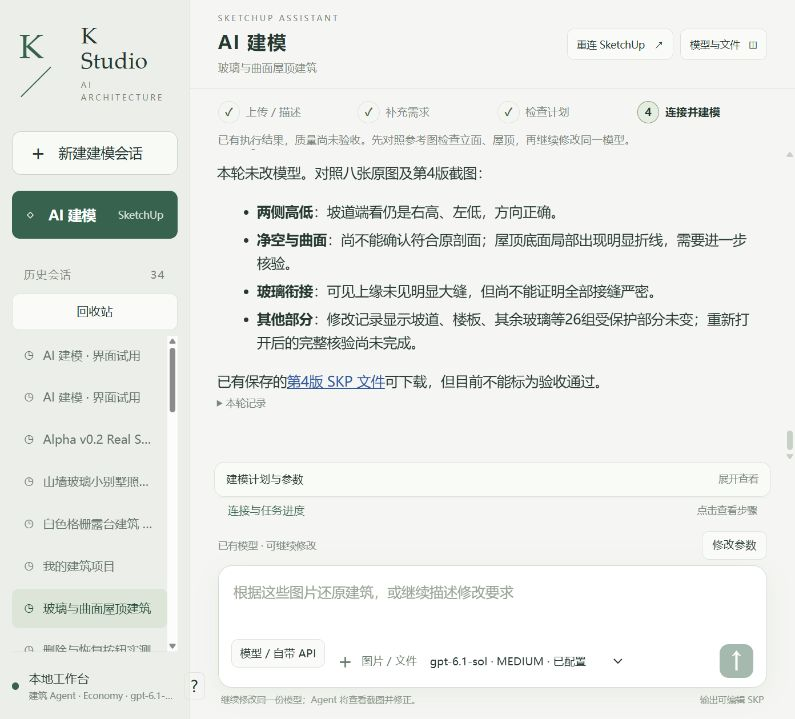

# 同八图 r4：继续诊断与精确路径保护修复（2026-10-15）

**代码保护缺口已修；没有修改建筑几何。整体仍PARTIAL / 源图保真FAIL。** 所有者先要求继续解决剩余问题，随后再次给出完整任务书，明确“斜撑并非确定问题则只读诊断，不擅自切换其他几何目标”。本轮遵循最后这条具体门槛。没有因旧文档停止必要工程工作，也没有用笼统“继续”覆盖新近的写入条件。

[前轮完整四系统诊断、原图配对、22张真机截图、方向剖面、r4 SKP及原始独立审查](../2026-10-15-eight-source-r4-quality-diagnosis/README.md)已在a9b9d73公开，属于本轮不可改写的基线；[八张整图/六个SKP/完整历史](../../../test-assets/architecture-project-4f0e4/README.md)。本轮不重复推理、重建、CLI对照、下载旧文件冒充新AFTER。

## 这次实际修好了什么

检查生产代码发现：原先allowed_mutation_paths虽然接受嵌套数组，却仅取parts[0]做父组范围；原事务scope主要核对子数与包围盒，无法发现同包围盒内的材质或顶点变化。这是实际保护实现缺口。

- 新[路径保护器](../../../../app/path_scope_guard.rb)复用既有原生深层采集器，**只遮罩明确目标子树**，祖先自身几何/变换、同父其他构件、根/文档松散实体、外部顶层组保持受保护。保护以既有collector的精度/覆盖为限，不是结构安全或所有SketchUp元数据认证。
- [ProjectRuby](../../../../app/project_ruby.py)把完整路径传进原有同一事务，提交前比对；保留目标容器PID，不准删除后重建容器。所有edit均必须给路径，不能在没有Critic上下文时漏检。host命名空间禁止Agent Ruby直接调用。
- 工具说明、内置重建Skill及CI更新为同一语义，避免继续诱导Agent放大成父组。
- Python核心相关回归193通过、扩展保护契约58通过（两组有重合，不能相加报独立测试数）。Ruby1正例+12负例验证同包围盒深层变化、根松散面、文档散边、旁支、外部组、目标换PID、呈现/身份变化、重复/重叠/空路径都被拒绝。
- **SU2024实际只读预检通过**：同r4上两次真实精确路径snapshot相等，receipt为deep_exact_paths_v1。没有原生失败写入/回滚测试；该部分NOT_RUN，不能宣称新编辑成功。

## 坡道连接进一步查清了什么

源图01的三段可见坡道均向画面左上升，而原生RAMP1/3方向相反、RAMP2吻合。详见[实际端点/平台数据](circulation-connectivity.json)：

|原生平台|PID|实际Y范围(mm)|实际顶标高(mm)|目前连接|
|---|---|---|---|---|
|LANDING_L0|41191|24000…26200|0|RAMP1低端|
|LANDING_L1|41223|-6200…-4000|3600|RAMP1高端、RAMP2低端|
|LANDING_L2|41255|24000…26200|7200|RAMP2高端、RAMP3低端|
|LANDING_L3|41287|-6200…-4000|10800|RAMP3高端|

这是**当前模型内部折返连接**，不是原图正确路线证明。从-X看+X，左=+Y；此处“北侧/南侧”仅指模型坐标，不是已核定地理北。仅把RAMP1/3坡向翻过来会与现有平台错开；下一次真正修坡道需要同时限定相应栏杆、平台和返回路径，不能“把两根斜板翻一下”便宣布成功。原图完整绕行长边路线依旧UNRESOLVED，未凭空选择。

## 原生与网站复核

整项目再次备份于[备份收据](backup.json)。SU24.0.484，实际GUID与原网站session一致，根20606/r4。[本轮最终原生身份与不变检查](final-identity-and-no-change.json)确认：整文档SHA仍b3fb8fbde6ae874a78570201b78dbd635072b9204ca9881c8972d189bfd14e10，原SKP字节仍c337d2bcc36922167da85be070463988bd9622b6c43bb402d2ce8d2151ec63db。几何写入0、保存0，无r5。原生原始JSON以gzip无损公开，[解压大小及SHA](native/compressed-index.json)。目标路径只读预检不是写入许可。

真实网站以同项目重新加载、重连成功，配置仍gpt-6.1-sol / Medium、本地native token/tool cap0，外层Codex不变。无新的Agent消息/推理、无付费API；不虚报实际模型调用。[指标](metrics.json)对当前零调用和历史89,747输入/1,957输出分开记录，外层未知null。

|验收项|状态|含义|
|---|---|---|
|DIAGNOSIS|PASS|此前四系统及本轮平台连接补充|
|SOURCE_FIDELITY|FAIL|坡道、外廊与部分内部细节未修|
|SCOPED_EDIT|NOT_RUN|斜撑厚实体前提不成立；未切换其他写入目标|
|PROTECTED_GEOMETRY|PASS|只读前后不变；新写入保护验收NOT_RUN|
|DELIVERY_3_STAGE|NOT_RUN|没有新版本，保留历史r4交付PASS|
|STRICT_BLANK_REPLAY|NOT_RUN|未另测|
|WEBSITE_POST_PATCH|NOT_RUN|仅真实加载/重连PASS，建模仍未测|

当前仍最值得处理的是**RAMP1/3坡向及对应转接/返回关系**，其次为源图明确透空的外廊楼面；内部精确挑空注册应继续保留未知。按最新任务书不替换斜撑目标。本次完成了必要安全代码修复和只读补充，不将它冒充建筑质量已解决。原始失败与审查错误见[错误记录](errors.json)及前轮独立review。
