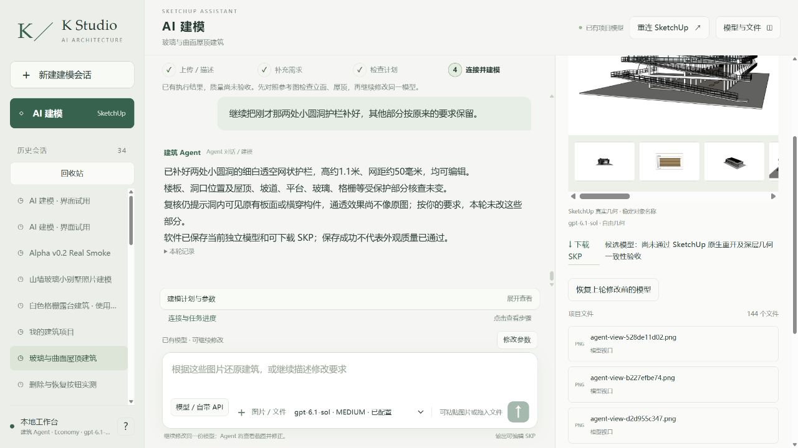
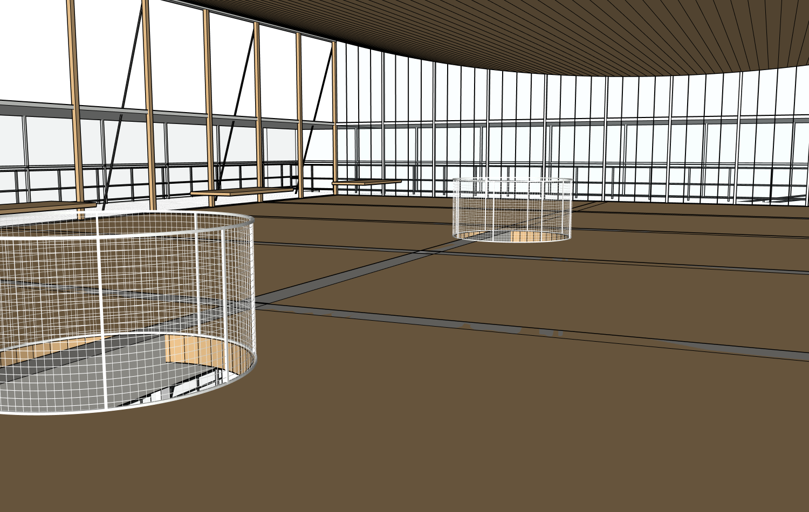

# r10 两处细网圆洞护栏：真实网站结果与原生证据

同八张原图、原项目/root20606，真实Studio普通中文、实际Sol6.1 Medium完成r9→r10一次提交。只新增CIRCULATION_INTERNAL/SMALL_CIRCULAR_VOID_GUARDS准确叶组，原有构件全部受保护。真实细白网距约50mm、线径3mm、高1100mm均为估计；两组可编辑。48/48透孔/网丝射线控制、576/576底部顶点与原楼板接触通过。不是结构安全认证。

[真实前后同机位证明](camera-comparison/camera-pairs.json)、[精确范围审计](native/r10-path-audit.json)、[原生采样](native/r10-small-guard-probe.json)。保护SHA5ea82028c115b4b85853406540ce8bee707bfe5df0485e3a4dfd44987f827cf2相同。初次因旧KEEP展开超限失败，修复后本次46工具/0失败，不隐去历史失败。

网站保存、实际浏览器下载、SU2024重开工作文件及下载文件全部完成。真实网站最终保存前已取得原生基线。[三阶段完整结果](model/native-reopen.json)明确并列：KStudioNativeStableGeometry/1声明精度契约PASS，原始全双精度严格SHA仍FAIL，不能宣称严格重放成功。真实下载SKP SHA4f178f0e1f0c7d5cc05ec2e175c04d62b4330c10784f38e7dfbde36981d59b31；原r4未覆盖，工作r10已恢复。[实际SKP](execution/models/)。

独立Critic实际使用八原图、六当前视角、8对来源对应图；准备计划的12对没有完成，覆盖标PARTIAL，保留host首次误设12对断言日志。剖面/平面对应图未剖切，不能证明隐藏内部。Critic继续指出上层平台外挑、粗横杆代替细网、圆洞疑似被既有构件横穿；最后一项尚不能直接归因楼板，必须辨认原生构件再改。

Builder4057525输入/5409输出、46工具/0失败、409844ms；独立Critic57132输入/755输出、201360ms另计。付费0，外层用量null，无本地流量上限。[实际用量](metrics.json)、[完整独立审查](review/critique.json)、[执行原始记录](execution/runtime/agent_events/82d7c3db707541f3a902a4e86940b359.jsonl)。

本轮只补了两处护栏，外部建筑尚未完整还原。后续所有者明确要求完整检查并补建外部、看不到处允许合理推断。之前逐轮冻结尚未完成外部的范围安排造成局部补丁停滞，不能继续把这种停滞当作模型无法建完的理由。
