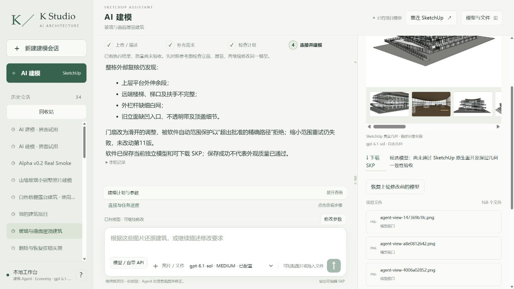
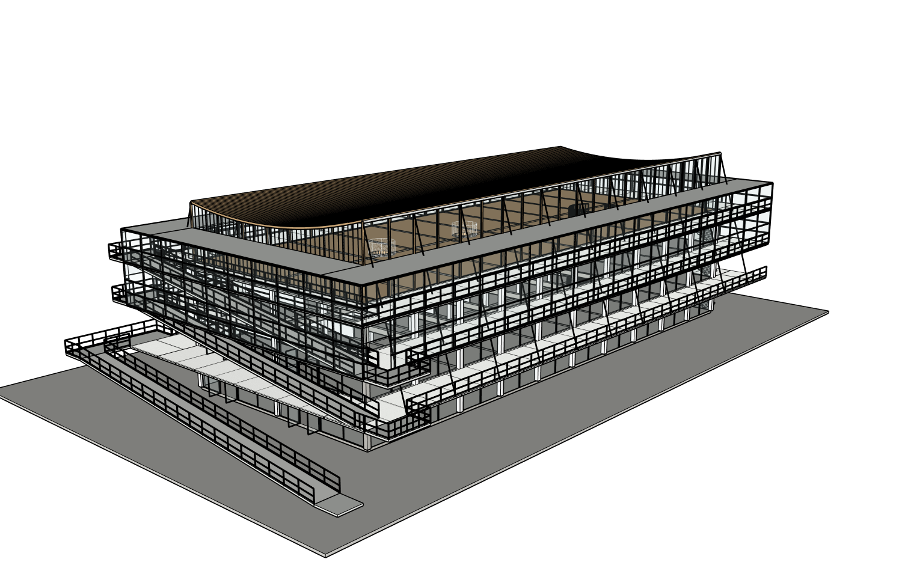

# r11：补齐缺失围护，确认后续真实问题并继续

同八张整图、原项目/root20606，真实Studio普通中文、实际Sol6.1 Medium完成r10→r11一次提交。新增顶层南北两条长侧窗、下部西东两端围护共四个可编辑组，40上厅窗跨及16真实出入口。读取实际屋顶/梁底/楼板定位，没有套旧13800mm屋顶值，西L2缺板区域不设门、远端底层已有服务核不重叠假玻璃。门窗细分为估计，不声称测绘。

四准确新叶组由原先单个host容器名称调整为Agent实际四个语义立面，原生先证明四组缺失/父组唯一，再登记，未扩大到整个父组。[范围调整](enclosure-preparation/target-alignment.json)、[实际激活策略](enclosure-preparation/authorization-active.json)、[独立作用域审计](native/r11-path-audit.json)。保护摘要a95243f707c6d78b40a9733ccc1de8497dd37d9b737b411859903751e09f941d前后相同；121原有部分KEEP、松散几何/其他对象保护，原r4不覆盖。

原生16/16门中央净空及门内侧板支承、86/86顶框与既有梁底接缝、80/80玻璃/开洞射线通过。[完整采样](native/r11-enclosure-probe.json)。这些控制不等于整条通路：网站后续发现新西L2外开门侵入窄回廊，改滑开两次被旧准确路径授权拒绝，均未提交新几何。原始失败/脚本保留；外层继续登记两扇准确新门范围进行r12修复，不让范围管理错误成为停止理由。r12结果另报。

实际八原图+六当前视图+12对匹配图独立Critic仍NEEDS_FIX：上层平台外伸、中间层进退/隔间前沿丢失、入口实墙头和不透明带被过度连续玻璃弱化。[独立审查](review/critique.json)。远端梯/梯口/扶手、外部细白网和顶盖节点也未完成。不是用“加了玻璃”冒充建筑外部完成。

真实网站保存、实际浏览器下载、SU2024重开工作文件/下载文件并恢复工作r11。[完整三阶段](model/native-reopen.json)：声明12位无量纲系数精度PASS；原始全双精度严格SHA仍FAIL，严格空白重放NOT_RUN。下载SHA797a0d865e4ba89307f710c0b7644c6ab51d4309b9d62b2ce2d53fe0b4e23b25。[实际SKP](execution/models/)、[五组原生修改前后同机位](camera-comparison/camera-pairs-r10-r11.json)。真实保存前基线先于最终网站保存取得，不伪造顺序。

本轮还揭示进度程序只枚举根层却将深层已建屋顶/板标成缺失。新代码先批量读计划准确嵌套目标；实际r11只读14目标全部存在，未标视觉verified。[原生故障定位与对照](native/r11-native-progress-nested-probe.json)。另有12对证据上限导致第一次审查失败；当前r11真实重试12对成功，新24对容量仅为完整八张多面板原图和细部比较，路径/版本/证明均不放宽。115相关自动检查通过，与真实建模结果分列。

Builder7080209输入/25562输出，实际66工具，失败见metrics；独立Critic64382输入/1582输出、472391ms另计。完整耗时/错误/调用[指标](metrics.json)、[错误](errors.json)、[执行事件](execution/runtime/agent_events/a62313934a9e44fa8dc54b95c0f7478f.jsonl)。付费0，外层未知null，无本地流量上限。继续同一模型，先门扇避让，再平台/端梯/细网及实墙玻璃/进退关系，不增加其他功能。
