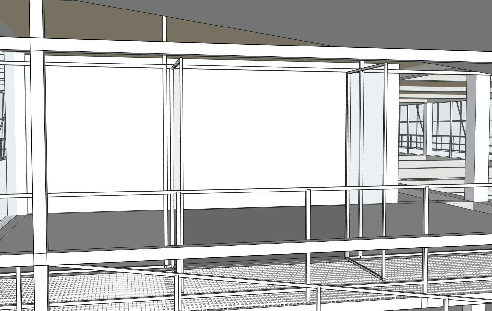
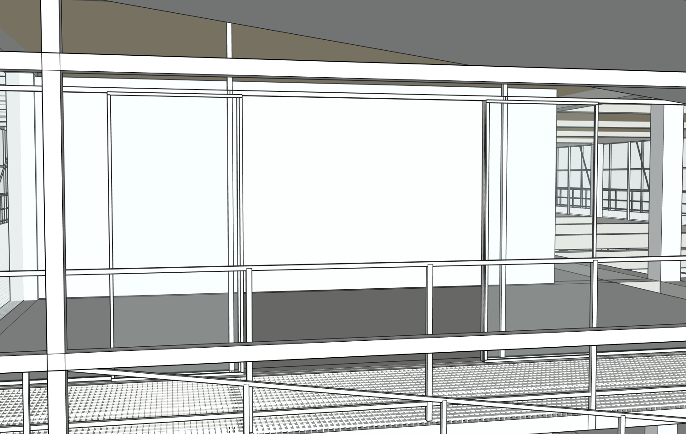
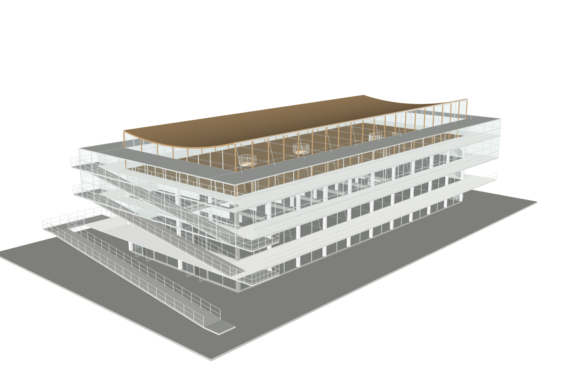

# r12：把新增门改为滑开，恢复窄回廊

真实Studio自然中文、同八原图/原项目/root20606，实际Sol6.1 Medium一次r11→r12。先原生核实两扇新门的唯一性和准确路径并备份，再允许修改；没有把权限扩大到父组。门洞、门框、楼板及其他围护保留，两扇门的原容器名称/PID不变，只改滑开构造。

[18组已有真实修改前后相机一致证明](comparison/camera-pairs.json)，其中包含这处门。旧门外伸1100mm，按原生旧叶边界与受保护未变的栏杆内边推得最窄532.5mm；新门外伸72mm，**计入栏杆厚度的原生最窄净宽1560.5mm**。网站约1.58m为未扣栏杆截面的近似值。9条侧向通行射线全部clear。[真实采样](recovery/r12-actual-return-clearance.json)、[计算边界](comparison/derived-native-width-before-after.json)。修改前侧向射线现场未及时取得，root11捕获时模型已到12并被守卫拒绝，不伪造9条前测；旧原生门边界与同机位图保留。不是整栋路线通行认证。

[准确两扇门作用域审计](native/r12-path-audit.json)保护SHA3395f10856bd48ffc3527a3f2329e6adeb02c62bf52614d8dbae2d37d6c98067相同。完整已有几何、材料、PID、父变换、文档松散几何均保护；真实R12writer也执行修复后的准确嵌套进度读取，计划目标零假缺失，未标视觉verified。

网站实际保存并浏览器下载，SU2024原生工作/下载副本重开并恢复r12。[三阶段](model/native-reopen.json)声明精度PASS，原始全双精度严格SHA仍FAIL；原r4字节未变，空白程序严格重放NOT_RUN。真实下载SHA674869c9873f32c4f21d485bea3f98419053072bf9849b9d28d879f168f4f265。[实际SKP](execution/models/)。原始保存前基线真实先取得；watcher复用打印有旧r10字样，排序JSON明确前后均r11检查点，不能用旧打印文字替代实际证据。

独立Critic实际接收八张原图、六当前视角及15配对，验证新24对容量已经真实工作；工具仍逐图校验路径、当前修订和证据，不是取消检查。Critic仍NEEDS_FIX：外挑平台/粗横杆、室内挑空/梁和楼梯完整性。其部分“连续楼板”判断与原生已有部分板需用剖视区分，不直接砍旧梁板。外部平台/端梯/梯口/细白网的33准确目标后续真实网站已接续执行，单独记录，不把本门通过当全栋完成。

上图仅临时关闭原生黑边线，没有隐藏任何构件/修改几何；展示原始材质后恢复原样。完整几何/材料SHA和非空presentationSHA前后相等。[显示诊断证明](native/r12-style-diagnostic-receipt.json)。它解释部分厚重读图误差，不能代替补建/源图验收。

实际63工具/1失败（一次只读batch参数错误后恢复），Builder5367338输入/6622输出、544547ms；独立Critic69794输入/657输出、265000ms另计。外层及未计量的内部SDK总调用未知null，付费0，无本地流量上限。[用量](metrics.json)、[失败](errors.json)、[真实事件](execution/runtime/agent_events/a6bed0e29b0a42c8a756c08c2e09bf1b.jsonl)。115代码回归与这些真实结果分列；没有重跑原版CLI或新建建筑案例。
