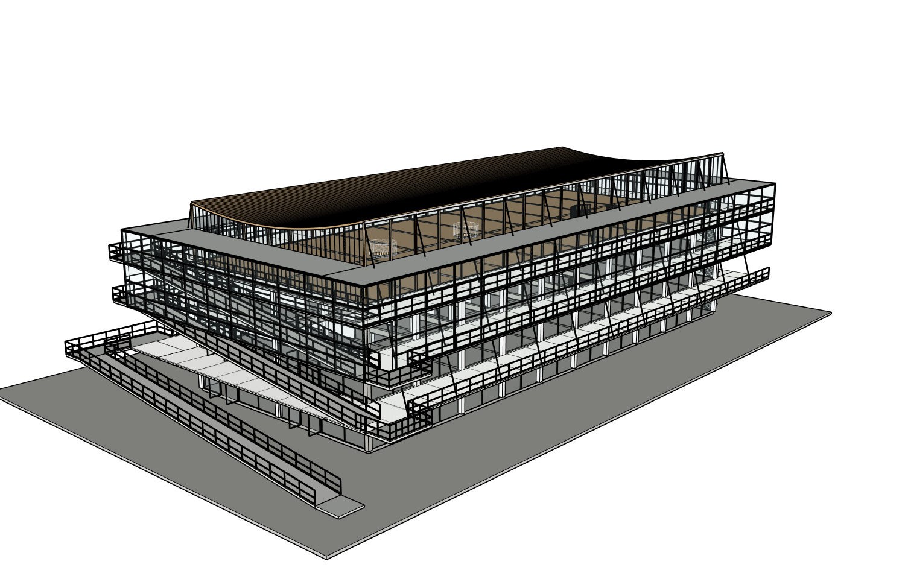

# r13：连续补齐外部交通与细白网

同八原图、原项目、root20606，真实Studio普通中文、实际Sol6.1Medium一次r12→r13。准确33目标(31已有容器+2准确新增叶组)，保留原r4与r12副本；没有整栋重建。上层平台不再伸出矩形外玻璃，远端端梯增添离散梯梁/踏步承托、扶手、防护、地面落脚连接，三层格栅留真实梯口，长外廊/坡道/平台/槽边统一成可编辑细白透空网。网距、构造尺寸及隐蔽支承是依原图和相邻几何的合理估计，不是测绘或结构合规认证。

[七组真实相机一致证据](comparison/camera-pairs-r12-r13.json)。远端端梯另有两组同机位近景，源图拍摄内参未知，不能冒充严格摄影标定。[端梯](comparison/after-r13/remote-stair.png)。

[完整准确作用域审计](native/r13-path-audit.json)保护SHAebaf69465f4f431317c6f8a180dfafca516bc38866ebb15fd4039e9ded201e23相同。屋顶、楼板、坡道本体、刚修门窗、结构及其他构件保护，72原端梯踏步PID/原生世界边界逐一相同。保护全图定义/实例/变换/材料及文档松散几何，不是只比包围盒。

[真实原生几何采样](native/r13-circulation-probe.json)：216净空射线、144踏步承托与实际梯梁相交、9梯口/格栅控制、2平台边界通过；没有把这些有限采样说成整栋路线认证。初次网片全场射线71/78通过，七条撞到相邻玻璃/立柱/另一道栏杆，原始FAIL保留。追加只针对实际网片原型及嵌套变换的原生面相交检查[78/78通过](native/r13-isolated-mesh-probe.json)，没有隐藏构件或改变几何。西端上一轮滑门9/9侧向通行射线继续通过；新细网槽边厚度后真实净宽1563mm，不沿用旧1560.5mm当新测量。

实际网站保存、浏览器下载、SketchUp2024分别重新打开工作与下载安全副本，再恢复工作r13；[真实三阶段](model/native-reopen.json)声明精度PASS_WITH_DECLARED_PRECISION，原始双精度严格SHA仍FAIL并保留。下载SHAcd4af52fa1b16e78376327116b49a1be010b17dab52e935137f777958bb2c542，保存前基线有真实先后顺序证明；原r4字节未变。[实际下载SKP](execution/models/r13-actual-browser-download.skp)。严格两次空白程序重放NOT_RUN。

独立只读Critic实际接收全部八图、六当前视角和16对应图，仍NEEDS_FIX：室内挑空/梁层、螺旋梯碰梁和到达关系、缺曲线半透明帘幕及材料差异。后续原生检查确认既有中间层大挑空9/9点开放；不能按未剖透视直接删楼板。另一方面螺旋梯216个净空采样中14个失败，真实碰到X7横梁或侵入洞口的桌面，最差实测1230mm；这是实际构造冲突而非纯显示误读。[原生挑空与螺旋梯证据](native/r13-void-spiral-probe.json)。先保持现有外部，接续准确范围的内部修复，不擅自删整个梁板系统。外部已接续检查两长边门窗、顶部轻框和收边，未把本阶段提交当整栋结束。

实际工具/耗时/Token见[metrics](metrics.json)，Builder与独立Critic分列，付费0，未计量外层/内部SDK总次数为null。本地流量上限仍0，历史累计未清零。所有失败保留；单元测试不代替视觉保真或原生验收。继续所有者授权执行，不是项目完成或交回所有权。
