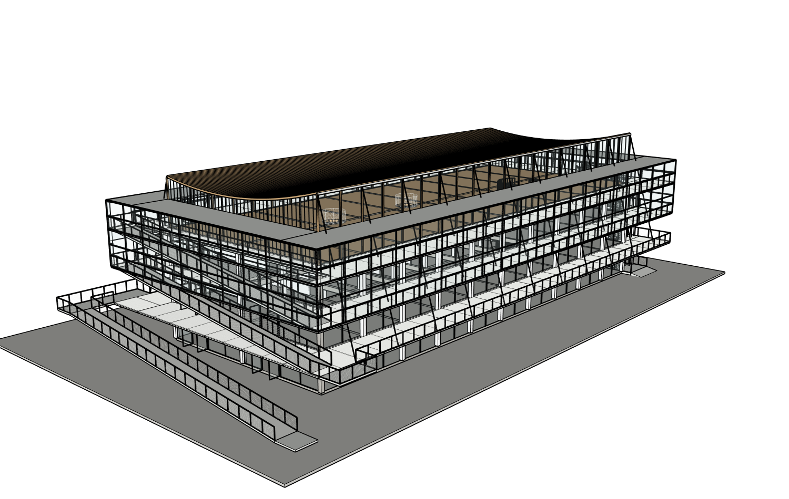
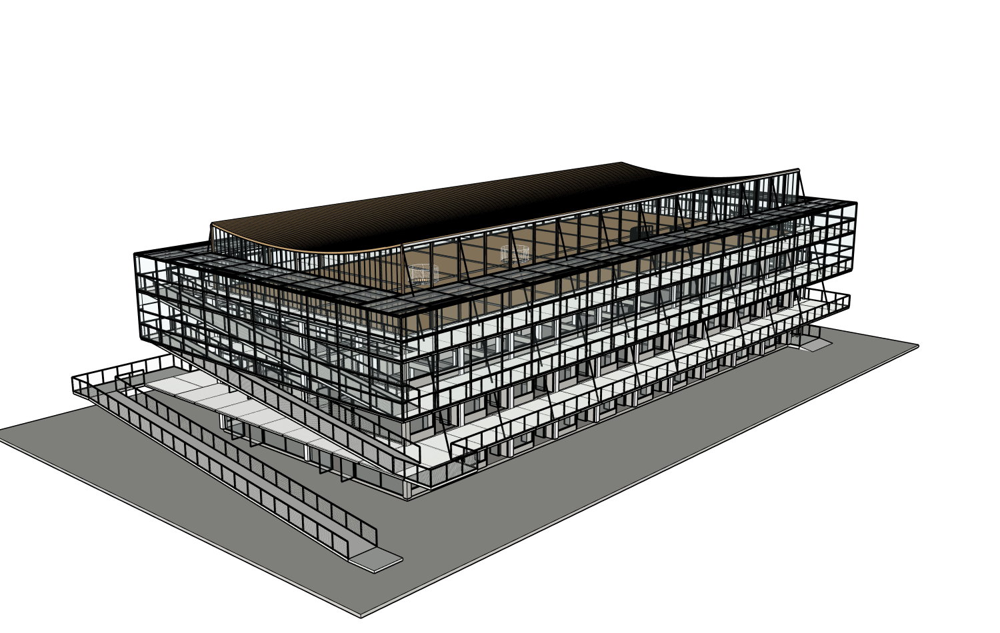

# r14：门窗、凹入口与轻型缓冲区顶部真实提交

原八张整图/原项目/root20606，真实Studio普通中文、实际Sol6.1Medium，同一个r13局部施工到r14，47准确目标。原始r4不变；未重建整栋。首次主机KEEP冲突失败已[单独保留并修复](../2026-10-16-r14-initial-scope-recovery/README.md)。

[七组真实相机一致](comparison/camera-pairs-r13-r14.json)。下部40玻璃叶组改为分层门窗，加入52实际外侧敞开门洞、20房间凹入口，4块原100mm实心顶盖发展成边梁、细椽、檩条、半透明主覆盖/外侧斜玻璃/局部百叶、压条滴水和收边；补上厅接口。数量、分格与隐蔽接法是依据源图及已有楼板的估计，不声称测绘精确。已有40立梃、屋顶、结构、楼板、坡道、细网、端梯及旧门窗保护。

[准确作用域审计](native/r14-path-audit.json)保护SHA41ca19e611e4d5c06b8b1c875fec856b4922d70fdff9dfc5598478d2179eb74d相同，使用纠正后的before快照；初次矛盾基线不能混用。[原生实测](native/r14-facade-canopy-corrected-probe.json)：288门洞中心双向射线、216入口标高表面、140实际盖板材料及板面四点透通采样、120椽梁支承接触通过。33入口首碰旧梁顶与楼板同高，原探针误要求首碰必须叫FLOORS；14中心板面探针遇窄檩条，不能叫整块背板。原始FAIL及全部遮挡控制保留。修正检查只证明有限真实板面点，不冒充全域/全身通行或结构合规认证。

实际保存、真实浏览器下载、SU2024工作与下载副本分别重开、恢复当前工作。[三阶段结果](model/native-reopen.json)声明精度PASS_WITH_DECLARED_PRECISION，原始双精度严格SHA仍FAIL，严格空白程序重放NOT_RUN。下载SHAd7a2a1d9fe6ed4e25d1f7e6f68f4318be85c663e28c9f36045dbe97fc844c22f，[真实SKP](execution/models/r14-actual-browser-download.skp)。保存前基线有真实先后顺序证明，原r4字节不变。

独立只读Critic实际八原图/六当前视角/24配对，仍NEEDS_FIX：缓冲区外檐/开启构件轮廓、螺旋梯连续支承与曲线细网、顶层曲线半透明帘幕。原生另外确证既有螺旋梯外缘净空/到达间隙及桌面侵洞，后续准确修复，保留梁板。外檐要辨别实体与通风箭头，不能盲目大改屋顶。[原评审](review/critique.json)。

重试真实77工具/1失败、5007194输入/6372输出、3625891ms。独立Critic88700输入/1153输出、269265ms另计。已有3600秒单轮运行超时在提交与24对复核后触发，正常Agent收尾FAIL；网站已保存，主机继续实际下载和原生验收，而非把超时当无提交/完整正常完成。历史与累计不清零，Token/工具限额继续0。下一轮同项目使用精简新上下文以减少重复历史，保留全部八源/脚本/记录，不另建建筑或调用付费API。
