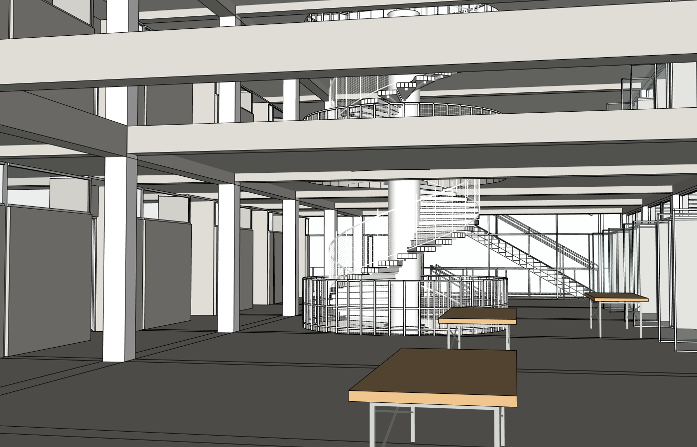

# r16：内部交通、桌架、半透明帘幕真实补建；任务继续

同原八张整图/原项目/root20606，真实Studio普通中文，实际gpt-6.1-sol/medium；14→15一次协调提交，随后16只纠正三张移位桌子的支架。原r4不变，无整栋重建/付费API。实际166工具/8失败、16711404输入/38902输出、2446422ms；独立最终Critic64165输入/1490输出/130687ms另计。本地Token/工具/总运行时间显式0无限，连接握手仍有限。

三段螺旋梯补连续支承、踏步根部支承、细网与上口连接；18桌补支架，三张侵洞桌子移位；上厅加入720实际半透明帘幕面、吊杆接实际木顶底面，顶层板与木顶只改浅色材料。尺寸、网距及隐蔽连接属推断。

[原生有限检查](native/r16-interior-probe.json)：216/216净空、72/72踏步/核心接触、18/18到达面、18/18网孔/网丝、72/72桌腿落地/桌底、39/39屋顶吊点通过。这不是完整人体路线/结构合规证明。[14/15/16整文档保护](native/r14-r16-native-protected-graph-audit.json)25准确目标外SHAa5bd5333273cfd5235c10463073ebfc6db843cdf77045697650bbc8eed790f87相同，祖先/兄弟/松散几何和实体身份保留。屋顶壳/顶层板全部顶点、拓扑、实体PID和变换不变，finish-only审计PASS。第15版旧writerreceipt未独立冻结，保留成功报告、源码与真实保护快照，不伪造历史receipt；第16版3桌scope及KEEP真实receipt完整。

[7组真实同机位](comparison/camera-pairs-r14-r16.json)。独立只读Critic实际八原图/六当前视角/13配对仍NEEDS_FIX：中心支承粗、室内偏暗、挑空被梁板条带遮蔽。此前原生大挑空9/9开放已证实，不能仅凭此图再批量切梁板。未遮挡源图不足以证明内部平面全还原。外部仍需补真正垂挂外翻开启板，源图08蓝气流箭头不能变成屋顶。

真实网站保存并浏览器下载[SKP](execution/models/r16-actual-browser-download.skp)，SHA989c76360576ab900c8b80aadbc1a90c28d2a0337036487d096e6f594574bb3c。SU2024工作文件与下载副本分别重开后，声明精度一致；原始严格双精度仍FAIL。首次网站最终保存之前16版基线未及时捕获，不能拿15版替代；[原生报告](model/native-reopen.json)明确是postsave/bound/download，不宣称历史三阶段完整PASS。原r4不变，工作16已恢复。严格两次空白原程序重放NOT_RUN。

失败都保留：首轮零向量、第二轮180秒工具超时后原生完整collector以250k唯一实体上限拒绝；未放大上限，Actor改为真正共享杆件原型后189016唯一实体可完整采集。迟到的rollback探针跨过成功提交，原FAIL不能冒充回滚失败或PASS。三桌支架位置初错随后真实16修正；额外粗核心修正触及本轮次数限制，未提交，下一阶段继续。

[共享玻璃安全副本测试](shared-safety/native-copy-write-and-negative-rollback2.json)：38真实出现位置全批准的准确叶组清空/重建成功；缺一个位置、父组放宽、无host optin、锁定、外部共享、额外共享跨和保护兄弟变化7负例拒绝并整文档回滚相等。初始fixture失败保留。生产16与原始r4未改。这是安全工具验证，非网站外檐修复成功；后续仍须真实网站执行。
