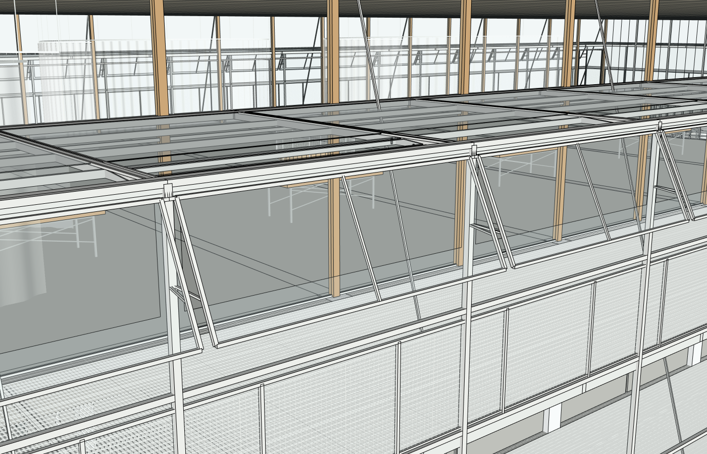

# r17：真实外翻通风窗与开口，发现末跨缺竖框，继续修复

原八张整图/原项目/root20606，真实网站普通中文、实际Sol6.1Medium，16→17一次提交。38准确共享GLASS出现位置全获批，新增OUTER_EAVE_VENTS，共39目标；玻璃原型清空/重建一次，其他38实例继承。两处已有门跨完整KEEP，未重建整栋。几何、原图与旧失败都保留。

每侧19扇细框透明外翻窗，实际铰接、撑杆与背后2720×800mm真实高位开口；原图05剖面观察到下挂外翻片，原图08蓝线是气流箭头。投影450mm/下落900mm及五金尺寸是相邻构件和图示比例推定，不是测绘。内部浅斜缓冲屋面和原曲屋顶保留。

[准确原生保护审计](native/r17-path-audit.json)PASS，SHAfc13e2e5cec490c71193164a505607d59c9af85a8fcf27f36804dbf1ebdfd3ef一致；原共享定义所有38实际出现位置均批准，无父组放宽。原框架、其他玻璃、屋顶、楼板、坡道、细网和内部完整保护。[同机位7组](comparison/camera-pairs-r16-r17.json)。

[原生真实采样](native/r17-vent-probe.json)：228/228开口、152/152原玻璃保留、38/38半透明片通过；连接151/152通过，有一处真实失败。NORTH末跨19右撑杆起点53985,24000,12800mm没有实际转角竖框支承。原程序仅重复每跨左立柱，末跨没有下一跨，短端竖框也没到北端角点。不是玻璃透明度误读。下一阶段登记一个准确缺失叶来补竖框，保持已建窗扇不变；没有把151/152写成全PASS。

网站已实际保存并浏览器下载[原生SKP](execution/models/r17-actual-browser-download.skp)，SHA673418bde39fc6d825dca82ae34613805943b26c8a45453230a2953166206f20。真实保存前基线及时捕获、收据仍16；随后SU2024分别打开工作文件和下载安全副本，[三阶段声明精度一致](model/native-reopen.json)，原始双精度严格SHA仍FAIL，严格两次空白程序重放NOT_RUN。原r4字节不变，工作17恢复。不要用Python测试冒充源图还原/结构合规。

独立只读Critic使用八原图/六当前视角/14配对，仍NEEDS_FIX：室内顶棚构造、浅色地面/木色顶面与密集接缝显示。之前真实中间层挑空已9/9开放，不能仅因相机透视/梁叠加批量切梁板。下一步仍需注册剖面和实体证据判断对应楼层、补支持明确的构造，合理推断遮挡细部。

实际87工具/2失败、3579095输入/12839输出、2734141ms；独立最终Critic65784输入/1330输出/162672ms另计。原始编码命令exit1与首次漏5源图对应的评审拒绝保留，后者补全后再提交。实际不限时正常收尾，模型/Token无替换或累计清零，付费API0。此为持续施工记录，非客户交付完成。
