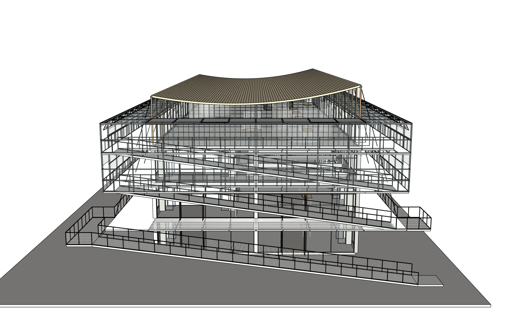

# r18：补齐末跨转角竖框，外檐连接实测通过

同原八张整图/原项目/root20606，真实Studio普通中文、实际Sol6.1Medium；17→18只新增一个批准的NORTH_EAST_CORNER_JAMB。60×60×6300mm白钢角框，断面与隐蔽接法按原图和实际既有框格推定；未修改旧窗、玻璃、撑杆或主框架。

[完整范围保护](native/r18-path-audit.json)PASS，SHA7ca35bcd3adfeb651f50b7798ed60259115c6b3ecf83bbc5dcdd640e3407dca0相同。第17版151/152连接中唯一失效的北末跨右撑杆，现已真实进入新竖框实体；[第18版原生复测](native/r18-vent-probe.json)152/152连接、228/228真孔、152/152保留玻璃、38/38透明片通过。新框与六道原横框端部均有真实实体接触，6/6通过。不是仅包围盒接近或把透明面当开孔。

[七组真正同机位](comparison/camera-pairs-r17-r18.json)。网站保存、实际浏览器下载[SKP](execution/models/r18-actual-browser-download.skp)，SHAb31d1d0f9e11e0e5ade65d190985adac5af155c978af02607e45d39d0a64c629。保存前基线及时捕获且收据仍17；SU2024工作及下载副本分别打开，三阶段声明精度PASS，原始严格双精度FAIL保留，严格两次原程序空白重放NOT_RUN。工作18恢复、原r4不变。

实际73工具/4失败、5333550输入/7381输出、567422ms；独立最终Critic69929输入/1170输出/132656ms另计。四个工具输入/路径/编码失败原样保留，只有一次实际几何提交。原来全部用量保留，本地限额及单轮总时间0，付费API0。外层模型未改；工具登记改变后网站创建新原生上下文，仍是同项目八图、真实Sol6.1Medium，不是原版CLI对照。

独立八源/六视角/15配对仍NEEDS_FIX：室内天花木饰面和浅V形细构件、材料观感；后续继续。另有[只读诊断](readonly-diagnosis/interior-diagnosis-r18/capture-receipt.json)：四个更宽室内机位、完整原生几何/材质不变、原相机恢复。它们晚于独立评审，不伪称Critic看过。

同机位明暗对照表明显示影响显著：当前木顶Face已经233/216/183，顶层地面225/224/216，默认视口Dark45/Light80/UseSunfalse却呈深灰；158曲面内拼接硬边也造成密黑条纹。[中性80/15明暗实验](readonly-diagnosis/display-lighting-neutral-diagnosis-r18/capture-receipt.json)仅调整原生查看设置，几何与材质完全不动，恢复浅色且保留细节，随后已恢复原设置。第一组85/90过曝没有采用，原图与失败保留。不能把明暗变化叫作真实材质/几何修复，也不能为了亮图隐藏网片。

下一步已在原生数据上准备：精确细化现有六个中心柱/底座叶，补与原支承及平台底面连通的短连接；六处旧平台支承顶部真实17.5mm空隙保留诊断。浅木天花/V构件按实际梁底和洞口推定布置；15组可用位置，另5组避开已有圆洞。24个饰面叶仅批准25个Face材质和158个曲面Edge.soft/smooth变化，坐标、拓扑、全部身份及其余属性需在原生提交前强制保护；此准备不是第19版已经修好，生产仍18。
