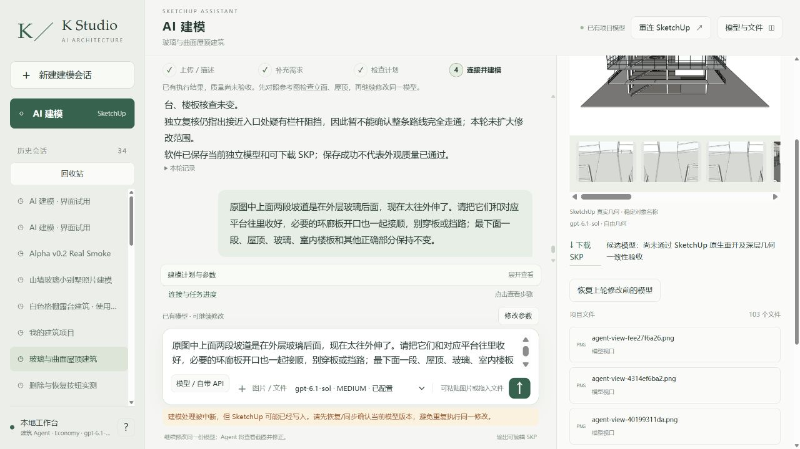

# r8 上层坡道收回与超时恢复

**局部保护、原生交付通过；源图质量仍 FAIL，客户 NOT_READY。持续执行，不是交付结案。** 同八张整图、同一项目、root20606，真实网站 Sol6.1 Medium 一次 r7→r8。上两段及关联平台/栏杆、六块环廊板局部修改；原 r4 未覆盖，没有整栋重建。

上两段实际收到外层玻璃后，X[-3900,-1700]mm，Y[-3000,23000]mm；原有上升方向及起止标高不变。上层环廊相应留窄槽，保留1650mm返回带，平台外挑收小。都是按图推定的协调尺寸，不是原图实测。

- [路径级深层审计](r8-path-audit.json)前后受保护SHA一致，15个准确目标路径，五个父组内部强制KEEP；最低段、屋顶、玻璃/门洞、室内楼板、其余系统不变，原有容器身份保留。
- [180个原生垂直采样](r8-flight-support-and-headroom.json)全部有支撑、净高>=2200mm；坡道样本最小实际净高2600mm。仅采样，不等于整条路线、栏杆完整或规范认证。
- [真实网页下载及原生三阶段](r8-delivery-verification.json)PASS，工作副本已恢复。基线是在网站自动检查点之后、受控保存之前采集；不冒称补齐首次自动保存前缺失证据。[实际两份SKP](execution/models/)。

原有水平门洞射线在新版会碰到向上爬升的坡道，这不是新的门洞堵塞结论；保留[原始180条](corridor-rays-r8-door-width-and-clearance.json)，不能直接沿用旧75/75水平通行结论。另按实际坡面及转弯路线测得[51条体高通行线](r8-walking-lines.json)全部无遮挡，187个路线支撑样点全部落在预期标高。包括三段坡道、最低段北平台和上下返回/接续带；仍不是连续扫掠人体、轮椅转弯、栏杆完整性或规范认证。

## 真实失败保留

本轮确有一次当前r8独立Critic（12配对涵盖八原图、六个当前标准视角），结论NEEDS_FIX：疑似玻璃接入障碍、栏杆应是细网、圆洞缺网状护栏，室内剖面尚无法核实。疑似障碍要用原生几何验证，不能当作已证实错误多切玻璃。[原复核](review/critique.json)。

随后Agent尝试补拍并再次审查，提交时漏掉原图05/06/08的当前配对，被校验拒绝；最终3600秒超时。不是“没有任何r8独立审查”，也不是已完成验收。完整失败及用量在[原始事件](execution/runtime/agent_events/94aa603eac9f4d2a94893edb218b6d17.jsonl)。输入4,723,630、输出17,828，127工具/3失败，3,605,937ms（60.1分钟）。Critic计量单列，外层未知为null，付费调用0。

另一耗时原因已定位：[源事实账本被追加执行历史](r7-review-reuse-diagnosis.json)，使未改变源事实的独立审查缓存失效；只读核查将继续，不放松哈希校验。源码归档准备把每次真正提交的Ruby在后续截图/检查前固化，避免中断后只有不断覆盖的最后一份；代码测试通过尚不等于原生实测。

已通过真实网站发送“先不要再改模型…八张图都对应检查…保存下载”的恢复请求，并把host允许写入路径置空。新恢复记录单列，绝不冒称初轮超时已通过。整体格栅、细网围护、室内源图对应、严格两次空白程序重放及干净客户/独立服务路径仍未全部通过。

[原八图和历史](../../../test-assets/architecture-project-4f0e4/README.md) · [持续执行任务](../../../NEXT_CUSTOMER_READY_SAME_CASE_2026-10-15.md)。
