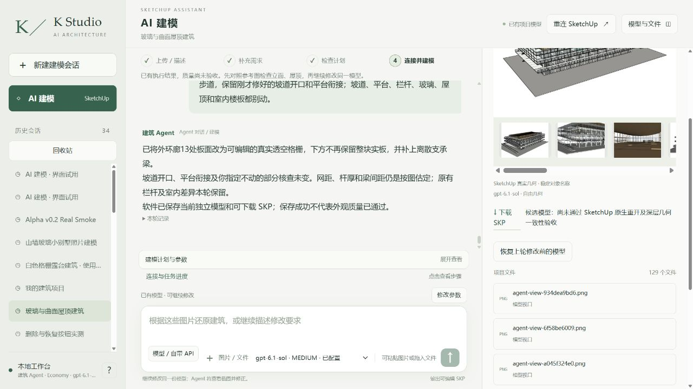
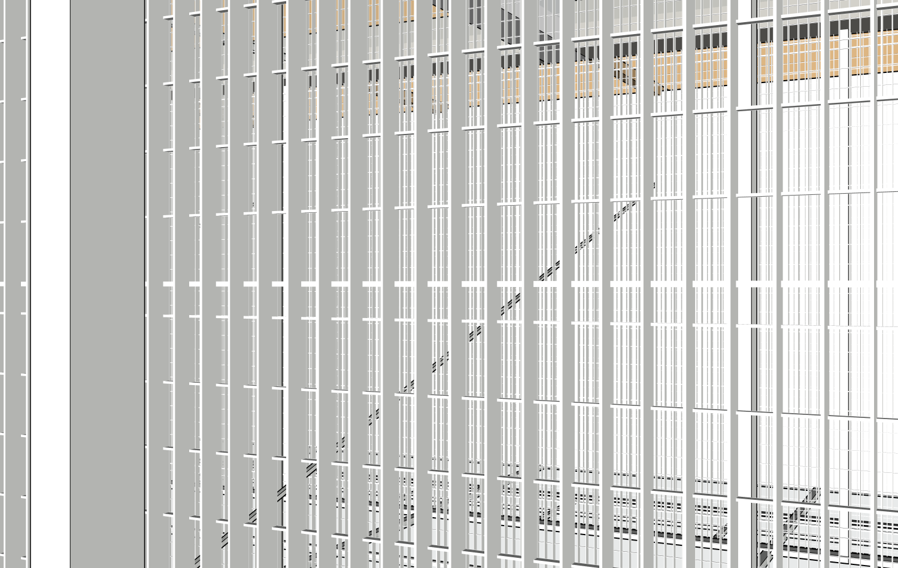

# r9：环廊真实透空格栅已完成，客户仍不可交付

同八张整图、同项目/root20606，真实网站普通中文、实际Sol6.1 Medium完成一次r8→r9局部提交；原r4字节不变。13个精确板件改为可编辑重复格栅及离散支承梁，没有整块实板背衬。坡道、平台、栏杆、玻璃、屋顶和室内保护未变。[作用域审计](diagnostics/r9-path-audit.json)保护SHA861418ed8bec76ee33540c08a818fcb0e31f5de3b3402da5a314195a2b57af2d相同。

39/39修正采样验证透孔与杆件。初始38/39中一个交叉杆控制被既有混凝土梁先截中，原始失败保留；在另一根真实横杆处避开既有梁后全部通过。不是删除控制或改变判据。旧固定宽高比截图整体发暗；取消宽高比锁定后，从已保存r8/r9受控重拍三对相同原生相机，几何前后不变。[相机配对](diagnostics/grating-corrected-recaptures/camera-pairs.json)。重拍不冒充修改前已取得的合格截图，历史暗图保留。

独立Critic使用八原图、六当前视角及12配对，仍NEEDS_FIX：栏杆横杆/框架太厚，两个小圆洞缺圆筒细网护栏，上层棕色楼面与半透明弧形围帘仍不符。[完整审查](review/critique.json)。格栅改善不等于整栋源图通过。

## 保存和原生验证的真实边界

真实网站保存5374ca398451检查点，实际浏览器下载，[两份SKP](execution/models/)。新完整定义图扫描2547个原型，保留所有实例/矩阵/面/边/材质及文档松散几何；实际展开435843面、872456边、74760实例。旧展开工具超过25万上限失败，不能提高计数或省略实例冒充通过。新图的3类原生故障检出/回滚通过；r8两种表示的完整直接组计数覆盖一致，哈希契约不混用。

**严格三阶段原始双精度SHA仍FAIL，不能报告原生交付完全通过。** 保存前真实基线已取证，工作文件和下载文件重开后彼此严格相等；与保存前相比，917处仅面法线及线性矩阵浮点末位不同，最大2.220446049250313e-16，所有顶点、拓扑、材质、平移完全相同。[严格结果](model/native-reopen.json)、[单独舍入诊断](diagnostics/r9-native-roundoff-diagnosis.json)。诊断不覆盖严格失败，后续需建立明确、保留原始值的数值稳定契约，不能静默放宽检查。原工作r9已恢复，原r4未覆盖；严格空白程序重放NOT_RUN。

## 本轮实际发现并处理的工具缺陷

- TCP每块单独UTF8解码会破坏中文原生定义名，从而使签名JSON不一致；外部连接器仅改为Node流式解码，保留原文件备份/SHA，真实SDK大图捕获验证通过。未公开连接器账号或配置。
- 首次writer已提交几何，随后只读检查因保存GUID竞争报错；真实失败保留，未重跑几何。代码新增同路径/root/项目/版本原生证明后，仅重试该只读检查一次；离线检查通过，专门原生竞争注入尚NOT_RUN。
- 已提交Ruby在后续失败前归档的机制，本次真实r9已验证，sourceSHA5a0052c1dea4dcb978cfb0afb47de93bffb0b7f12a9bbb005384b78a39231f0b。没有把后续错误误记为未提交。
- 精确新增叶组候选保护在一次性副本通过1次新增/清理及7类越界拒绝/回滚；初次Entities.empty?兼容错误已修复。候选未部署到正式writer，不是圆洞护栏已修好。
- 源事实账本仍被Agent追加执行历史，提示词约束未解决，保留为未解决的性能/复核问题。

Builder输入5147635、输出11930，91工具/1失败，1777813ms；独立Critic300187ms、59959输入/1003输出、0工具另列。付费0，外层未知null，未设置流量上限。[原始执行记录](execution/runtime/agent_events/251efc4d8b154f15924f618e446ddaca.jsonl)、[用量](metrics.json)、[错误](errors.json)。

下一步优先稳定深层保存/重放数值契约，再以已验证精确保护处理细网栏杆和两个小圆洞。不能扩大到整个父组。客户本地独立安装/服务商推理和严格两次空白重放均未完成，继续执行，不宣称READY。
