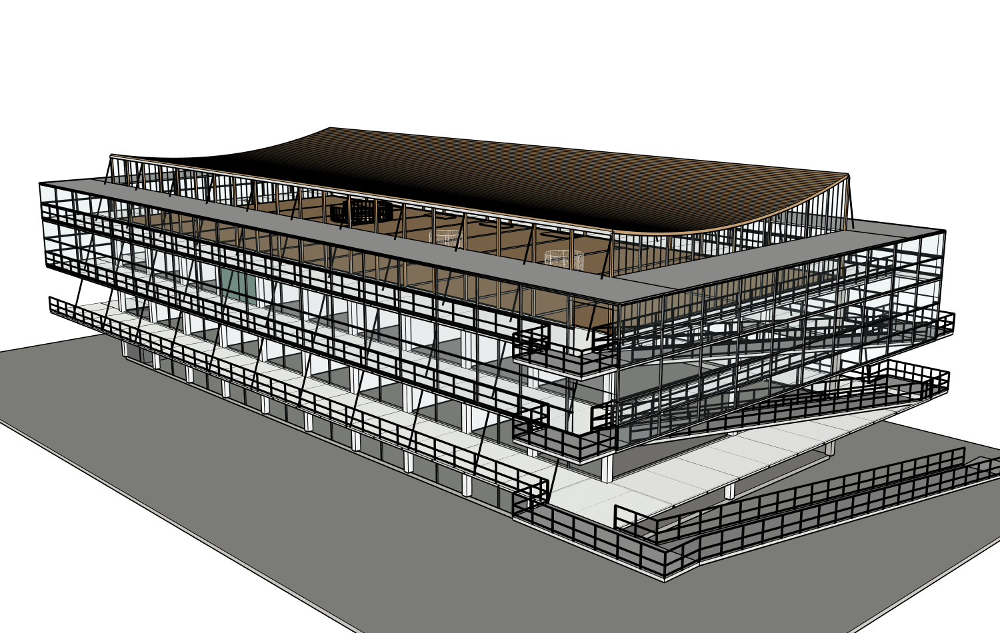
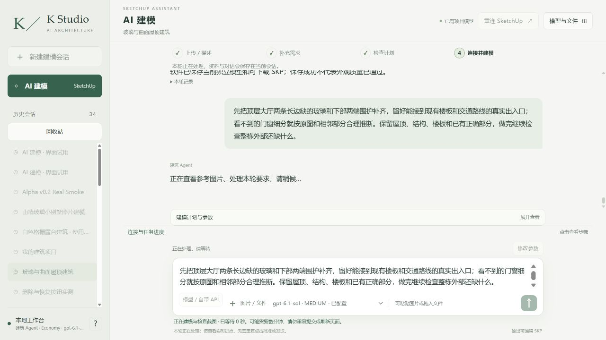

# 为什么建筑外部仍未完成：真实 Studio + MCP 全面检查

本轮按所有者纠偏，检查同八张整图、原项目/root20606/r10。真实网站Sol6.1 Medium读取八图全部面板，并拍摄四面及节点10张；外层又通过实际SU2024 MCP核查原生构件。此目录为只读诊断与继续补建准备，几何提交0；后续围护构建已经从真实网站发起，结果另报。

## 具体漏建与错误

1. **顶层大厅两条长边内层侧窗没有建。** ROOF_SUPPORTS146个子件只有木柱、边梁、端玻璃/端框；INNER_GLAZING80子件只有两长边0–10800mm玻璃/柱。外层两层缓冲玻璃不等于顶层内厅围护。源图2/4/5/8显示连续上厅侧窗。
2. **下部内层两短端围护、出入口缺失。** 原生清单与原始构造Ruby都只建立y=0/20000两长侧内玻璃；两端需要按实际柱、楼板、核心和梯位补齐，未见分格合理推断。外层短端玻璃已经存在，不能误报整个外皮无端面。
3. **远端直梯只建了72踏步。** 支承、侧防护、上下平台及格栅梯口不完整；原生接近层高不能证明通行。细部可据图5/7及相邻构造推断，不能镜像坡道端。
4. **上层平台还有约2.2m外伸余段。** 需与坡道/门洞一起整理，而非只删一块板。
5. **细白网栏没有完成。** 长环廊、坡道及平台仍主要三道横杆，缺网片/转角/门口收边。全黑SketchUp边线也夸大厚重感，但样式不能掩盖真实漏建。
6. 长侧内层门窗的分层入口/开启分格缺失；缓冲区平盖/轻框节点过简。顶盖透明、不透明部分需分清，不能凭画面干净删除拉索。

[网站完整逐项报告](review/review.md)、[实际原生清单](host/native-exterior-inventory.json)、[实际网站10张视角与读回](readonly-record/runtime/agent_workspace/qa/exterior_readonly_r10_20261016.json)。已有曲面屋顶、实际格栅和薄拉索保留，不重新生成整栋。

## 为什么一直卡在局部补丁

之前host给每轮“只改这一点，其余不动”，将未完成的外部也冻结。r10只允许新增两个小洞护栏，所以Agent不能顺手补立面。这个范围安排是造成碎片化推进的真实原因，不是模型/MCP不能构造玻璃。

持久项目记忆也不一致：执行卡仍以两天前“只读、待确认”开头，九个系统全pending，部分目标路径根本不存在，方法ID不在实际目录中，加载器捕捉错误后静默返回None。旧卡/计划已完整备份，按真实原生路径纠正当前卡与策略；built只表示几何存在，不标verified。产品新增writer写入前严格校验已存在的策略，报出具体文件/字段错误，避免静默丢掉计划。29项相关回归通过；新代码当前未重启加载，真实新版writer预检待安全重载后验证，不能写成已原生验证。

## 已开始继续补建

网站已收到普通中文：先补顶层长边玻璃和下部两端围护，按原图和相邻关系推断未见门窗，留好真实出入口，保留已正确部分。精确授权新增ENVELOPE_OUTER/INNER_ENCLOSURE_COMPLETION，已有屋顶/端玻璃、全部楼板/框架/坡道/格栅/玻璃和内部保护。原r4及r10备份不覆盖。随后连续完成平台/端梯、长侧门窗、细网和轻框节点，不能在一个补丁后再结案。此前准备的28护栏/平台准确路径保留为后续阶段，尚未激活，不冒充已修。

[围护计划](enclosure-preparation/buildplan.json)、[校验](enclosure-preparation/validation.json)、[实际激活保护](enclosure-preparation/authorization-active.json)、[记忆修复验证](enclosure-preparation/memory-repair-verification.json)、[真实修改前5机位](camera-comparison/before-r10/capture-receipt.json)。此目录不把只读检查、策略修复或网站已受理当作几何修复完成。
