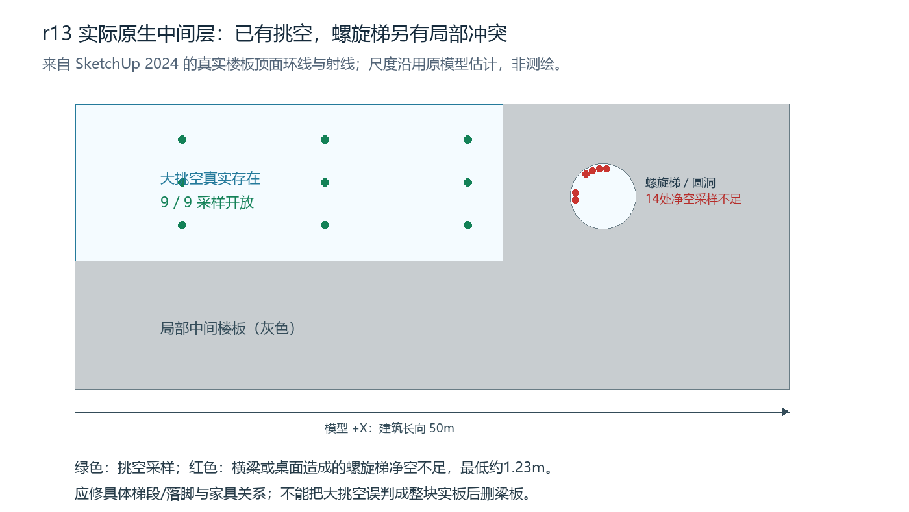

# r13剩余问题：原生纠正误读，接续外部施工

真实Studio Sol6.1Medium使用原八张整图，对同一r13/root20606只读检查，53工具、0失败、3062386输入/13546输出，1869859ms。没有几何提交；主机额外只读探针及其失败另列，不混入网站成功次数。

**大挑空已经存在。** 实际五个FLOORS子组、原生顶面完整环线和9/9点射线证明中间层局部留空。此前Critic把未剖透视中的上层板底/梁网概括成连续中间楼板，这是误读；不能据此批量删梁板。源图6明确保留旧结构。示意仅用原生数据绘制，不是伪造模型截图，坐标为模型轴/估计尺度。

**楼梯确有局部构造问题。** 原生216条踏步中心/半径射线中14条净空不足，实际首碰X35m横梁或侵入洞口的桌面，最小中心采样1230mm。网站另按原生尺寸与既有生成器做凸体分离轴复算：第11—14级最西外缘局部1530至1080mm，扶手13与梁下角小相交；这部分不是原生布尔交体积证明。两种采样位置不同，不能把1080mm写成主机中心射线实测。踏步本体没有穿梁，附近另两条梁只是透视重叠。末级与洞边200mm缺连接、到达平台和护栏开口未协调。[网站详细报告](execution/runtime/agent_workspace/notes/readonly_envelope_void_stair_r13.md)、[原生射线](native/r13-void-spiral-probe.json)。后续优先修梯段/落脚和家具，保护梁板。

**外部继续施工，不停在验收结论。** 下部两长边仍有40跨三层固定玻璃，缺分层门窗/真实出入口；18条房间隔墙前沿未完成凹入口。4块缓冲区顶盖实际都是100mm实心盒子，需发展轻框/覆盖分格、边梁、泛水等。顶层大厅40模块和6入口已经有，不重复全建；接口节点及外层温室开启扇仍须完善，隐藏断面按相邻构件推断。[真实7机位及构件范围](execution/runtime/agent_workspace/qa/readonly_envelope_void_stair_r13.json)。

已登记并原生验证下一批**44已有准确叶+3准确缺失语义叶**，备份r13，完整保护已修外部交通、屋顶、结构、楼板、门窗等。真实Studio普通中文施工已开始，几何结果另记。外层温室开启扇还需单独准确玻璃叶范围，不会为补一个窗默默扩大父组范围。未新建案例/整栋重建/调用付费API。

[只读后全原生深层一致性](native/r13-readonly-diagnosis-geometry-equality.json)PASS，保留实际全图与既有r13比较；不是视觉全栋PASS。主机附加楼板环线探针最初有路径别名与Ruby括号错误，多次失败保留，修正后只读取数；不把调试写成模型质量通过。代码回归、视觉保真、原生交付与严格重放仍分列，任务持续进行。
