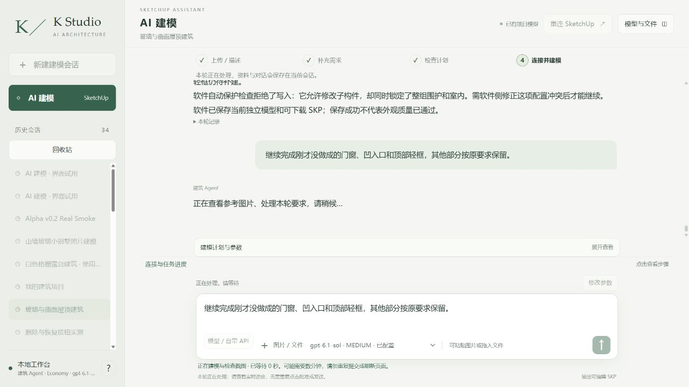

# r14初次失败：纠正主机KEEP冲突后继续真实网站

本轮没有新模型提交，仍是r13。真实网站47目标施工首次在原生保护阶段被回滚；错误来自主机过期父组KEEP与批准子目标互相冲突。不能把它归咎于模型不会建，也没有关闭保护或扩大权限。[完整诊断与恢复](review/review.md)。

[原始失败](initial-attempt/runtime/scripts/reports/glass_curved_roof-r14-33d9ed85.json)、[原始冲突配置](scope/initial-contradictory-active-policy.json)、[纠正配置](scope/authorization-active.json)、[回滚后原生全图一致性](native/r14-initial-abort-protected-equality.json)、[原生Ruby验证](native/r14-final-native-guard-fixtures.json)。初次与纠正后的修改前作用域分别保留，后续必须使用纠正基线，不能混用快照。

实际初次40工具/1失败、5115285输入/24299输出、3043156ms。重试不混入这组数字，付费0、外层未知null、本地无限额，历史累计不清零。33代码回归与SU2024只读内存夹具通过不等于真实建模通过。后续真实网站Sol6.1Medium已经接续执行，几何、保存下载、原生重开及独立视觉结果另记。
