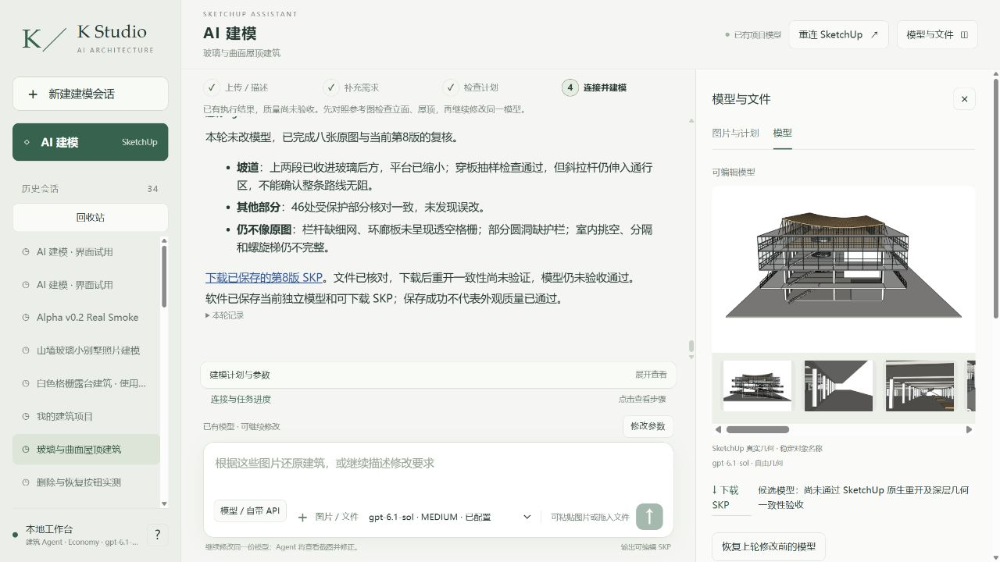

# r8 只读恢复：八图复核和最终文件重开完成

**本次恢复完成，无新增几何；整体源图质量仍 FAIL，客户 NOT_READY。** 原r8编辑超时保留在[上一报告](../2026-10-16-customer-readiness-r8-ramps/README.md)，不是把失败删掉重标PASS。本次真实网站普通中文、实际Sol6.1 Medium/native resume，host允许修改路径置空。八原图、六当前视角和12配对重新做独立readOnly Critic。

## 真实结果

- 独立复核完成仍NEEDS_FIX：环廊实板及粗横杆应为轻型格栅/细网；圆洞缺网状护栏，室内空间还未能可靠对应；还报告疑似斜杆连接。不能把完成复核当作源图PASS。[完整Critic](review/critique.json)。
- [整文档原生几何/材质SHA和完整组PID树](r8-readonly-full-document-unchanged.json)在只读恢复前后相等，没有新revision。原r4不变。
- 最终网站保存生成cae9fff9c706检查点，实际浏览器下载，并在SU2024对最终工作/下载副本[深层三阶段验收PASS](r8-review-delivery-verification.json)。[两份真实SKP](execution/models/)。这是受控跟随保存基线，仍不补造初次自动保存前证据。
- 对冻结原生顶点/面进一步核查22根TENSION_BRACING：上端四个截面角点都在实际木柱内，下端中心接触真实环廊顶外缘。载体确认为六面八角点的轴对齐实体，不是只用包围盒猜形状。[接触数据](r8-tension-end-contact-analysis.json)。只证明几何接触，不证明节点/结构合格，也不保证Critic所指一定是这22根；因此不盲移斜杆。

## 发现一个真实下载体验缺陷

Agent回复中的“下载已保存的第8版”仍链接到先前df8105检查点，自动保存后的面板链接则是cae9ff。两份本次几何虽然一致，这种先回复后生成文件名的流程在未来编辑中可能给错版本。现修复：host完成最终保存后，将本轮/当前下载链接绑定到实际新检查点；历史/修改前/外部链接保持原指向。63相关回归通过，**此新代码的真实网页验收尚NOT_RUN**，后续同一项目局部操作再验证，不冒称本次已加载该修复。

Builder输入4,135,127、输出8,261，62工具/0失败，1,356,656ms（22.6分钟）；独立Critic291,516ms、59,932输入/685输出、工具0单列。外层未知为null，付费0。耗时和用量仍很高，保留真实记录，未设置或重置流量上限。

下一步已有原图03直接证据的13个环廊板件格栅修复准备：[准确目标](grating-target-inventory-r8.json)、[图谱](grating-design-graph.json)、[计划](grating-buildplan.json)、[校验](grating-plan-validation.json)。仅离线准备，不是已改模型；必须保留坡道、平台、板槽、栏杆、玻璃、屋顶和室内楼板。之后再处理细网、圆洞及其他有实证的问题；严格重放和独立客户服务仍未完成。Codex继续执行，非交付结案。
