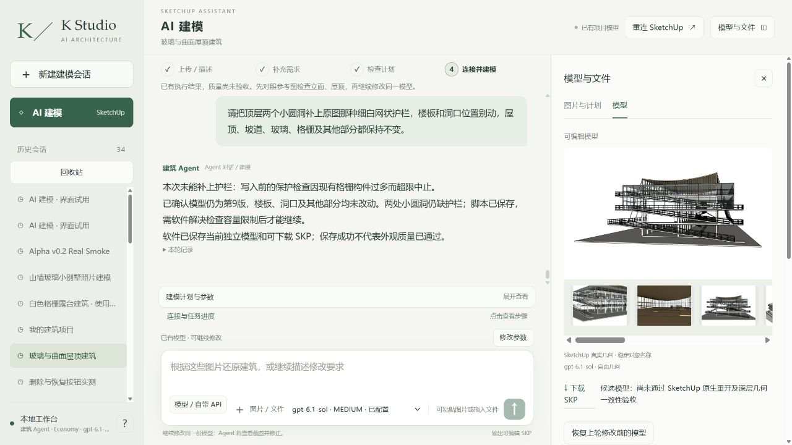

# 小圆洞护栏首次网站操作被旧 KEEP 上限拦住，已修软件继续

**此处没有新增护栏，生产仍r9。** 真实网站发送普通中文：“请把顶层两个小圆洞补上原图那种细白网状护栏，楼板和洞口位置别动，屋顶、坡道、玻璃、格栅及其他部分都保持不变。”实际Sol6.1Medium，新注册工具线程01a142e8-326e-7f83-bc58-f14ae01fc09a，八图SHA/order不变。累计输入从39694001继续，没有清零。

Agent已写好局部护栏脚本，writer前KEEP批量检查仍使用旧展开扫描，超过250000实体上限，事务未提交；另外保留一次读取上限参数错误和一次缺失组读取。总26工具/4失败，1197590输入/4686输出，175672ms。不能把主scope图工具通过当作整个KEEP调用链已经升级。[完整错误](errors.json)。

已取真实原生整文档快照，与操作前同机位取证的基线SHA一致，楼板、洞口和其余全部几何/材质未变，root20606/revision9。[未变证明](r10-first-attempt-full-unchanged.json)。不是只凭“版本号没增加”。

**修复点：** host明确graph模式时，KEEP的批量深层读取和事务内验证也使用完整定义图；旧项目仍用原契约。所有深层KEEP现在携带明确collector，Python和Ruby双侧拒绝混用，即便两个摘要字符串碰巧相同。真实SU2024同一原项目只读核验六条deepKEEP，包含整个巨大CIRCULATION_EXTERNAL，3,109ms通过；故意混入旧collector被拒。[原生控制](native/r10-keep-cap-recovery/native-result.json)。65项相关回归通过，**修复后的真实网站写入此检查点仍NOT_RUN**，继续同一网页请求，不再生成别栋建筑，不改父组保护范围。

下一步返回当前网站补两处护栏，然后当前六视角/八源独立Critic、同机位前后、深层保护和实际保存下载重开。严格空白重放、源图整体、独立客户环境尚未通过。客户NOT_READY；本次失败和后续恢复分开保留，继续执行。
