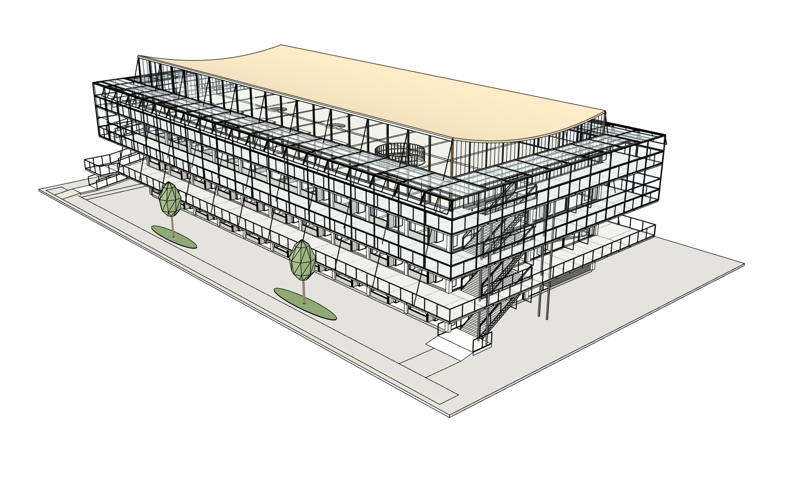

# 八图建筑案例收尾：基础建筑 + 简洁周边（最终第20版）

**已按所有者2026-10-17最新范围完成并结束本案例。** 不再深化构件，不再追加帘幕、天花、斜撑、圆洞、梁板等精修。继续同原八张整图、同architecture-project-4f0e4、同根PID20606；原r4不变。真实K Studio网站、普通中文、实际Sol6.1Medium，外层模型未改。

## 交付文件与基本结果

- [最终可编辑SKP：基础建筑与周边第20版](models/KStudio-basic-building-and-site-r20.skp)，5,391,194bytes，SHA256 `062eb01595b026add4252b6b71429e0b358b2bb8a9acdca9a64d345ad1bd78cb`。
- [实际浏览器下载原文件](execution/models/r20-actual-browser-download.skp)与上面命名版本逐字节一致；不是重新建的另一个建筑。
- 门窗、楼梯、墙柱未发现整组缺失：[原生基本构件清单](native/basic-building-summary-r19.json)。33柱、18既有隔墙组、3螺旋梯及门窗组有实际回读；组合组数不当成门窗数量或质量分。此前真实门洞、通路、梯段/支承抽查继续保留，第20版建筑完全不改。
- 最后一轮仅增加SITE_GROUND/SIMPLE_SURROUNDINGS：6段步道/入口连接、4块低绿地、4棵简单树。校园环境原则来自原图01，准确布局、树种和尺寸是合理推定，不是测绘复原；不做树叶、家具或其他装饰。
- [真实场地检查](native/r20-site-probe.json)：6段铺地有实际厚度并落在原地面，4棵树干与花床/原地面及树冠连接通过；西坡道入口及既有东端梯接近坡共6点接缝通过。不是完整市政/无障碍或结构规范认证。

## 保护、保存与重新打开

[完整范围审计](native/r20-path-audit.json)PASS：准确新增一叶，现有建筑所有门窗楼梯墙柱、屋顶/坡道/楼板/内部及原ADJACENT_GROUND均未改，完整保护SHA `1589ada84f2d9e53cb7b11a55a41959608222977a00d19e68d0e31f02cac5174`前后相同。[六组真正同机位19→20](native/r19-r20-canonical-camera-comparison.json)，使用真实网站当时捕获的原生相机/图片，不事后假设机位相同。

[原生交付](native/r20-native-delivery-verification.json)：20提交后及时捕获保存前完整图，收据仍19；网站真实保存、点击下载；SketchUp2024/24.0.484分别打开绑定文件和下载副本。三阶段按记录的原生声明精度一致PASS，原始严格double差异FAIL保留，四项查看明暗设置也保存后重开保持。工作20恢复，原r4字节SHA仍c337d2bcc36922167da85be070463988bd9622b6c43bb402d2ce8d2151ec63db。友好名称文件也实际从网站点击下载并验证字节相同，浏览器事件观察器20秒超时但真实下载已成功，原记录保留。

模型回复说“工具无保存入口，最后确认19”发生在模型推理结束、宿主保存之前；网站宿主随后实际保存20。原回复不改写，[单独标明的宿主核验记录](native/final-owner-closeout-receipt.json)说明真实保存/重开结果并提供最终下载，不能伪造模型已知道之后才生成的随机文件名。网站最终页面证据见[截图](native/final-website-native-verified.png)。

## 真实评审、用量和保留限制

独立只读Critic使用原8张整图、6当前视图和20组对应证据，[原评审](review/review.md)仍NEEDS_FIX：原横梁/挑空读法、帘幕显示等源图细节尚有差异。所有者明确当前开发程度够本案例使用，停止继续精修；这些结论原样保留，不转为完全复原PASS。旧历史失败/未确认关系保留在前序证据与本次档案。

真实网站253工具/0失败、7,255,759输入/11,565输出、1,107,547ms；最终独立Critic78,849输入/736输出/209,860ms另列，已包含在本轮墙钟时间内。宿主原生交付另228,578ms。此前107,488,248Builder输入保留，累计114,744,007；本地Token/工具/总时限仍0无限，没有重置历史，付费API0。未计量的外层Token和总桥接次数为null，不据此推断费用。

严格两次原程序空白重放、独立付费provider和商业客户部署未认证；按本次缩小后的范围保留NOT_RUN，不再延伸为新的案例工作。`run.json`总体PARTIAL对应完整源图保真尚未全通过，`owner_scope_result=COMPLETE`和`case_status=CLOSED_BY_OWNER`对应所有者本次基础建筑/周边收尾已完成。不是用Python/CI通过冒充建模质量。

之前的[第19版建筑本体/原生证据](../2026-10-17-r19-basic-building-closeout/README.md)、[第18版外檐角框](../2026-10-16-customer-readiness-r18-corner-jamb/README.md)、[原八张整图及历史模型](../../../test-assets/architecture-project-4f0e4/README.md)全部保留。凭证/密钥/账号密码不公开；本案例图片、SKP和测试记录按所有者授权公开。当前施工授权已关闭，本案例到此结束。
