# SU 本机试用：全部记录公开归档（2026-10-17）

所有者在本轮验收结束后明确要求上传全部记录、图片和执行细节。**296份冻结文件全部上传**，仅六份文字记录中的本机账户目录用户名替换为 `LOCAL_USER`；图片与模型字节不变。凭据容器未收集、未上传。隔离分支 `codex/su-trial-candidate-20261017`，不合并 main、不部署、不继续建模。

**可开始本机个人试用；整体结果 PARTIAL。** 网站初建、一次局部修改、16组保护、保存、真正网页下载及 SU24 原生重开完成。源图保真仍 NEEDS_FIX；三阶段声明精度 PASS、原始严格比较 FAIL、严格空白重放和独立商业API NOT_RUN，全部保留。

- [逐步执行、完整中文需求、修复及失败、耗时和Token](EXECUTION_DETAILS.md)
- [全部296份原始执行资料（用户名脱敏）](records/) · [逐文件原始/公开SHA与脱敏清单](publication-provenance.json) · [公开SHA256清单](artifacts.json)
- [实际网站完整项目：对话、输入、脚本、回执、事件、Critic和模型](records/final-project-record/) · [修改前r3冻结记录](records/r3-record/)
- [最终r4实际网页下载SKP](model/SU-trial-r4-browser-download.skp) · [局部修改前r3 SKP](model/SU-trial-r3-before-edit.skp)
- [规划图/BuildPlan/校验](records/validation.json) · [实际写入回执](model/write-verifications.json) · [栏杆1.2米原生测量](records/actual-r4-rail-height.json)
- [16组KEEP和深层作用域保护](records/local-edit-protection.json) · [六对同机位实际相机检查](records/paired-camera-check.json)
- [网页下载SHA证明](records/browser-download-proof.json) · [三阶段声明精度检查](records/native-delivery-declared-precision.json) · [严格失败原文](records/native-delivery-strict.json)
- [独立Critic原文](review/critique.json) · [独立Critic历史](records/final-project-record/runtime/agent_workspace/qa/visual_review_history.jsonl) · [宿主单独复核](review/review.md)
- [所有失败记录](errors.json) · [原生实际用量](metrics.json) · [最终代码回归输出](records/final-status-tests.txt) · [可启动候选版说明](../../../SU_TRIAL_CANDIDATE_2026-10-17.md)

实际路线 `gpt-6.1-sol/medium`，SU 24.0.484，项目 `su-1017`，根19，第4版。网站97工具/7失败、6250695输入/25390输出；独立Critic另119942输入/4271输出。代码545通过/13跳过不是建模保真通过。完整原图在 [真实上传文件](records/final-project-record/inputs/reference/2fc62f9b95-villa-single-view.png)，原始已有公开合成图在 [仓库源图](../../../test-assets/cloud-villa/villa-single-view.png)。

## 实际页面与原图机位

| 最终真实网站 | 真实模型的原图对应角度 |
| --- | --- |
| 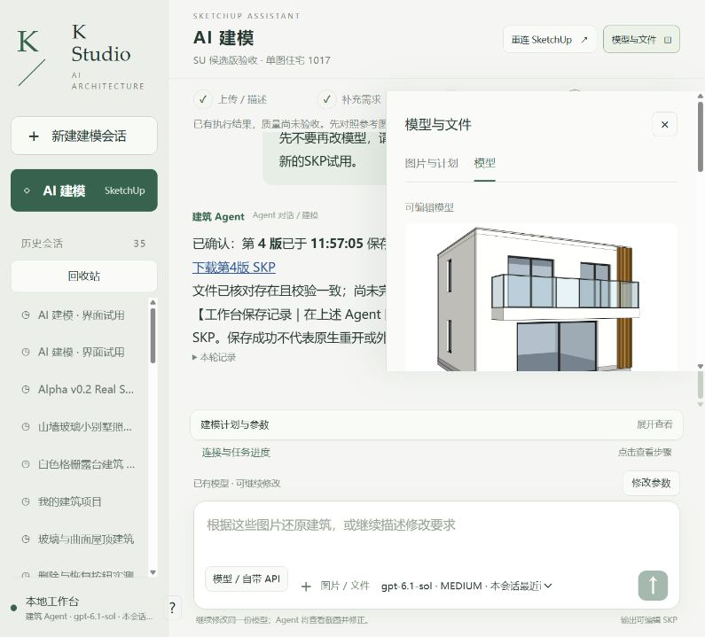 | 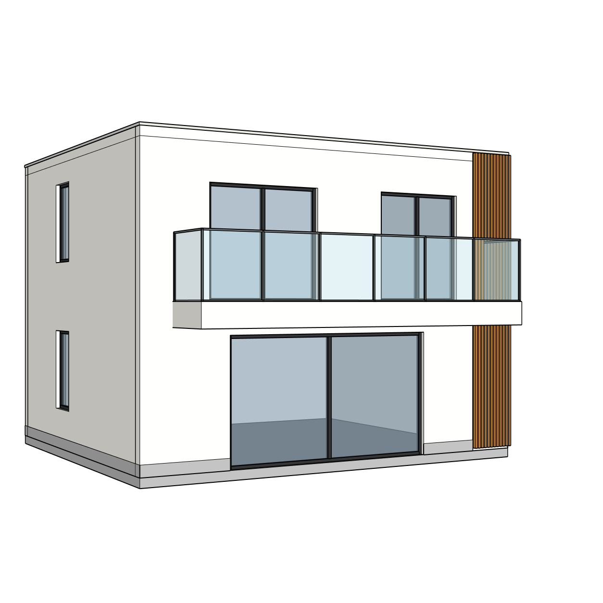 |

[分析运行](records/01-analysis-running.png)、[草稿恢复](records/02-draft-restored.png)、[断网提示](records/03-offline-plan-state.png)、[计划](records/04-plan-approved-scope.png)、[建模中](records/05-build-running.png)、[r3预览](records/06-initial-model-preview.png)、[保存和下载](records/07-final-save-and-download.png)。

## 修改前后：同一原生相机

| front r3：修改前 | front r4：栏杆升高后 |
| --- | --- |
| 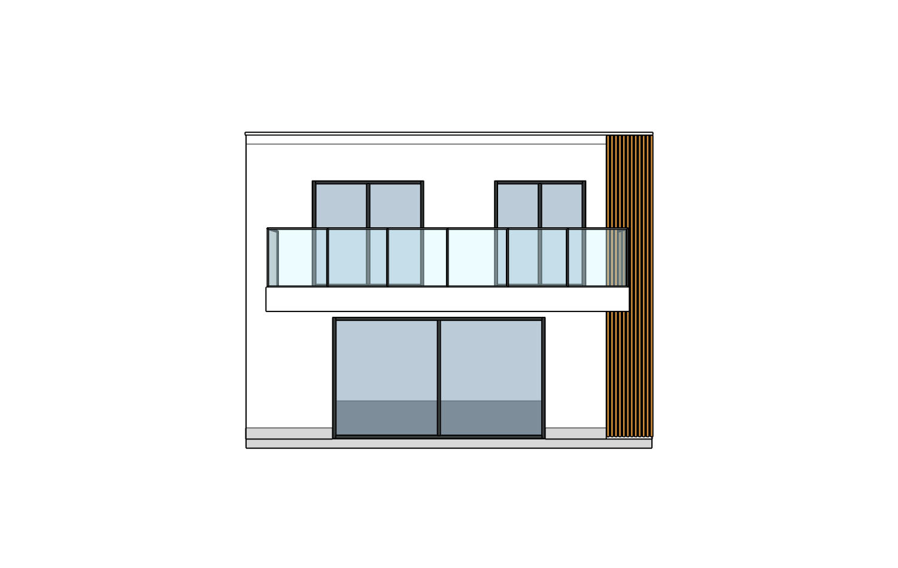 | 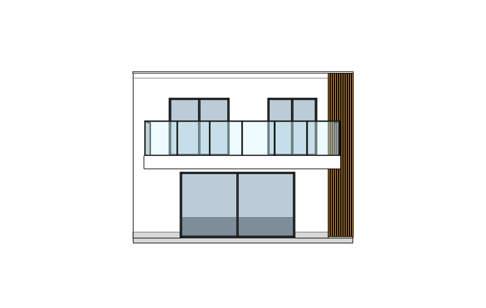 |

| rear r3：修改前 | rear r4：栏杆升高后 |
| --- | --- |
|  | 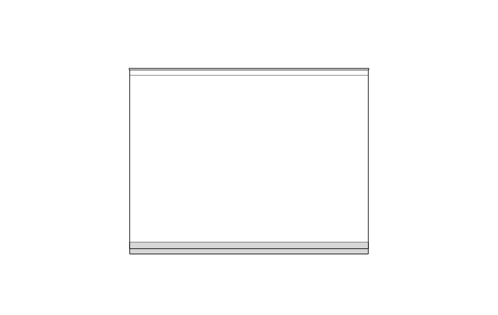 |

| left r3：修改前 | left r4：栏杆升高后 |
| --- | --- |
| 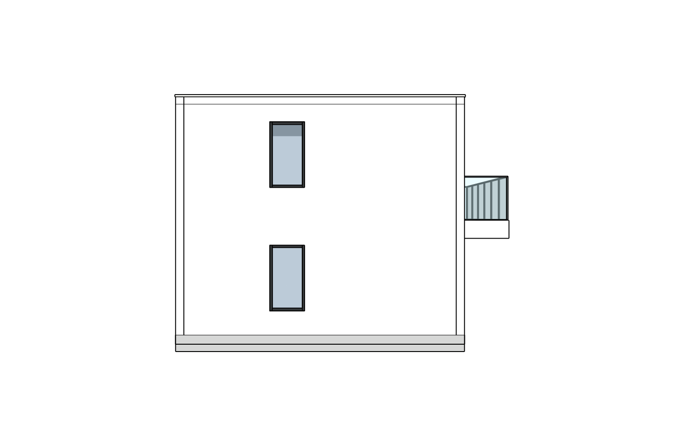 | 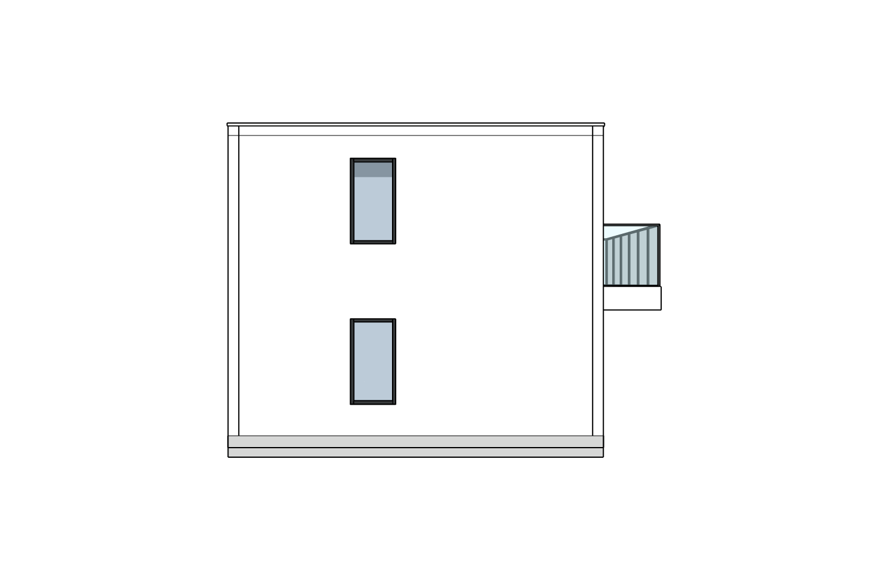 |

| right r3：修改前 | right r4：栏杆升高后 |
| --- | --- |
| 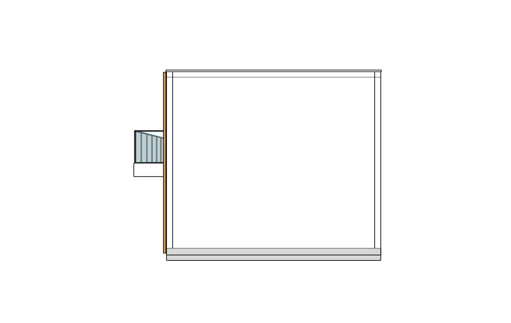 | 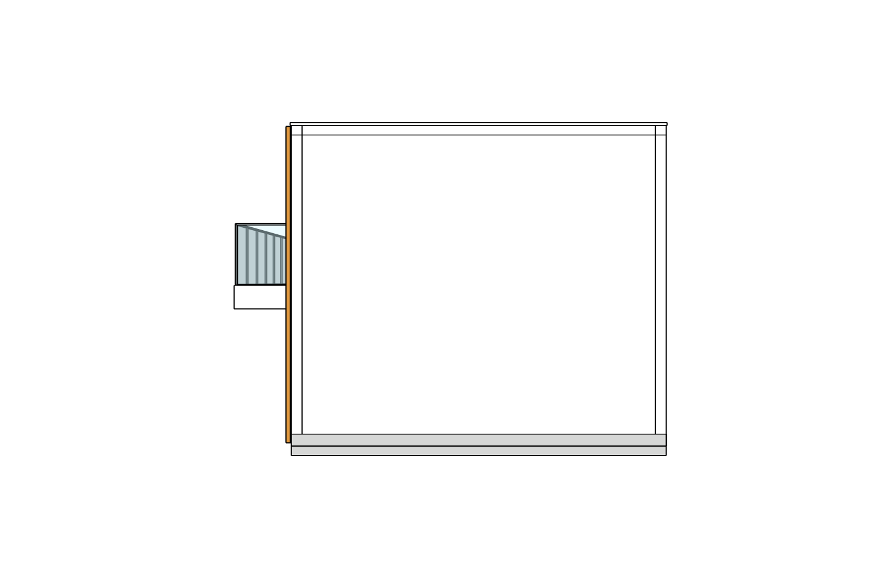 |

| roof r3：修改前 | roof r4：栏杆升高后 |
| --- | --- |
|  | 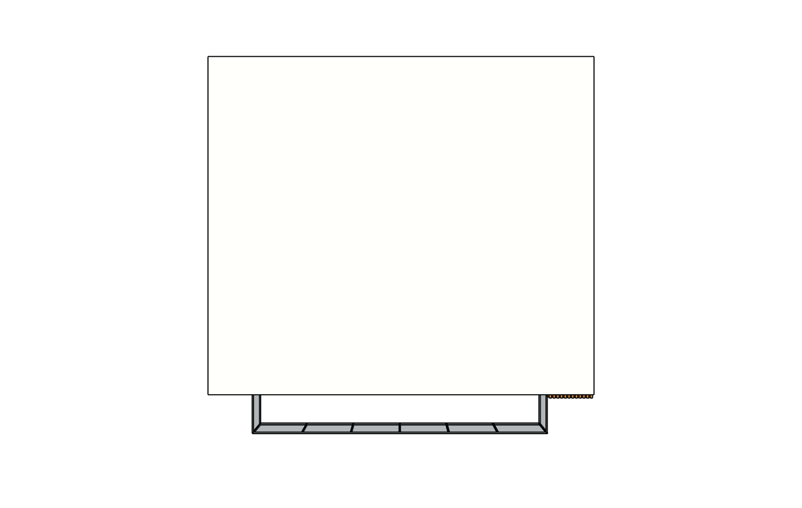 |

| oblique r3：修改前 | oblique r4：栏杆升高后 |
| --- | --- |
| 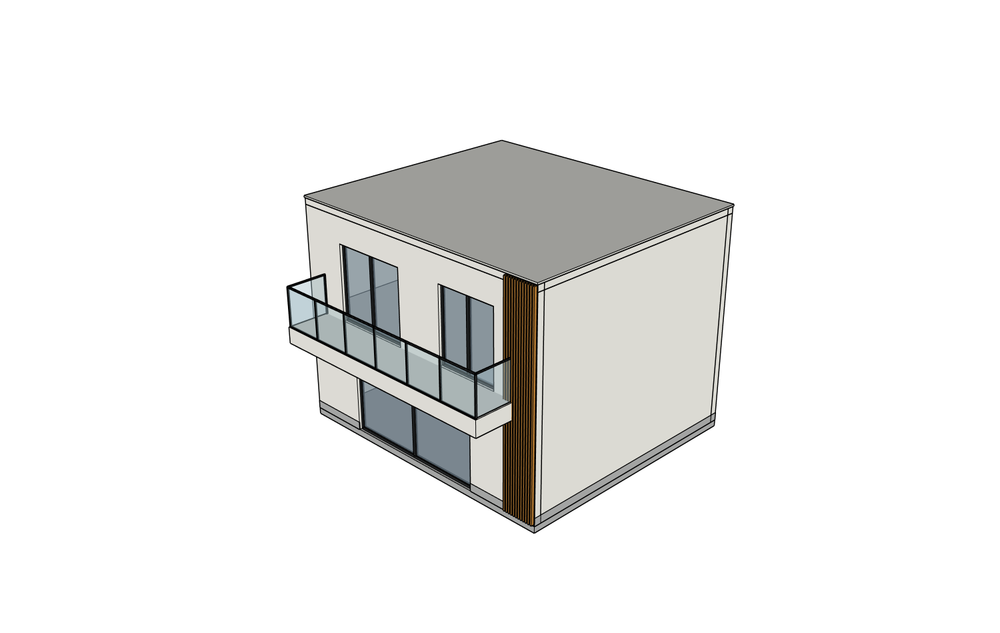 | 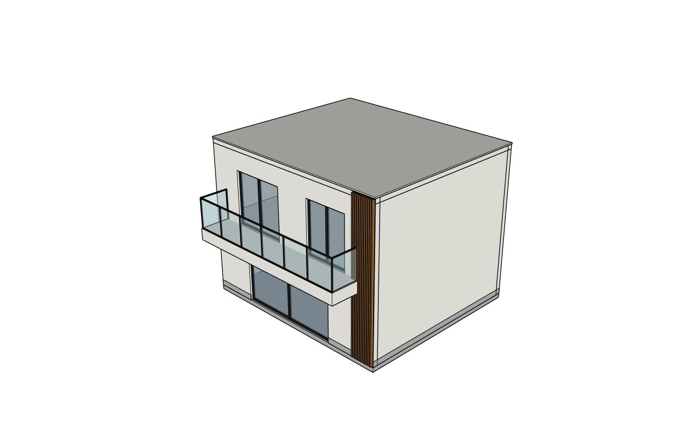 |

## 归档边界

preserved/ 是旧r20和原r4的保护备份；test-generated/ 是离线测试夹具，不能算真实建模。原始日志、失败和历史清单保留，机器用户名脱敏导致文字文件SHA变化由 provenance 明确列出。PNG与SKP均字节相同。没有账户密码、Key、令牌、Cookie、认证容器；没有完整外层Codex聊天导出或桌面录像，未编造缺失材料。

## 以下为上传授权前的历史工程索引

下段“本机保留/不上传”是前一条授权下的历史状态，已被本页顶部这次明确上传授权覆盖；其他验收结论不变。

---

# 2026-10-17 本机 SU 试用候选版：真实主流程完成，保留质量限制

本次是新授权的独立本机产品验收，不继续旧八图r20。隔离分支 `codex/su-trial-candidate-20261017`，以r20/main `564d75c` 为基线，审查并包含 `55b492d`、`a6347ca`。[完整工程结论及启动方式](../../../SU_TRIAL_CANDIDATE_2026-10-17.md)。

**可开始所有者本机个人试用。** 网站/模型入口/SU24真实连接、普通中文建模和一次局部修改、保护、保存、真实网页下载、原生打开和恢复均已执行。源图外观仍 `NEEDS_FIX`；原始双精度比较FAIL，既有声明精度三阶段PASS。没有把离线545测试通过冒充图像建模成功，没有独立商业API或客户交付认证。

本目录仅提交脱敏工程索引及实测汇总。**根据本次新授权，完整原图、日志、截图和SKP保留在本机 `runtime/su-trial-20261017/`，不提交或自动公开。** 这不是可在GitHub独立复核的完整公开原生证据包；没有宣称公开证据协议校验通过。新用户要求覆盖历史自动上传/推main规则。当前分支只做本机提交，不推送、部署或合并main。

本机证据路径均相对仓库根：

| 实测内容 | 原始本地记录 |
| --- | --- |
| 项目/SU/模型身份及原生数据 | `runtime/su-trial-20261017/initial-r3-deep.json`、`actual-r4-writer.json`、`actual-r4-rail-height.json` |
| 16组KEEP和松散几何保护 | `scope-before-edit.json`、`scope-after-edit.json`、`local-edit-protection.json`；保护SHA `cfaaa92e7216ef372d1c39875f8350e288efefa511c6ab5d8805c06331c0af08` |
| 六组真实3/4同机位截图 | `paired-camera-check.json`；原始PNG/侧证在 `r3-record/outputs/renders/` 与 `final-project-record/outputs/renders/` |
| 保存顺序/下载SHA | `edited-r4-before-final-save.json`、`save-ordering-proof.json`、`final-save-receipt.json`、`browser-download-proof.json` |
| 原生两份重开/三阶段比较 | `bound-r4-reopened.json`、`browser-download-r4-reopened.json`、`native-delivery-strict.json`、`native-delivery-declared-precision.json`、`working-r4-restored.json` |
| 网站/刷新/断网/草稿/下载/最终页面 | 本轮 `01`至`08` 截图；最终`08-candidate-ready.png` |
| 真实模型及全部规划/写入/工具/审查 | `r3-record/`、`final-project-record/`，包括原生AppServer事件、四次独立只读Critic和历史失败 |
| 未提交原始模型保护 | `preserved/` 中旧r20/原r4和四份旧状态，末次字节一致核对通过 |
| 全部文件SHA清单 | 本轮本地 `artifacts.json`；没有密钥/账号密码/认证容器副本 |

外部方法：以原生SketchUp面/挤出和组件实例完成，有具体兼容性回退理由；真实OSS ledger为0包装调用，不伪称SAIE/ADAI执行。两项试用分支修复则已进入真实当前网站流程。独立Critic只收原图及当时当前模型截图；前后六配对由宿主另行核对，不冒称Critic收到两版对照。

初建60工具/5失败/424.125s，局部修改28工具/2失败/165.516s，最终只读保存确认4工具/0失败/269.907s。网站五回合合计6,250,695输入/25,390输出，独立Critic四次另计119,942输入/4,271输出；费用未知null、付费供应商调用0，外层控制器Token未知null。延迟与重复读取较重是已知限制，按任务不开展新优化功能。

未验证项目如实保留：硬杀服务时的事务恢复、跨客户端幂等、其他SU版本、独立商业API、严格两次空白程序重放、完整源图保真。普通双击/刷新/网络中断恢复已经真实执行。最后停止推理和几何写入，保留可用页面及工作副本供所有者操作。
