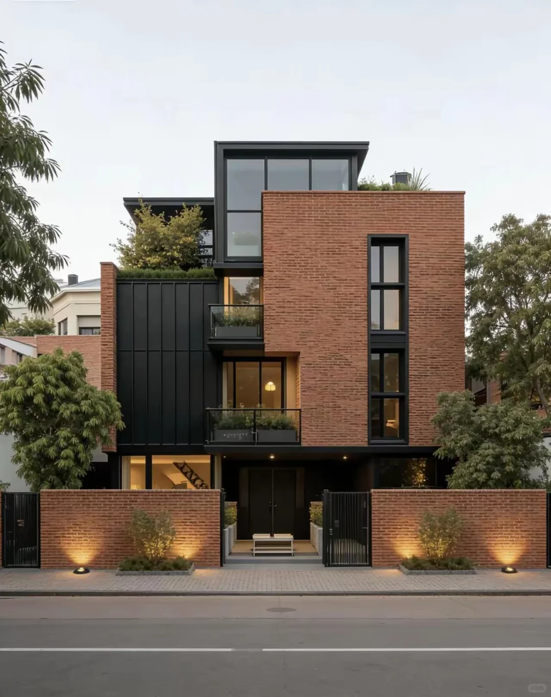
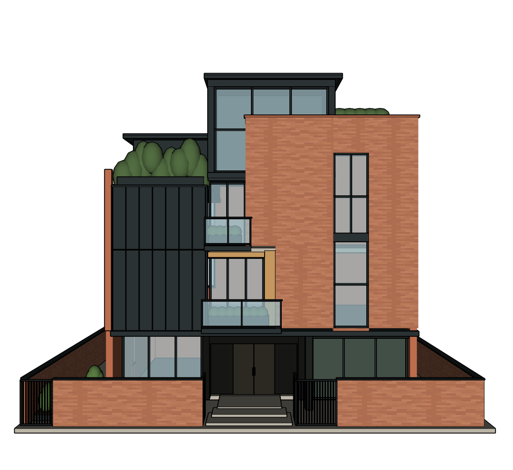
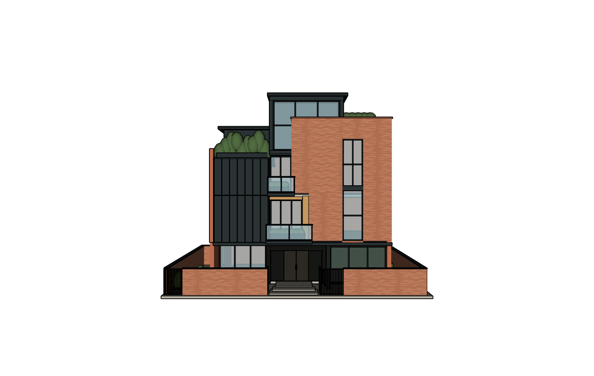
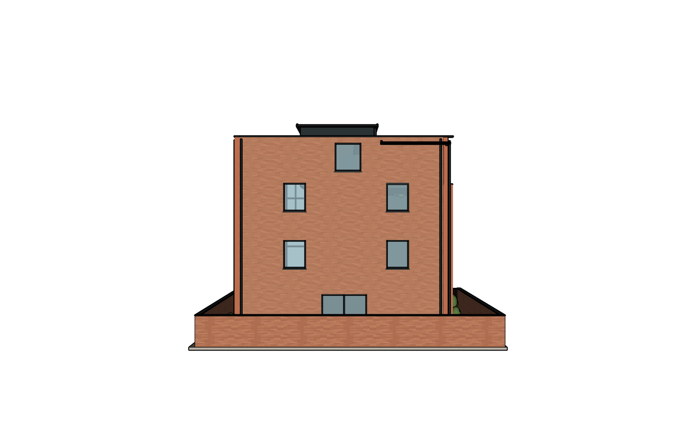
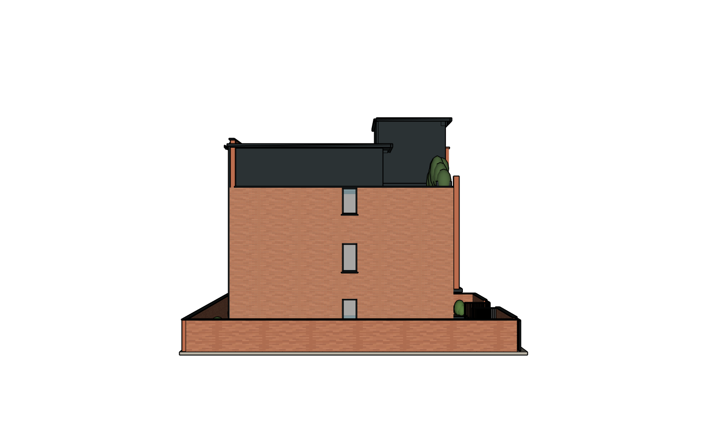
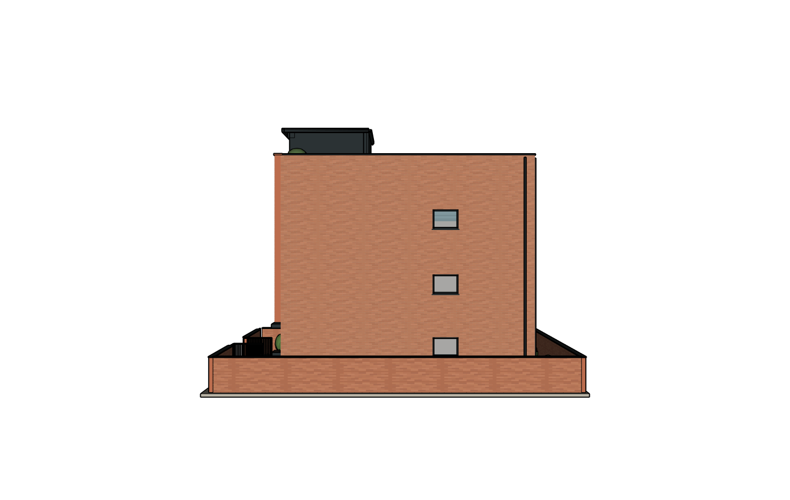
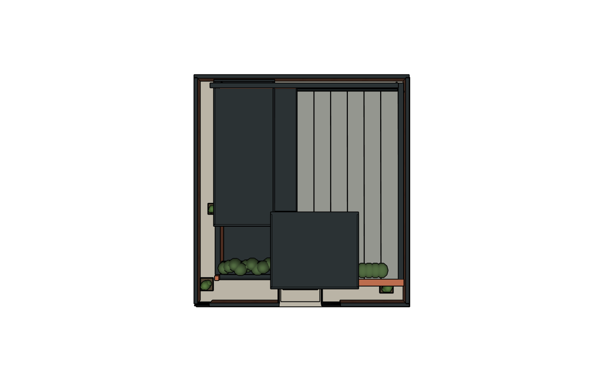
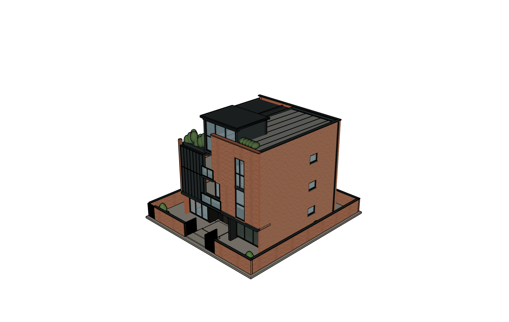

# 今天中午12点红房子｜正确任务完整记录

**这是所有者指定的红房子记录：2026-10-17 北京时间12:16:00—12:57:15，网站项目「测试」`architecture-project-fa471`。** 红砖右侧主墙、左侧黑色竖缝立面、两个内凹阳台、抬高的屋顶玻璃房。上一轮误上传的 `su-1017` 白色两层住宅不是此次指定任务；两者资料和验收结论完全分开。

本次只归档现存资料，**没有继续建模、没有新推理、没有重开或覆盖模型**。251份项目文件全部收录，约29.35MB，包括87张PNG、6份SKP、2份SKB、完整网站对话、16份执行事件日志、9次独立Critic、计划、提交/失败脚本及回执。1份文字日志仅脱敏Windows用户名；所有图片/模型字节原样。凭据容器没有收集或上传。

## 直接查看

- [完整中文对话及北京时间执行时间线](EXECUTION_DETAILS.md)
- [全部251份项目资料](records/) · [项目状态与原始对话](records/state/project_context.json) · [全部工具事件](records/runtime/agent_events/)
- [网站第7版下载候选SKP](model/Red-house-r7-site-download-candidate.skp) · [所有现存模型/备份版本](records/outputs/model/)
- [全部图片与原生截图](records/outputs/renders/) · [原图和用户补充问题截图](records/inputs/reference/)
- [实际写入回执](model/write-verifications.json) · [全部修订脚本/校验/失败记录](records/runtime/scripts/reports/) · [最后原生回读](model/geometry-readback.json)
- [最终独立Critic](review/critique.json) · [全部9次Critic历史](records/runtime/agent_workspace/qa/visual_review_history.jsonl) · [构造修正历史](records/runtime/agent_workspace/qa/repair_history.json)
- [真实失败10次](errors.json) · [Token/耗时/工具调用明细](metrics.json) · [原始保存凭据](model/native-reopen.json)
- [逐文件原始/公开SHA](publication-provenance.json) · [公开完整性清单](artifacts.json) · [保存凭据与冻结文件字节比较](model/checkpoint-vs-snapshot.json)

## 原图与实际第7版

| 12:16上传的真正建筑原图 | 实际r7原图对应机位 |
| --- | --- |
|  |  |

另五张输入在12:44:09上传，是所有者指出缺陷时提供的**旧模型截图**，不是该建筑的其他实景照片。背面、屋顶隐藏细节仍属推定，不能用模型截图循环证明实景准确。

| 六个当前原生机位 | 图片 |
| --- | --- |
| 正面r7 |  |
| 背面r7 |  |
| 左侧r7 |  |
| 右侧r7 |  |
| 屋顶r7 |  |
| 斜视r7 |  |

六张图都带原生相机和修订侧证，均为 `villa_reconstruction:7`，不是上午试用项目图片。其他旧版本的六视图及源角度图保存在完整renders目录中。

## 实际做了什么

| 北京时间 | 实际网站记录 |
| --- | --- |
| 12:16:00—12:16:45 | 上传红砖原图，“帮我建模这个别墅”，Agent识别四层错落、窄窗、阳台、屋顶玻璃房和前院；询问尺寸与范围 |
| 12:17:12—12:19:15 | 用户要求合理估算、外部为主、先计划不建模；拟11.2m宽/12.3m高/12m深，隐藏背侧推定 |
| 12:19:37—12:28:15 | 用户批准后实际建模到r3；外观未完全匹配、修正次数用尽，宿主随后保存候选文件 |
| 12:30:57—12:33:56 | 用户“继续优化细节，所有不确定的细节和逻辑请自行设计补全”；Agent先更新计划 |
| 12:34:01—12:41:44 | 用户批准，继续原模型到r4；阳台内衬、玻璃房细框、推定后窗/庭院门/平台/排水和砖纹完善 |
| 12:44:09—12:47:21 | 用户指出接缝、屋顶细节、重叠、围墙不闭合等问题，上传5张实际模型问题截图；Agent更新局部修复计划 |
| 12:47:40—12:57:15 | 用户批准，r5—r7局部修正；压顶、转角/管口、屋顶排水、围墙周边、绿化和砖缝；独立复核仍needs_fix |

以上从原始网站项目记录转录，不冒称本轮归档者在中午逐次代替用户点击；没有另造鼠标操作录像。最后写入根PID19、GUID `97f065fe-ba16-4dc6-b7bb-67ace591d23b`、脚本 `villa_reconstruction` 第7版。这个根号碰巧与上午试用相同，项目/脚本/文件/GUID均不同，不能只凭根号混为同一案例。

## 实际结果与未验证项

**整体PARTIAL / 源图保真NEEDS_FIX。** 最后Critic仍指出首层层高视觉受压、前围墙过低、砖纹质感未匹配；尺寸仍估算，隐藏侧后方和屋顶细节是推断。原图、五张问题模型截图和当前同角度证据一并保留。没有宣称所有接缝、重叠或隐蔽连接已解决。

本项目原始保存状态是 **UNVERIFIED_NATIVE_REOPEN**，没有可验证的真实浏览器下载、SU原生重开、三阶段深层一致性、严格程序重放；都保留未验证，**不能套用su-1017上午的验收PASS**。现存KEEP/写入校验原文收录，但归档者没有补作完整全构件保护检查。

网站下载候选 `agent-checkpoint-6c8b4bb5fb13.skp` 2844594字节、SHA `4ae2c364544b3ffd70cc0925765a107f3a9f5e5b404b595796f784b5b5755cb2` 与最后保存凭据一致。当前绑定工作SKP为2850071字节，SHA `e12ed7848db1613e0d13f3890b9e8291aa6b52312a67d5cc7ea1a1a4b163efde`，与凭据中2844595字节的历史绑定文件不同；两者均原样保留。**字节差异不直接证明几何损坏或谁进行了后续保存**，缺少原生深层三阶段证据，不猜原因。

## 实际用量与失败

实际网站 `gpt-6.1-sol / medium`，现有Codex App Server路线。7个网站回合：**10,299,507输入 / 73,288输出Token，215次工具 / 10次失败，累计调用2,084,642ms（34分44.642秒）**。包括计划与建模，不含用户停顿；已含嵌套Critic墙钟时间。独立Critic9次另计311,188输入 / 8,869输出；账单金额和外层控制器Token未知null。原始16份事件中7份为网站回合、9份为独立Critic。

7次实际几何提交（r1—r7）和一次失败Ruby脚本均保留。10次工具失败含：不合法方法标识1次、单轮写入次数上限拒绝3次、六视图审查收据失效拒绝2次、绿化生成 `nil.pushpull` 1次、原生编码命令失败3次。上限拒绝是原任务真实失败记录，不将它删掉，也不在归档任务中更改建模策略或重复调用模型。

## 发布与更正说明

上一轮错把上午 `su-1017` 296份记录当成本请求；该资料保留为单独历史案例，并显著标注范围更正。本目录才是所有者此次指定的“今天12点红房子”。所有者现在明确上传范围，本包不增加新功能或几何授权；隔离分支发布、不合并main、不部署。

原项目复制前后251个路径和SHA完全相同，冻结期间未发生项目变化。公开provenance记录每份原始/公开SHA；只有一份文字事件中的本机用户名脱敏。原图、用户模型截图、PNG、SKP、SKB字节不变。账号密码、Key、令牌、Cookie及认证容器从未从项目外收集。

现存资料没有完整原始网站界面操作截图、完整外层Codex聊天导出、原生桌面录像或真实下载/重开证明；不能事后伪造。已经收录全部可找到的该项目文件和事件。证据协议校验通过只说明文件完整、相机侧证与版本齐备，不代表建筑质量通过。
