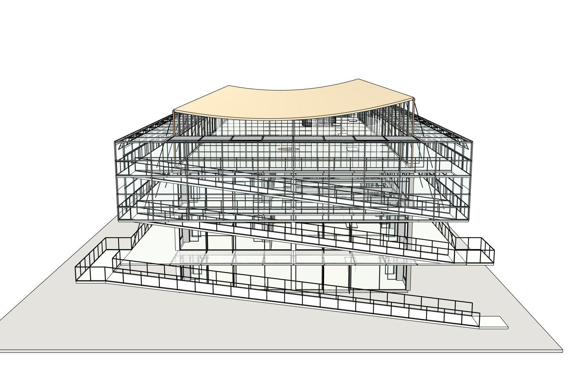

# 第19版建筑本体收尾：真实网站、保存下载及原生重开

原八张整图/原项目architecture-project-4f0e4/root20606，实际Studio普通中文、Sol6.1Medium，一次18→19提交。三根螺旋梯中柱740→300mm、底座450mm，并补与原踏步/支杆/平台实际相交的短连接；浅木天花、15组浅V构件、25个指定面饰面、158条曲面软边。屋顶曲率、楼板/洞口、原桌面形状身份和整栋其他部件不动。隐藏接法/构件尺寸均为按图推断。

[完整作用域审计](native/r19-path-audit.json)PASS，31准确路径之外深层SHA2650390f61f42c8b711956db72e1759cb2455e934802fed8a4845cb7e666b741相同。首次真实网站采用Surface硬保护：24叶所有原始Face/Edge/Vertex身份、坐标、环/法向/变换及其他属性相同，只允许25面材质/158软边，形状SHAbe2569d44f18262204d9d06d84ee03f36154bedfe9ae1982d419eca1860cee15不变。

[真实原生抽查](native/r19-interior-finish-probe.json)：6柱/底座半径、216踏步短托接触、18平台托接触、216净空、15V构件实际梁端/中心/楼板吊杆接触、158软边、25饰面全部通过。不是完整人体路径或结构规范认证。一次初始宿主探针错把有孔非凸楼板用凸多面体包含法检查而误报吊杆不接板，原FAIL保留；修正为真实Face分类和垂直交点，实际10555端点处于10550..10800板体内。模型没有为此重建。另一次审计传错state包装层BLOCKED也保留，使用真实内层收据后通过。

[四组真实室内同机位](comparison/camera-pairs-interior-r18-r19.json)，源图原始相机内参未知，不冒充精确标定。19采用原生Dark80/Light15/UseSuntrue/noShadows，改善灰暗与曲面硬缝；18默认明暗和本轮不同，分别记录显示与真实饰面修改，不把亮图当几何改善。

网站完成正常收尾，实际80工具/1编码失败、4990307输入/13808输出、4222188ms，独立最终Critic82522输入/794输出/219234ms另计。八张原图/六当前视图/22对应近景评审仍NEEDS_FIX：旧横梁与挑空的读法、帘幕显示等。隐藏关系未完全验证，不把Python通过冒充质量通过。原始事件、失败与历史累计完整保留，无付费API。

实际浏览器下载[第19版SKP](execution/models/r19-actual-browser-download.skp)，SHA0c2de2fb2dde70cf4a91517273b2f73481f4dac36403953b60fcb43d6c1d68d6；保存前基线及时捕获且收据仍18，绑定和真实下载副本分别SU2024重开，[三阶段](native/r19-native-delivery-verification.json)声明精度PASS/原始严格doubleFAIL，四项原生显示设置均保存后重开保持。原r4字节不变，19工作模型恢复。严格两次原程序空白重放NOT_RUN，独立付费provider/商业客户就绪未认证。

**所有者2026-10-17最新收尾决定**：当前案例做到这里即可，不再深化构件。只核对基本门窗楼梯墙柱，补简单周围环境，保存上传记录后结束。已关闭本轮进一步细节写授权；不再追帘幕、斜撑、天花、圆洞、梁板或重放基础设施。后续最后一轮只允许新场地叶，建筑本体全部保护。这是所有者缩小结束范围，不是把旧保真FAIL改成PASS。
