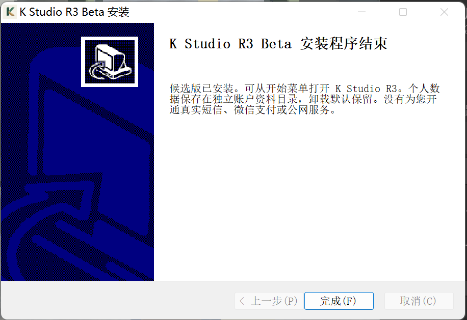
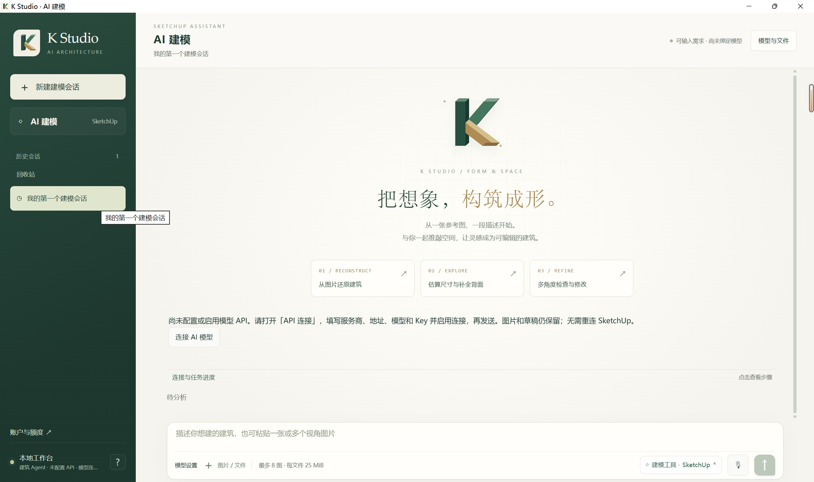
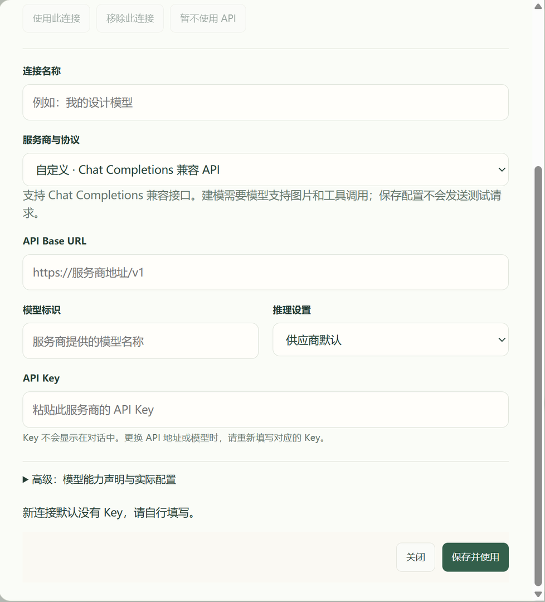
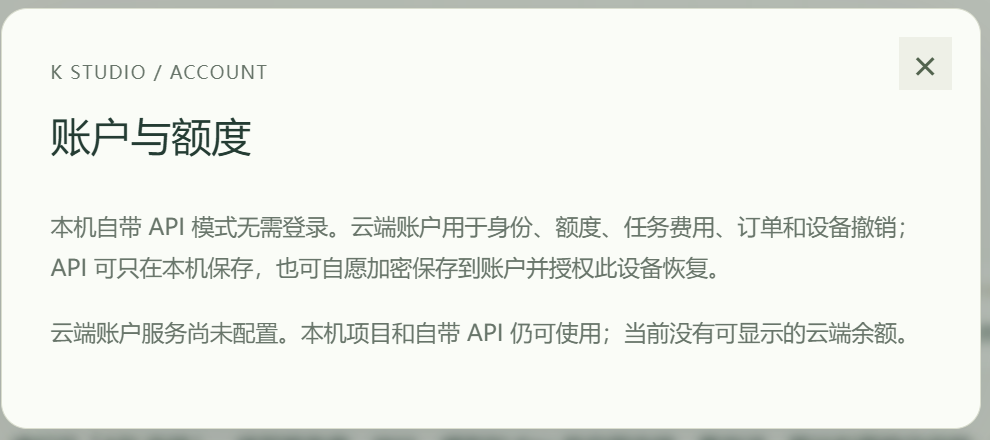

# beta03 E 盘安装与首次界面独立验收

结论：**PASS_SCOPED_INSTALL_AND_INITIAL_UI**。2026-11-07，AGENT_SIMULATED；使用本轮独立 NEW_APP_PROFILE（beta01 建立后保留升级），既有 Windows 环境，**不是 CLEAN_WINDOWS**。这是获交付本地安装包后的补充验收；官网公开下载仍 **BLOCKED**。

## 直接观察与只读核对

- 真实 GUI 完成 beta03 安装，未勾选额外桌面快捷方式；看到安装完成页。
- 从 Windows 开始菜单「K Studio R3 Beta → K Studio」启动。PID 4700 的实际程序位于 E 盘；current 与 highwater 均为 sequence 10。
- 初始界面保留原有空白会话，提示尚未配置模型 API；保存的 API 连接为 0，API Key 为空。账户页显示云端账户服务尚未配置。未观察到另一 native 测试 profile 的连接。
- 安装器退出、首次启动前，对原 profile 的 207 个文件检查：缺失 0、大小变化 0；201 个小文件 SHA256 变化 0、读取错误 0。旧 beta01/beta02 slot 目录仍在。未重复全量 slot 哈希。
- 12:36 左右正常点击关闭；12:37:55 只读确认 PID 4700 已退出，桌面交回主代理。

安装器完成页尚打开时，第一次 profile 核对遇到运行时锁文件 PermissionError；关闭安装器后重试通过。保留此过程，不视为资料丢失。

## 版本与证据身份

安装包：2026.11.07-R3-beta03，311380733 bytes。独立重新计算 SHA256：
`35af0a8861c842a7773655797ed31a66fb8854ee62986d02fc387ce9354ed3b7`。

打包代理报告 core `790d7f099939228b9828a6524eeccf94f374f7be`、installer source `99c3465f8599db7b9811a48eb48df3137a0da335`；本代理没有通过源码复核身份。实际 installed EXE 与 launcher SHA、指针及截图 SHA 见 [独立收据](../receipts/first-user-beta03.json)。

## 干预与父代理证据

常规安装按钮、开始菜单与界面观察为 H0；公开帮助 H1 已于 beta01 阶段检查，本次未重新验证完整帮助。主机启动按授权使用项目 video-workspace.ps1 设置**仅本进程** E 盘 TEMP/TMP，再以 Hidden 启动明确包；因此初始安装窗口隐藏。父代理精确恢复 PID 55284 的安装窗口后交回本代理操作，记为 H3 主机代操作，不冒称从官网点击下载得到安装器。

父代理另行只读核对 PID 4700：Exe、DataDir、TEMP/TMP 全在 E，6 个 WebView 子进程 user-data-dir 也在 E。该项是 **PASS_REPORTED_BY_PARENT**，本代理未重复该环境核对。父代理本地证据为 program-migration/runtime-on-e.json。

父代理报告删除已核验 C 盘旧程序副本被自动审批拒绝（blocked by policy），命令未执行。**C 旧副本保留，cleanup BLOCKED_BY_POLICY**；本代理未尝试删除或替代绕过。

## 验收边界

**nativeNOT_RUN_BY_FIRST_USER**：未配置 Key、发送推理、支付、绑定连接器或写入 SketchUp 模型；不覆盖建模、局部编辑、保存下载重开、clean OS、真实云账户/支付或商用上线。beta01 首启范围及 beta02 用户要求改 E 盘时的 PARTIAL 历史保持，不因 beta03 安装成功改写。包仍未签名，许可证 REVIEW_REQUIRED。

## 真实界面

仅发布已逐张目视检查的安装器／K Studio 区域，未包含 Key、私人绝对路径或其他应用窗口。含 E 盘绝对路径的解包过程图仅保留本地。

