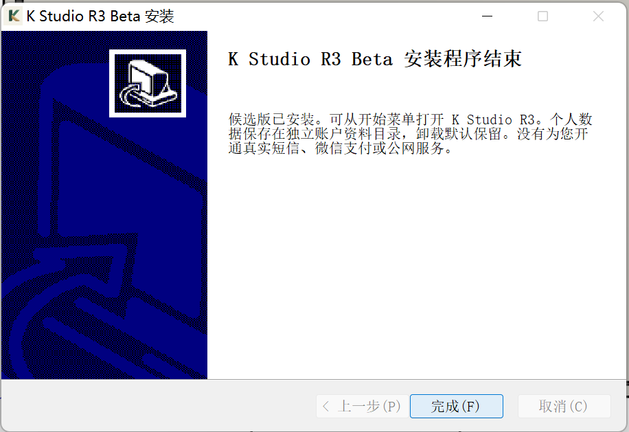
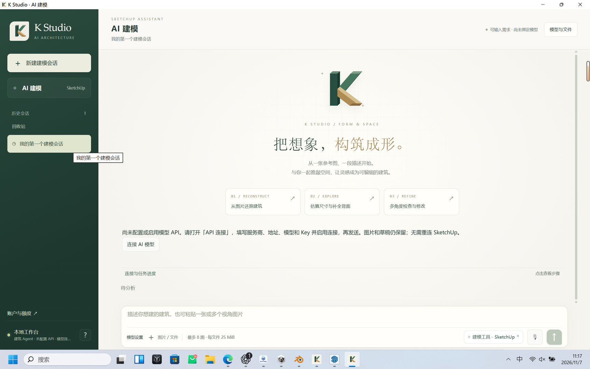
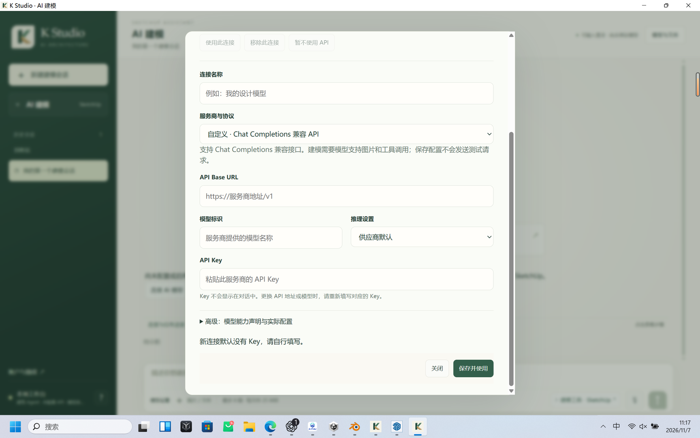

# R3 beta01 独立首次使用模拟：本机安装与启动补充记录

日期：2026-11-07。执行者：独立 agent 首用模拟者。

**本轮结果：本机 GUI 安装完成、从开始菜单首次启动成功。** 这仅是安装与初始界面观察，不是首次使用全部通过，不是原生建模质量或商业上线验收。

- 类型：`AGENT_SIMULATED + NEW_APP_PROFILE`，**非 `CLEAN_WINDOWS`**。
- 版本：`2026.11.07-R3-beta01`；来源标识：`source834a`（主代理提供的来源标识）。
- 本地安装包：`KStudio-2026.11.07-R3-beta01-win-x64-setup.exe`。
- 主代理给定大小：311375016 bytes；模拟者独立复算 SHA-256 并匹配：
  `e4a3391c378d05b8cf4c4b5099ac4c5614032b257f11d74f3f5a78e9e56c5ce2`。
- 原生能力：`nativeNOT_RUN_BY_FIRST_USER`。
- 官网入口：此前本机候选网站 `http://127.0.0.1:8923/download` 显示“公开下载尚未开放”；**官网公开下载 BLOCKED 保留**。本包由主代理本地交付，不能记成真实官网下载。
- 后续 beta02 的本地截图修复复验不属于本轮证据，不用于覆盖 beta01 或提升本轮结论。

## 环境与帮助边界

主代理事先准备全新 R3 应用资料目录、保留 R2 与旧模型。这是测试环境准备信息，模拟者未读取或审计旧配置与其他测试资料。新 UI 表现与独立资料目录一致：只有自动创建的“我的第一个建模会话”，无已保存 API 连接。Windows、运行时和建模软件已存在，因此不能证明干净机器首次安装依赖项成功。

H0：模拟者独立操作指定安装包、开始菜单和客户端可见入口。H1：只使用先前官网公开指南、内置快速开始与连接向导。H2：主代理提供本地包、预置应用资料目录并限定观察范围，故不是无提示的真实用户研究。H3：无主代理代点安装或配置；所有操作由 agent 模拟，仍不等于人类受试者证据。

上述独立 GUI 首用阶段没有读取仓库源码、开发笔记、其他测试 profile、密钥或内部 API；没有修改代码。

## 实际路径与观察

1. 真实 GUI 安装器欢迎页标注内部候选版，说明 Windows x64、WebView2、合法 SketchUp 2024 与模型服务要求。
2. “创建桌面快捷方式”默认未勾选并保持不选。约 11:07 开始解压，约 11:15 显示“安装程序结束”（Asia/Shanghai）；约 8 分钟为本机粗略观察值，不是正式性能基准。
3. 完成页说明候选版已安装、从开始菜单打开、个人数据独立保存及卸载默认保留；未开通真实短信、微信支付或公网服务。
4. 开始菜单搜索“K Studio R3”当时未找到结果；改用“所有应用 → K → K Studio R3 Beta → K Studio”成功启动。可能涉及索引时延或命名差异，本轮未诊断根因。
5. 约 11:17 首次界面显示“尚未配置或启用模型 API”“尚未绑定模型”；API 连接列表只有“添加 API 连接”，地址、模型和 Key 均为空白占位提示。**未填写、未保存配置、未发送聊天或模型请求。**
6. 无缺失运行时错误弹窗，但仅证明当前已有运行时环境下启动成功；缺失依赖安装分支 `NOT_RUN`。
7. 快速开始、模型设置、建模工具和账户入口可打开。账户面板说明“云端账户服务尚未配置”，本机自带 API 模式无需登录；本地桥接显示未响应。
8. 连接向导能解释配对、安装插件、只读检查和独立副本绑定。只查看并展开说明，**未安装连接器、未检查桥接、未自动打开/连接 SketchUp、未操作任何既有模型**。
9. 约 11:19 关闭本轮新开的 R3 窗口并交还桌面，其他原有窗口保留。

## 可操作性问题与限制

- 完成页称从开始菜单打开“K Studio R3”，实际文件夹是“K Studio R3 Beta”，其中启动项是“K Studio”。建议在完成页给出准确入口，或提供明确的立即启动选项。
- 解压耗时较长，界面主要展示内部文件名，缺少用户易懂的阶段说明。
- 快速开始使用“接教学检查 MCP”等术语，且没有把 API 前置条件列在步骤开头；初学者需要结合首页提示和连接向导。
- 展开手动连接步骤后底部操作接近窗口下缘，需要滚动寻找。
- 未测试卸载、升级、回退、缺失运行时恢复、真实登录/计费、API 推理、SketchUp 连接、建模、门廊修改、保存、下载或重开。后台其他测试均不计入本轮。

Windows UI 树采集曾超时，改为快速截图后看见安装持续前进并完成；只终止采集脚本，没有终止安装器。截图落盘工具限制没有改变产品结果。

## 可公开截图

仅选用不含私人路径、Key 或私人应用窗口内容的三张本轮实际截图。安装中截图显示本机路径，**未公开复制**；该阶段只以上文文字记录。

本轮仅确认安装和初始入口可达；`nativeNOT_RUN_BY_FIRST_USER` 与官网公开下载 `BLOCKED` 均不改变。

## 后续只读候选审阅补充（不改写原始首用结论）

本节是在上述 GUI 首用观察结束后，按主代理新增任务读取候选汇总及外部输入文档形成的交接，不是盲测过程中使用的提示。没有继续操作桌面，没有查看或修改源码；没有把此后获知的信息倒填成 H0 观察。

| 验收对象 | 本模拟者能确认的范围 | 不能由本轮推出的结论 |
|---|---|---|
| beta01 安装及首启 | 指定 package `e4a339...` 的真实 GUI 安装结束、StartMenu 启动、新资料初始无 Key 界面 | 不证明官方公开下载、另一台机器或干净 Windows |
| beta01 原生任务 | `nativeNOT_RUN_BY_FIRST_USER`；主代理后续通报首轮结束截图捕获失败 | 不将本轮安装 PASS 扩写为 native PASS，也不抹去该失败 |
| core802c 修复 | 主代理通报截图路径修复，属于后续工程变更 | 本模拟者未对该修复独立原生复验，修复提交存在不等于结果通过 |
| beta02 | 主代理通报正在打包及继续同项目局部修改；本轮等待另行 GUI 交接 | 未安装、未升级、未独立复验，不能替代 beta01 证据或宣称首用全部通过 |
| 商业服务 | 本机初始账户未配置；此前候选网页公开下载 BLOCKED | 工程/夹具测试、安装完成或本机 BYOK 不等于登录、付费或公网商业开放 |

截至此次文档审阅，候选目录主 README 与通用 review 仍含早先“安装待补”“真实建模 NOT_RUN”的范围快照。这里仅提示其时效性；本模拟者未改动这些文件，也不擅自将其改为主代理新 native 结果。

### 外部动作能否一次列清

已只读检查[当日外部输入状态](../../../../execution/KSTUDIO_R3_EXTERNAL_INPUTS_STATUS_20261107.md)和[负责人配置表](../../../../execution/KSTUDIO_R3_OPERATOR_INPUTS_20261105.md)。**可以：当日状态表已给出五类最少负责人动作、配置位置和工程续跑入口。** 下表仅压缩现有交接，不另设新收费或权限门槛；资源状态来自该文档，不是本模拟者重新检查私人账户后的发现。

| 影响入口 | 最少需要负责人或外部服务完成的动作 | 交给工程后的续验 |
|---|---|---|
| 真实官网与分发 | 给出已有主机、域名/DNS、COS的受控授权和非秘密资源标识；确实没有时才确认采购预算并由本人完成必要账户/主体手续 | 私有部署配置 → HTTPS/健康/恢复检查 → 实际发布下载地址 |
| 手机号与 PC 微信登录 | 给出已开通 OIDC 应用、有效短信通道、微信网站登录权限；本人完成平台要求的身份或扫码步骤 | 私有 OIDC 配置 → 两种真实登录/身份关联/桌面设备授权与撤销 |
| Native 充值与退款 | 提供已开通商户、正确支付 AppID、安全凭据引用；确认一次真实付款/退款的付款人和金额边界 | 私有微信支付配置 → 回调验签/查单/入账/退款；通过后再开收费入口 |
| 平台模型与正式收费 | 确认平台账号对外服务权限、开放模型、对客套餐及模型费/软件费/失败退款规则和预算 | 服务端模型/价格配置 → 实际计量与结算核对；既有测试授权不自动变成正式售价 |
| 对外经营与可信发行 | 确认真实经营主体、支持联系和服务/隐私/退款内容；提供确需外部持有的签名/更新信任及再分发权利材料 | 工程完成许可清单审阅、签名/更新链、发行元数据与公开包核对 |

无需向聊天或 Git 提供密码、验证码、API Key 或私钥；沿文档规定使用受控运维身份、私有变量或秘密文件引用。本人实名、主体审批、扫码及真实付款由本人/相关服务完成。

**不应变成负责人外部待办的工程任务：** beta02 打包和升级验证、截图路径修复、同项目局部修改、真实下载/重开证据、许可依赖审阅与回归测试，仍由工程继续完成。干净 Windows/SU2024 需要独立环境实测；若现有资源能提供 VM/第二台机器，应由工程直接执行，仅在确实缺少环境或许可时集中提出具体外部资源需求。新应用资料目录不能替代这项验收。

当日状态文档已列 `check --commercial → deploy → health → audit` 续跑入口；本模拟者未运行部署命令，也未重新验证其当前可执行性。商业公开仍以真实外部配置和各项独立验收为准。
