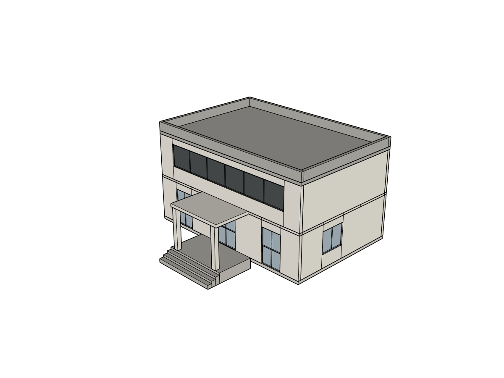

# R3 本机真实 BYOK 建模与原生交付补充验收

**整体 PARTIAL。真实网站建模、门廊局部修改、下载和SketchUp重开完成；栏杆纠正失败并保留缺陷，商业发布仍未开放。** 本目录是实际付费模型调用的独立补充批次，不能与同日“launch-candidate”零模型调用的工程阶段混为一谈。

场景来自执行书固定文字任务：[12×8米、两层每层3米的小展亭](planning/acceptance-scope.md)，不是用户旧建筑，也没有参考照片。使用实际K Studio冻结客户端页面、BAI `deepseek-v4.1-flash` / Responses / Low，通过官方DeepSeek Harness和原生SketchUp2024写入。`Low`是已知测试配置，不宣称最佳，也没有切换外层Codex代建。供应商未独立回报底层模型身份或实际推理档，配置名与实报身份明确区分。

## 执行结果

| 环节 | 真实结论 | 证据 |
|---|---|---|
| 初始讨论/批准/分阶段建造 | r1至r8共8次原生提交；有图谱和Ruby失败后模型自行恢复 | [writer回执](model/write-verifications.json)、[失败](errors.json)、[原方案](planning/reconstruction_card.md) |
| beta01最终截图归档 | FAIL：已提交r8，但宿主自动截图目标落在配对项目外，不能写成页面完整成功 | [回归修复回执](receipts/capture-regression.json) |
| 重启升级beta02 | 核心`802c4b2fe98de8bcd966f6c6cf7e99162f566fe7`；API配置加密文件哈希前后相同，未重输Key，待批准方案恢复 | [重启回执](receipts/restart-configuration.json) |
| 门廊UI修改 | r9完成，加深0.5米并补连续平台；真实preview/SKP链接返回，postcapture复验通过 | [最终斜视](views/oblique.png)、[尺寸](model/dimensions-r9.json)、[r9回执](model/write-verifications.json) |
| 门廊无关部件KEEP | 仅EntrancePorch、EntranceSteps变化，其他10组深几何/材质哈希不变 | [独立KEEP](model/keep-results.json) |
| 栏杆纠正 | FAIL，无r10：供应商连接错误后未知用量，SDK重试被本机保护拒绝 | [400链路诊断](receipts/rail-error-diagnosis.json) |
| 最终原生下载重开 | PASS：真实UI下载后SU Ctrl+O打开下载文件，字节SHA、原生深哈希一致 | [交付回执](model/native-reopen.json)、[深哈希对照](model/deep-equality.json) |
| 建筑质量 | PARTIAL：门廊基本连续性修好；栏杆柱脚/扶手转接未修好，背墙阶梯轮廓问题保留 | [独立评估](review/review.md)、[结构化评估](review/critique.json) |

最终 root PID19 / r9，12个语义主组。下载文件86,596字节，SHA256 `31b41d386ae5d51426ba73d401688c046e5cd384720f8fdf86d77d7ce988c4bf`。门廊修改后、失败后最终、六视图/内部采集后和下载重开后的原生几何材质SHA均为 `bc5dc9d865021137ddd9d603dfc2121ad9119aba5b84e7f447d18dd4f24dccff`。一致性证明此模型被保存和交付，没有证明它已无建筑缺陷。

## 实际画面

[正面](views/front.png) · [背面](views/rear.png) · [左面](views/left.png) · [右面](views/right.png) · [屋顶](views/roof.png) · [斜视](views/oblique.png)

[初始r8缺平台](before/initial-r8-oblique.png) · [下跑/平台](interior/lower-stair.png) · [上跑出口](interior/upper-stair.png)

六视图都有实际相机、图片SHA与r9侧车；由宿主在网站真实生成结果上只读采集，深哈希证明拍摄未改几何。`source-perspective.png`复用本轮真实斜视供统一证据schema使用，**没有参考照片，未作源图视角标定**。不使用AI效果图或旧模型代替本轮原生画面。

## 费用与失败边界

读取本次账本得到 **57笔已预留供应商请求：56 settled、1 unknown**。已知usage合计输入（含缓存）1,957,920、输出72,581；由于最后一笔未知，总usage和实际金额均为`null`。供应商账单未取得，不能估计为0元。[逐笔脱敏账本](receipts/provider-ledger.json)保留每笔已知usage与最后未知状态。

SDK记录58个message/attempt事件，并不等于58次实际供应商请求：最后一个是保护阻止的重试意图，没有第58笔预留，更未派发给供应商。根因顺序为：第57笔流报`TRANSPORT / Connection error.`，SDK生成的全0usage不是计费回执；账本标unknown；SDK准备重试；本机`/test-budget/reserve`因未知负债拒绝；JS仅呈现`Host tool refused: 400`。最初网络错误的具体TLS/网络/上游原因没有日志证据，不能猜成余额、鉴权或模型不会建栏杆。90次上限尚未耗尽，停止原因是unknown保护。随后停止所有付费调用，不重置账本、不将unknown变成免费。

70次工具调用中5次工具结果失败；另有宿主postcapture失败和最后供应商/保护链路失败，分层记录而不重复混算。共9次原生提交（8次分阶段初建+1次局部门廊修改）；栏杆失败没有额外几何提交。最初图谱原流缺一个JSON终括号，SDK规范化后变为`{}`，模型下一次自主重发正确图谱成功；不是人工替模型补JSON执行。[精确图谱恢复证据](receipts/graph-malformed-json-recovery.json)

## 外部能力吸收结果

| 方法 | 实际记录 | 结论 |
|---|---|---|
| 官方DeepSeek Harness + K Studio建筑工具 | 真实事件、工具调用、分阶段原生提交 | 本轮实际执行，不等同每项上游能力均验收 |
| 受控工作区Ruby | 11次writer调用，9次提交，2次失败；保留身份/事务/KEEP | 完成基本建筑与门廊修改，几何细节仍不完整 |
| ADAI/SAIE包装几何方法 | 最终原生OSS ledger `events=[]`，adoption `actual_wrapped_calls={}`，`any_oss_product_use=false` | 不声称本次调用过这些方法；记录为空也不推断选用理由 |

[OSS ledger](model/oss-method-ledger.json)、[adoption](model/oss-method-adoption.json)直接来自r9真实writer结果，不按安装情况补造采用次数。

## 范围与剩余验收

本次是现有Windows上的独立应用profile，本地安装包补充测试；不是第二台干净电脑，也不补写官网首次下载BLOCKED为成功。操作者为agent，通过实际页面用自然中文；宿主只读诊断/拍摄/深哈希独立标注。没有发布私人SKP、凭据、原始模型推理或机器绝对路径。

下一轮应先解决错误可诊断性并核对未知账单，再决定是否授权新请求；质量上需要栏杆真实支承/转角、后墙阶梯轮廓及必要的精确净空验证。不能仅靠基本尺寸、组数量或可重开宣称建筑完整、结构安全、法规合规或商业稳定发行。原始失败、未修改的r9和账本保持留存。
